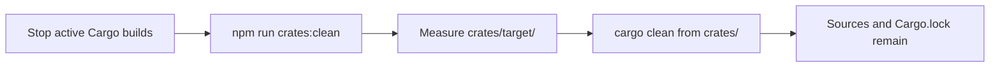
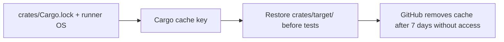

# Native crate build gates

The default Cargo workspace build includes only crates used by the safe startup
path. `zk-verifier`, `x402-processor`, and `soroban-reconciler` remain workspace
members so they can be built deliberately, but are excluded from
`default-members` and from the default webhook build and image.

The workspace root package in `crates/Cargo.toml` owns the opt-in feature map
and its optional path dependencies:

| Crate | Cargo feature | Prerequisite before enabling |
|---|---|---|
| `zk-verifier` | `zk-verifier` | Close ESC-05: wire the experimental feature flag and require a pinned verification key in the TypeScript consumer. |
| `x402-processor` | `x402-processor` | Close ESC-05: resolve the payment-flow gaps and wire the experimental feature flag. |
| `soroban-reconciler` | `soroban-reconciler` | Close ESC-02: establish an authoritative on-chain state source. |

Each feature activates the corresponding `optional = true` path dependency.
For example, explicitly include one crate in the build graph with:

```sh
cargo build --manifest-path crates/Cargo.toml \
  -p safetrust-native-gates --features x402-processor
```

To produce a Neon addon artifact for an explicitly approved deployment, build
with the opted-in feature and run that crate's `copy-native.js` script. This is
intentionally not part of `npm run build:rust`; nor should it be enabled before
its prerequisite issue is closed. `soroban-reconciler` also retains its separate
compile-time `unvalidated-reader` and runtime
`SOROBAN_RECONCILER_ALLOW_UNVALIDATED=true` safeguards.

## Missing native modules

Node's Neon package loader resolves the package's configured entry point
(`index.node` or `native/index.node`) through ordinary `require()`. When the
crate is excluded, the artifact is absent and Node throws (normally
`MODULE_NOT_FOUND`). The TypeScript consumers catch that load failure,
log the unavailable addon, and take their existing fail-closed/fallback path:
ZK proof requests fail closed, x402 payment validation fails closed without
the validator, and Soroban reconciliation skips unavailable native work. The
`webhook-verifier`, `stellar-utils`, and `escrow-state-machine` crates are not
gated or otherwise changed; their active consumers remain on the default
build path.

## Cache Management

The crates in this directory form a Cargo workspace. Run workspace commands
from this directory, or use the root-level npm scripts where available.

Cargo build output lives in `crates/target/`. It is generated data and is
already excluded from Git. Removing it does not affect Rust source files or
`Cargo.lock`; Cargo recreates build artifacts on the next build.

### Local cleanup

Do not clean the cache while a Cargo build or test is running. When no build is
running, `cargo clean` is safe and removes only the workspace's `target/`
directory. From the repository root, run:

```sh
npm run crates:clean
```

The script measures and prints the cache size before cleanup (`du -sh` when
available, with a portable size calculation otherwise), then runs `cargo clean`
from this workspace. Running `cargo clean` directly from `crates/` is also
supported.



### CI cache policy

The Rust workspace test job caches `crates/target/` using the runner OS and the
hash of `crates/Cargo.lock` as its key. Reusing compiled artifacts avoids
repeated 5–10 minute cold builds. GitHub Actions automatically evicts caches
that have not been accessed for 7 days, limiting stale artifact accumulation.



For larger CI workloads, `sccache` or `cargo-cache` are optional additional
optimizations. They are not required for local cleanup or the CI cache.
