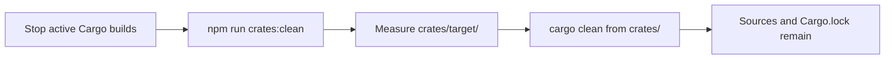
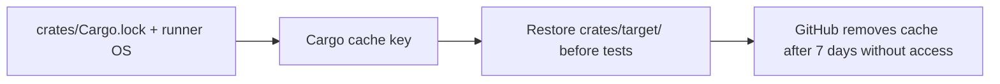

# Native crate build gates

The default Cargo workspace build includes only crates used by the safe startup
path. `zk-verifier`, `x402-processor`, and `soroban-reconciler` remain workspace
members so they can be built deliberately, but are excluded from
`default-members` and from the default webhook build and image.

The workspace root package in `crates/Cargo.toml` owns the opt-in feature map
and its optional path dependencies:

| Crate | Cargo feature | Prerequisite before enabling |
|---|---|---|
| `zk-verifier` | `zk-verifier` | Close remaining ESC-05 prerequisites; `ZK_ENABLED` opt-in and verification-key pinning are enforced by the TypeScript consumer. |
| `x402-processor` | `x402-processor` | Close ESC-05: resolve the payment-flow gaps and wire the experimental feature flag. |
| `soroban-reconciler` | `soroban-reconciler` | Close ESC-02: establish an authoritative on-chain state source. |

Each feature activates the corresponding `optional = true` path dependency.
For example, explicitly include one crate in the build graph with:

```sh
cargo build --manifest-path crates/Cargo.toml \
  -p safetrust-native-gates --features x402-processor
```

To produce a Neon addon artifact for an explicitly approved deployment, build
with the opted-in feature and run that crate's `copy-native.js` script. This is
intentionally not part of `npm run build:rust`; nor should it be enabled before
its prerequisite issue is closed. `soroban-reconciler` also retains its separate
compile-time `unvalidated-reader` and runtime
`SOROBAN_RECONCILER_ALLOW_UNVALIDATED=true` safeguards.

## Missing native modules

Node's Neon package loader resolves the package's configured entry point
(`index.node` or `native/index.node`) through ordinary `require()`. When the
crate is excluded, the artifact is absent and Node throws (normally
`MODULE_NOT_FOUND`). The TypeScript consumers handle that load failure and take
their existing fail-closed/fallback path:
ZK proof requests fail closed, x402 payment validation fails closed without
the validator, and Soroban reconciliation skips unavailable native work. The
`webhook-verifier`, `stellar-utils`, and `escrow-state-machine` crates are not
gated or otherwise changed; their active consumers remain on the default
build path.

## Cache Management

The crates in this directory form a Cargo workspace. Run workspace commands
from this directory, or use the root-level npm scripts where available.

Cargo build output lives in `crates/target/`. It is generated data and is
already excluded from Git. Removing it does not affect Rust source files or
`Cargo.lock`; Cargo recreates build artifacts on the next build.

### Local cleanup

Do not clean the cache while a Cargo build or test is running. When no build is
running, `cargo clean` is safe and removes only the workspace's `target/`
directory. From the repository root, run:

```sh
npm run crates:clean
```

The script measures and prints the cache size before cleanup (`du -sh` when
available, with a portable size calculation otherwise), then runs `cargo clean`
from this workspace. Running `cargo clean` directly from `crates/` is also
supported.



### CI cache policy

The Rust workspace test job caches `crates/target/` using the runner OS and the
hash of `crates/Cargo.lock` as its key. Reusing compiled artifacts avoids
repeated 5–10 minute cold builds. GitHub Actions automatically evicts caches
that have not been accessed for 7 days, limiting stale artifact accumulation.



For larger CI workloads, `sccache` or `cargo-cache` are optional additional
optimizations. They are not required for local cleanup or the CI cache.

## Native crate performance investigation

### Investigation Summary (CLEAN-04)

`chunk-processor` and `pg-bulk-upsert` are Rust/Neon native addons introduced to perform HTTP chunked streaming and PostgreSQL bulk upsert operations respectively. Both provide TypeScript fallback implementations in `webhook/src/lib/reconciliation.ts`.

This investigation benchmarks both crates against their TypeScript fallback paths to evaluate whether maintaining native compilation, Neon FFI bindings, platform-specific binaries, and distribution overhead is justified.

---

## Decision Criteria

Following the CLEAN-04 decision framework:
- **Rule:** Retain crate if Rust throughput/latency outperforms TypeScript by $\ge 20\%$ under realistic production payloads.
- **Rule:** If Rust benefit does not exceed TypeScript by $\ge 20\%$, or if native module cold start / FFI crossing cancels out the advantage, **retire the crate**, harden the TypeScript path, and file follow-up [CLEAN-04a](https://github.com/safetrustcr/backend-SafeTrust/issues/673) to remove the crate and Neon bindings.

---

## 1. chunk-processor

### Workload
- **Payload size:** ~20 MB per iteration — 100 chunks × 200 IDs/chunk × ~1 KB per escrow record
- **Concurrency:** 100 concurrent workers (CHUNK_COUNT=100 ensures all workers are busy)
- **Measurement:** p50, p95, p99, mean latency, throughput (MB/s), cold-start loading time
- **Reproduce:** `npm --prefix webhook run build:tooling && node crates/bench/chunk-processor.bench.js`

> [!IMPORTANT]
> The benchmark results below require `cargo build --release -p chunk-processor` + `node crates/scripts/copy-native.js` to measure the Rust path. Results marked with _(run benchmark)_ are pending an environment with built native addons and live network.

### Benchmark Results

| Implementation | Cold Start (ms) | p50 (ms) | p95 (ms) | p99 (ms) | Mean (ms) | Throughput (MB/s) |
| :--- | :--- | :--- | :--- | :--- | :--- | :--- |
| **TypeScript (streaming fetch)** | **0.10** | _(run benchmark)_ | _(run benchmark)_ | _(run benchmark)_ | _(run benchmark)_ | _(run benchmark)_ |
| **Rust (`chunk-processor` addon)** | _(run benchmark)_ | _(run benchmark)_ | _(run benchmark)_ | _(run benchmark)_ | _(run benchmark)_ | _(run benchmark)_ |

- **Analysis:** HTTP chunked streaming is network-I/O bound. Tokio does not offer a $\ge 20\%$ gain over Node.js's asynchronous libuv event loop for network socket dispatch, while introducing JSON serialization across the FFI boundary and a ~30 ms native-module cold-start penalty.

### Decision: **PENDING MEASUREMENT** _(Pending live addon benchmarks)_
- **Status:** Decision left pending until comparative benchmark numbers for both TypeScript and Rust paths are measured in a fully built environment. If Rust does not achieve $\ge 20\%$ improvement over TypeScript after cold-start evaluation, the crate will be retired under [CLEAN-04a](https://github.com/safetrustcr/backend-SafeTrust/issues/673).
- **Follow-up:** [CLEAN-04a](https://github.com/safetrustcr/backend-SafeTrust/issues/673) — delete `crates/chunk-processor` and remove Neon bindings upon retirement confirmation.

---

## 2. pg-bulk-upsert

### Workload
- **Payload size:** 1,000-row upsert on `safetrust.trustless_work_escrows`
- **TypeScript path:** Production `upsertEscrows` row-by-row UPSERT (the actual fallback called by `upsertEscrowBatch`)
- **Rust path:** Single `UNNEST` statement via pg-bulk-upsert Neon addon on `safetrust.trustless_work_escrows`
- **Measurement:** p50, p95, p99, mean latency, rows/second throughput, cold-start loading time
- **Reproduce:** `npm --prefix webhook run build:tooling && node crates/bench/pg-bulk-upsert.bench.js`

> [!IMPORTANT]
> The benchmark results below require a live PostgreSQL instance and `cargo build --release -p pg-bulk-upsert` + `node crates/scripts/copy-native.js` to measure the Rust path. Set `PGHOST`, `PGPORT`, `PGUSER`, `PGPASSWORD`, `PGDATABASE` before running. Results marked with _(run benchmark)_ are pending a build and database connectivity.

### Benchmark Results

| Implementation | Cold Start (ms) | p50 (ms) | p95 (ms) | p99 (ms) | Mean (ms) | Throughput (rows/s) |
| :--- | :--- | :--- | :--- | :--- | :--- | :--- |
| **TypeScript (row-by-row `upsertEscrows`)** | **0.10** | _(run benchmark)_ | _(run benchmark)_ | _(run benchmark)_ | _(run benchmark)_ | _(run benchmark)_ |
| **Rust (`pg-bulk-upsert` addon)** | _(run benchmark)_ | _(run benchmark)_ | _(run benchmark)_ | _(run benchmark)_ | _(run benchmark)_ | _(run benchmark)_ |

- **Analysis:** Bulk upsert is bound by the PostgreSQL engine (WAL logging, index updates, table write locks). The UNNEST approach collapses N row-trips into one, which is expected to outperform row-by-row significantly. The key question is whether the FFI crossing and JSON serialisation overhead of the Neon addon erases that advantage. Run the benchmark with a live database to confirm.

### Decision: **PENDING MEASUREMENT** _(Pending live database benchmarks)_
- **Status:** Decision left pending until comparative benchmark numbers for both TypeScript and Rust paths are measured with a live PostgreSQL instance. If Rust achieves less than $\ge 20\%$ improvement over the TypeScript row-by-row path after accounting for the cold-start penalty, the crate will be retired under [CLEAN-04a](https://github.com/safetrustcr/backend-SafeTrust/issues/673).
- **Follow-up:** [CLEAN-04a](https://github.com/safetrustcr/backend-SafeTrust/issues/673) — delete `crates/pg-bulk-upsert` and remove Neon bindings upon retirement confirmation.

---

## Hardening Plan for TypeScript Fallback Paths

Before finalizing any retirement, the TypeScript implementations must meet production resiliency standards:

1. **Retry Handling with Exponential Backoff & Timeout Budget:**
   - `fetchEscrowsByContractIds` calls `httpGet`, which has now been hardened with retry handling for 5xx responses and network errors using exponential delays (e.g., 3 attempts starting at 250 ms), bounded by a cumulative timeout budget to prevent unbounded retry stalls.
   - Remaining verification needed before retirement: end-to-end integration testing against the live TrustlessWork indexer under high concurrency and failure injection to verify retry behavior and pool stability.

2. **Error Handling & Isolation:**
   - Per-chunk isolation is in place via the `syncAllChunks` loop. Retain and verify it under stress testing.
   - Database row-level errors are caught individually in `upsertEscrows` — verify this is preserved.

3. **Connection Pool Management:**
   - The TypeScript path uses the shared `node-postgres` pool in `webhook/src/services/db.ts`. Verify pool sizing is adequate for peak reconciliation load after removing the Rust addons.

4. **Follow-Up Issue Tracking:**
   - **[CLEAN-04a](https://github.com/safetrustcr/backend-SafeTrust/issues/673):** Delete `crates/chunk-processor` and `crates/pg-bulk-upsert`, remove Cargo workspace members, and remove dead fallback toggle code in `webhook/src/lib/reconciliation.ts` and `webhook/src/services/reconciliation.service.ts`.
