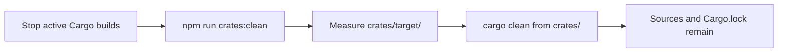
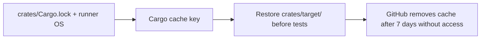

# Native crate build gates

The workspace has one functional crate, `x402-processor`, plus the
`safetrust-native-gates` root package that owns its opt-in feature. A bare
`cargo build` builds only the root package; `npm run build:rust` (webhook)
builds `x402-processor` explicitly because the x402 Karate suite exercises it.

| Crate | Cargo feature | Prerequisite before enabling in production |
|---|---|---|
| `x402-processor` | `x402-processor` | Close ESC-05: resolve the payment-flow gaps and wire the experimental feature flag. |

```sh
cargo build --manifest-path crates/Cargo.toml -p safetrust-native-gates --features x402-processor
```

The other crates (`stellar-utils`, `escrow-state-machine`, `webhook-verifier`,
`chunk-processor`, `pg-bulk-upsert`, `soroban-reconciler`) were replaced with
TypeScript in #755. See
[docs/architecture/crate-boundaries.md](../docs/architecture/crate-boundaries.md)
for what replaced each one and how their behavior was checked.

## Missing native modules

Node's loader resolves the package's configured entry point (`index.node`)
through ordinary `require()`. When the artifact is absent, Node throws
(normally `MODULE_NOT_FOUND`) and x402 payment validation fails closed.

## Cache Management

The crates in this directory form a Cargo workspace. Run workspace commands
from this directory, or use the root-level npm scripts where available.

Cargo build output lives in `crates/target/`. It is generated data and is
already excluded from Git. Removing it does not affect Rust source files or
`Cargo.lock`; Cargo recreates build artifacts on the next build.

### Local cleanup

Do not clean the cache while a Cargo build or test is running. When no build is
running, `cargo clean` is safe and removes only the workspace's `target/`
directory. From the repository root, run:

```sh
npm run crates:clean
```

The script measures and prints the cache size before cleanup (`du -sh` when
available, with a portable size calculation otherwise), then runs `cargo clean`
from this workspace. Running `cargo clean` directly from `crates/` is also
supported.



### CI cache policy

The Rust workspace test job caches `crates/target/` using the runner OS and the
hash of `crates/Cargo.lock` as its key. Reusing compiled artifacts avoids
repeated 5–10 minute cold builds. GitHub Actions automatically evicts caches
that have not been accessed for 7 days, limiting stale artifact accumulation.



For larger CI workloads, `sccache` or `cargo-cache` are optional additional
optimizations. They are not required for local cleanup or the CI cache.

## Native crate performance investigation (CLEAN-04)

`chunk-processor` and `pg-bulk-upsert` were benchmarked against their
TypeScript paths under CLEAN-04 and deleted under CLEAN-04a / #755 without a
port: both were opt-in, the sequential fetch and per-row UPSERT were already
the defaults, and reconciliation reads at most 50 escrows per request every
15 minutes.
