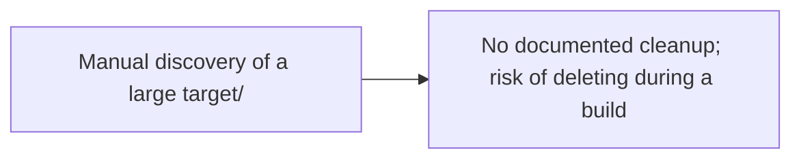
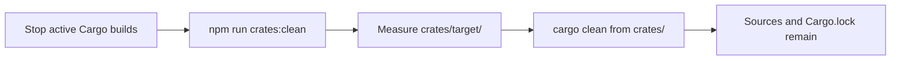
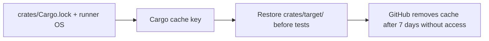

# Rust workspace

The crates in this directory form a Cargo workspace. Run workspace commands
from this directory, or use the root-level npm scripts where available.

## Cache Management

Cargo build output lives in `crates/target/`. It is generated data and is
already excluded from Git. Removing it does not affect Rust source files or
`Cargo.lock`; Cargo recreates build artifacts on the next build.

### Local cleanup

Do not clean the cache while a Cargo build or test is running. When no build is
running, `cargo clean` is safe and removes only the workspace's `target/`
directory. From the repository root, run:

```sh
npm run crates:clean
```

The script measures and prints the cache size before cleanup (`du -sh` when
available, with a portable size calculation otherwise), then runs `cargo clean`
from this workspace. Running `cargo clean` directly from `crates/` is also
supported.





### CI cache policy

The Rust workspace test job caches `crates/target/` using the runner OS and the
hash of `crates/Cargo.lock` as its key. Reusing compiled artifacts avoids
repeated 5–10 minute cold builds. GitHub Actions automatically evicts caches
that have not been accessed for 7 days, limiting stale artifact accumulation.



For larger CI workloads, `sccache` or `cargo-cache` are optional additional
optimizations. They are not required for local cleanup or the CI cache.
