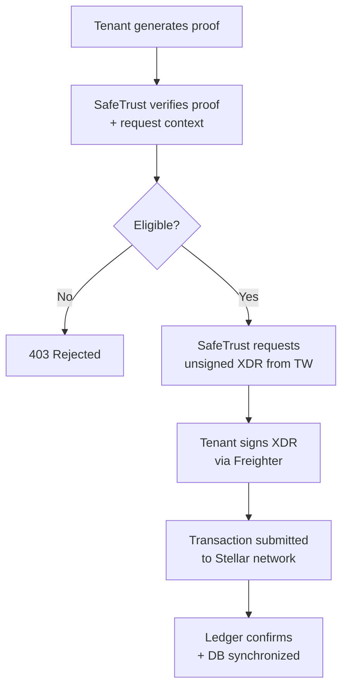
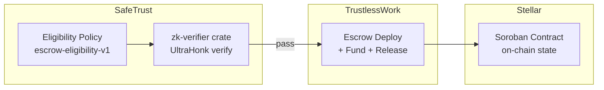
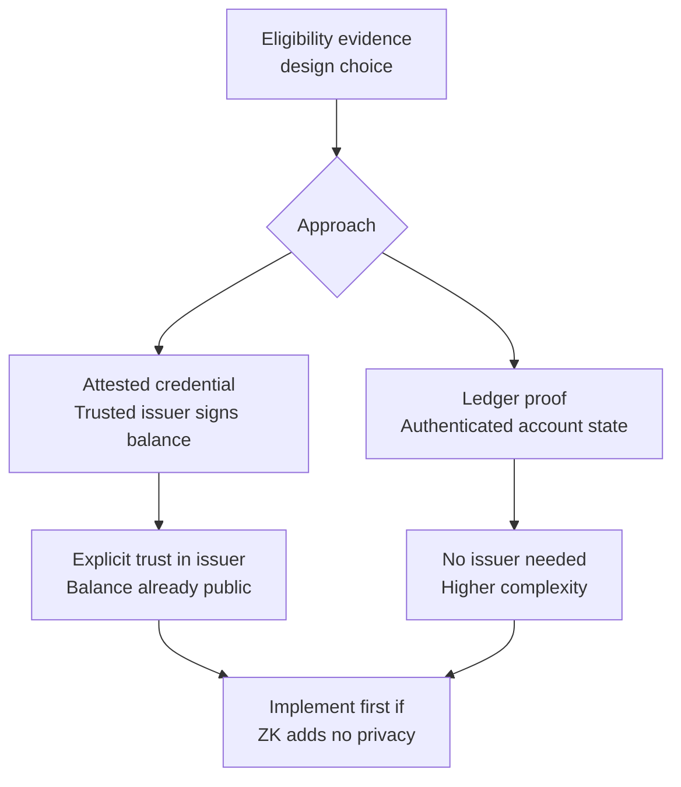

# ADR-0001: Escrow Eligibility Statement and Trust Model

- **Status**: Accepted
- **Date**: 2026-10-18
- **Deciders**: SafeTrust Core Architecture Team, DevOps & Security Engineering
- **Context Issue**: [#655 ZK-01: Define the eligibility statement and trust model](https://github.com/safetrustcr/backend-SafeTrust/issues/655)
- **Policy Identifier**: `escrow-eligibility-v1`
- **Blocks**: ZK-02 through ZK-09

---

## 1. Context and Problem Statement

The SafeTrust backend provides an endpoint (`/escrows/initialize` handled by `initialize.handler.ts` and `escrow.service.ts`) that accepts an optional Zero-Knowledge (ZK) proof bundle (`zk_proof`, `zk_verification_key`, `zk_threshold_stroops`, `zk_balance_commitment`). This proof is verified via the native Rust `zk-verifier` crate using Barretenberg UltraHonk.

However, the existing codebase lacked:
1. A formally specified **eligibility predicate**: what the applicant is proving and what parameters bind the proof.
2. An **authenticated witness source**: a verification that proves the private witness originates from an authentic account balance on the Stellar network rather than an arbitrary fabricated secret number.
3. A defined **trust boundary** and **privacy guarantee**: standard Stellar account balances and transactions are public; a ZK proof of funds does not anonymize the subsequent on-chain Soroban escrow funding transaction.
4. **Verification Key Pinning enforcement**: `ZK_PROOF_OF_FUNDS_VK_SHA256` was optional, allowing malicious clients to substitute arbitrary circuits.

Before SafeTrust requests escrow deployment XDR from Trustless Work, an authenticated applicant must satisfy an eligibility policy bound to the intended tenant, network, asset, and deposit amount. This document establishes the exact eligibility predicate, trust model, technical feasibility trade-offs, and security requirements.

---

## 2. Architecture Diagrams

### Diagram 1 — ZK Eligibility Gate in the Escrow Flow

The eligibility check acts as an application admission gate before unsigned XDR is requested from Trustless Work:



### Diagram 2 — Trust Boundary Map

Trust boundaries separate SafeTrust's off-chain admission gate, Trustless Work's escrow deployment coordinator, and Stellar's on-chain Soroban contract state:



### Diagram 3 — Attested Credential vs Ledger-Proof Choice

Comparing evidence generation strategies for witness authentication:



---

## 3. The Exact Eligibility Predicate

An applicant attempting to initialize an escrow for amount $A$ must prove:

$$\mathcal{P}_{\text{eligible}}(W, \text{Asset}, \text{Threshold}, \text{Tenant}, \text{Network}, \text{Snapshot}, \text{Context}) = \text{True}$$

### 3.1 Predicate Conditions

1. **Ownership & Transaction Authority Binding**:
   - **Key Possession**: The prover proves possession of signing key $K$ corresponding to public key $W$ via a cryptographic signature over an application session challenge (SEP-10 or `/auth/wallet/challenge`).
   - **Transaction Authority**: The current ledger state of account $W$ must be verified to confirm that key $K$'s signer weight meets or exceeds the threshold required for medium-security operations (payments and Soroban contract invocations):
     $$\text{weight}(K) \ge \text{threshold}_{\text{med}}(W)$$
     If the proving key has weight zero (e.g., master key disabled) or insufficient weight to authorize funding on its own without additional signers (multisig), the account cannot authorize funding with that key alone and evaluates to `False`.
2. **Asset Identity & Whitelist**: The asset identity $\text{Asset}$ must match the canonical asset whitelisted for the network:
   - **Stellar Mainnet (Pubnet)**: `USDC:GA5ZSEJYB37JRC5AVCIA5MOP4RHTM335X2KGX3IHOJAPP5RE34K4KZVN` (or its SEP-41 Soroban SAC contract equivalent `CCW67TSZV3SSS2HXMBQ5JFGCKJNXKZM7UQUWUZPUTHXSTZLEO7SJMI75`).
   - **Stellar Testnet**: `USDC:GBBD47IF6LWK7P7MDEVSCWR7DPUWV3NY3DTQEVFL4NAT4AQH3ZLLFLA5` (or configured testnet SAC address).
   - Any non-USDC asset (such as native XLM, arbitrary tokens, or unapproved issuers) evaluates to `False`.
3. **Atomic Unit Scaling**: Thresholds are computed in stroops ($1\text{ USDC} = 10^7\text{ stroops} = 10,000,000\text{ stroops}$). The required escrow deposit $D$ is converted deterministically into:
   $$\text{Threshold}_{\text{stroops}} = \text{Amount} \times 10^7$$
   Amounts with sub-stroop precision ($>7$ fractional digits), non-numeric formats, zero, or exceeding $\text{uint64 max}$ ($18,446,744,073,709,551,615$) are rejected.
4. **Available vs. Total Balance**:
   - **USDC Trustline / SAC Balance**: Stellar's account minimum reserve restricts native XLM and is **not** deducted from non-native assets. Spendable USDC is strictly the trustline (or SAC) balance minus selling liabilities (e.g., active sell offers on the DEX):
     $$B_{\text{available}}(W, \text{USDC}, \text{Snapshot}) = B_{\text{total}}(W, \text{USDC}) - \text{SellingLiabilities}(W, \text{USDC})$$
     The predicate requires:
     $$B_{\text{available}}(W, \text{USDC}, \text{Snapshot}) \ge \text{Threshold}_{\text{stroops}}$$
   - **Separate XLM Fee Reserve Requirement**: To ensure the account can submit and pay network fees for the subsequent XDR funding transaction, native XLM is verified independently against Stellar base reserves:
     $$B_{\text{available}}(W, \text{XLM}, \text{Snapshot}) = B_{\text{total}}(W, \text{XLM}) - \text{SellingLiabilities}(W, \text{XLM}) - \text{MinimumReserve}(W) \ge \text{FeeReserve}$$
     The XLM reserve is explicitly not subtracted from the USDC trustline calculation.
5. **Freshness Window**:
   The balance snapshot was observed at ledger sequence $L_{\text{snapshot}}$ with timestamp $t_{\text{snapshot}}$ such that:
   $$t_{\text{current}} - t_{\text{snapshot}} \le \Delta t_{\text{max}} \quad (\Delta t_{\text{max}} = 300\text{ seconds / 60 ledgers})$$
   Snapshots older than 300 seconds are stale and evaluate to `False`.
6. **Tenant & Request Replay Prevention (Single-Use Nonce Lifecycle)**:
   The proof or attestation must commit to a cryptographically secure context digest:
   $$\text{ContextDigest} = \text{SHA256}(\text{TenantID} \parallel \text{NetworkPassphrase} \parallel \text{ContractID} \parallel \text{Nonce})$$
   This prevents reusing an eligibility proof generated for tenant `safetrust` inside tenant `hotel_industry`, or reusing a testnet proof on mainnet.

   To guarantee request replay prevention, the $\text{Nonce}$ follows a strict single-use lifecycle:
   - **Issuance**: The verifier / backend issues a cryptographically secure 32-byte nonce (generated via CSPRNG) bound to the requesting client's active initialization session, tenant, and intended contract ID with a short time-to-live (TTL $\le 300\text{ seconds}$).
   - **Request Binding**: The client supplies this nonce within the initialization request. The verifier validates that the supplied nonce matches the active challenge session and context parameters $(\text{TenantID}, \text{NetworkPassphrase}, \text{ContractID})$.
   - **Atomic One-Time Consumption**: During verification, the verifier executes an atomic test-and-set consumption of the nonce (e.g. database CAS `UPDATE zk_challenges SET consumed = true, consumed_at = NOW() WHERE id = $nonce AND consumed = false` or Redis atomic `GETDEL`). If the nonce is missing, expired, or already consumed, the request is rejected immediately before running proof verification or creating escrow records.

---

## 4. Why "Secret Number Exceeds Deposit" Is Insufficient

A naive range-check circuit proving only:
$$\text{assert}(\text{secret\_balance} \ge \text{threshold})$$
where $\text{secret\_balance}$ is an unconstrained private input provided by the client, is completely insecure:
- Any malicious client can supply $\text{secret\_balance} = 2^{60}$ as their witness.
- The prover will generate a mathematically valid UltraHonk proof.
- The verifier will return `true`.
- Yet the client may possess 0 USDC on the Stellar network.

**Fundamental Requirement**: The secret number must be **authenticated** against actual wallet state. The circuit must verify that the balance was either:
1. **Attested by a trusted signer**: verified inside the circuit using an ECDSA/Ed25519 signature check over $(W, \text{Asset}, B_{\text{available}}, L_{\text{seq}}, t_{\text{snapshot}})$, OR
2. **Authenticated via cryptographic ledger state**: proven against the Stellar SCP ledger header and BucketList Merkle/hash accumulator root.

---

## 5. Attested Credential vs. Authenticated Ledger Proof

| Dimension | Attested Credential (Issuer-Signed) | Authenticated Ledger Proof (BucketList Merkle) |
|---|---|---|
| **Witness Source** | Trusted attestation oracle queries Soroban RPC/Horizon and signs a structured balance claim. | Client downloads Stellar ledger header and BucketList entry proofs directly from validators. |
| **Trust Model** | Trusts the issuer's signing key and honesty. If the issuer signs a false claim, invalid proofs pass. | Trustless. Anchored entirely in Stellar Consensus Protocol (SCP) quorum headers. |
| **Circuit Complexity** | Moderate. Requires verifying one signature (e.g. Ed25519 or Schnorr/BabyJubjub) and comparing balance. | Extreme. Requires SHA-256 evaluation over Stellar BucketList trees, XDR parsing inside Noir, and SCP quorum checking. |
| **Proving Overhead** | Fast (< 1-2 seconds in browser WASM). | Prohibitive (> 30-90 seconds, > 2-4 GB RAM), crashing typical browser Freighter extensions. |
| **Network Overhead** | Tiny payload (signature + balance + timestamp ~ 128 bytes). | Large (Stellar ledger header + multi-level Merkle path proofs ~ dozens of KB). |
| **Feasibility in Noir 2026** | Fully feasible today via standard cryptographic primitives. | Infeasible for web/mobile clients without dedicated off-chain proving clusters. |

### Concrete Feasibility Decision
SafeTrust selects the **Attested Credential** architecture for any future ZK implementation because direct ledger proofs exceed client browser memory limits and proving time budgets. However, as evaluated below, even attested ZK credentials must be weighed against honest signed API checks.

---

## 6. Public Balances on Stellar and the "Ship Signed Eligibility First" Rule

### The Stellar Privacy Reality
Stellar is a public, transparent blockchain. Account balances, trustline balances, and Soroban SAC contract token balances are publicly queryable by anyone via Horizon or Soroban RPC.
In SafeTrust's escrow lifecycle:
1. The applicant proves eligibility at Step B.
2. SafeTrust fetches unsigned escrow initialization XDR from Trustless Work.
3. The applicant signs the XDR with Freighter using wallet $W$.
4. The transaction executes on Stellar, transferring USDC from $W$ into the escrow contract.
5. The transaction, sender address $W$, and amount are published in cleartext on the public ledger.

Because the subsequent funding transaction reveals the wallet address and deposit amount on-chain, **a ZK proof of funds provides zero net privacy for standard escrows**.

### The "Ship Signed Eligibility First" Rule
- **Decision Rule**: If ZK adds no practical privacy benefit for a transaction that settles in cleartext on-chain, SafeTrust will **defer circuit deployment** and rely on honest, authenticated signed checks (server-verified Stellar RPC balance or attested credentials).
- **Enforcement Status**: Real-funds ZK enforcement remains **disabled by default** (`ZK_ENFORCEMENT_ENABLED=false`).
- If a client supplies a ZK bundle, the backend validates it against the pinned circuit key and threshold; but standard escrows do not require ZK proofs until privacy-preserving funding pools or anonymous credentials are introduced in future phases.

---

## 7. Eligibility as a Snapshot (Not a Funds Reservation)

An eligibility check (whether attested or ZK-proven) represents a **point-in-time snapshot**:
- It certifies that at ledger timestamp $t_{\text{snapshot}}$, account $W$ held $\ge \text{Threshold}$ spendable stroops.
- It does **not** lock, freeze, or reserve funds on the Stellar ledger.
- An applicant could transfer their USDC elsewhere immediately after generating the proof.
- **Ultimate Settlement Authority**: The on-chain Soroban escrow smart contract remains the sole deterministic arbiter. When the tenant submits their signed funding XDR, the Stellar network will confirm or abort the transfer based on live balance at transaction inclusion time.

---

## 8. Supported vs. Unsupported Accounts and Assets

### Supported
- **Standard Single-Signature Stellar Accounts**: Accounts prefixed with `G...` governed by a single Ed25519 keypair.
- **Assets**: Native Circle USDC on Stellar testnet and pubnet via the official Stellar Asset Contract (SAC).

### Explicitly Excluded / Unsupported
- **Accounts Where Proving Key Lacks Transaction Authority**: Accounts where the proving key's signer weight is below the threshold required to authorize payments or Soroban contract invocations ($\text{weight}(K) < \text{threshold}_{\text{med}}$), including accounts where the master key has weight zero.
- **Multisig Accounts**: Accounts requiring multiple distinct signers to reach $\text{threshold}_{\text{med}}$ are excluded from automated single-signature proofs.
- **Smart Contract Accounts**: Soroban contract addresses (`C...`) that lack Ed25519 private keys.
- **Volatile / Non-USDC Assets**: Native XLM, arbitrary stablecoins, unpegged hotel tokens, or custom cross-border assets.
- **Frozen or Restricted Trustlines**: Accounts with revoked or authorized-to-maintain-liabilities-only trustline flags.

---

## 9. Verification Key Pinning & Circuit Substitution Defense

### Threat
In Noir/Barretenberg UltraHonk, a proof is verified with respect to a verification key (`vk`). If the verifier accepts arbitrary verification keys from the client:
1. An attacker compiles a dummy circuit: `fn main(threshold: pub u64, commitment: pub Field) { return; }`.
2. The attacker generates a proof that always passes for any public inputs.
3. The attacker submits the proof and the dummy `vk`.
4. The native verifier passes, admitting an unqualified client.

### Mitigation: Mandatory Production Pinning
- In `webhook/src/lib/zk-verifier.ts`, the verification key SHA-256 hash (`ZK_PROOF_OF_FUNDS_VK_SHA256`) is **mandatory by default** (required in production, staging, and any environment where `NODE_ENV` is not explicitly `'development'` or `'test'`).
- Missing or malformed pins throw `ZK_VERIFIER_MISCONFIGURED` (HTTP 500 / fail-closed).
- Any submitted verification key whose SHA-256 does not match the pinned hash is rejected with `false`.
- Only explicit development and test environments (`test`, `development`) permit optional pins to allow frictionless local circuit development.

---

## 10. Threat Model

| Threat ID | Threat Description | Attack Vector | Impact | Mitigation Strategy | Residual Risk |
|---|---|---|---|---|---|
| **T-01** | Malicious client supplies fabricated proof | Client crafts arbitrary private witness $> \text{threshold}$ without funds. | Unauthorized escrow creation without financial backing. | Pinned verification key + witness authenticated against trusted issuer / ledger state. | Low (prevented by crypto verification). |
| **T-02** | Circuit substitution attack | Client uploads valid proof for a dummy trivial circuit with its own `vk`. | Complete bypass of eligibility gate. | Mandatory verification key SHA-256 pin in production (`ZK_PROOF_OF_FUNDS_VK_SHA256`). | None (pin verified with constant-time equality). |
| **T-03** | Issuer key compromise | Attestation oracle's private signing key is stolen or rogue. | Forged eligibility credentials for arbitrary wallets. | Short attestation TTL (5 min), key rotation, multi-signature attesters, and HSM key storage. | Medium (addressed by HSM and audit monitoring). |
| **T-04** | Stale balance data | Client drains funds between attestation generation and escrow initialization. | Escrow requested without adequate funds. | 300-second freshness window; final on-chain Soroban contract funding fails transaction if balance is insufficient. | Low (snapshot semantics handled by on-chain transfer). |
| **T-05** | Cross-tenant credential reuse | Proof generated for tenant `safetrust` presented to `hotel_industry`. | Bypassing tenant-specific KYC or deposit constraints. | `ContextDigest` in public inputs includes `TenantID` and `NetworkPassphrase`. | None (domain separation enforced). |
| **T-06** | Cross-network replay | Valid testnet proof presented to Stellar mainnet. | Free escrow admission on production network. | `NetworkPassphrase` hash bound to public inputs and verified against server network config. | None (network separation enforced). |

---

## 11. Concrete Test Vectors & Eligibility Examples

### 11.1 Approved Positive Example
```json
{
  "scenario": "Eligible guest initializing booking escrow on testnet",
  "input": {
    "wallet_address": "GDVEU3DD4KOFECV66VIHWEZOYX4ZKR3WV27L464SIIPOU2IUI3JCZA57",
    "tenant_id": "safetrust",
    "network": "testnet",
    "asset": "USDC",
    "escrow_amount": 100.0,
    "amount_stroops": "1000000000",
    "available_balance_stroops": "2500000000",
    "snapshot_age_seconds": 12,
    "zk_bundle": {
      "zk_proof": "0x1a2b3c...",
      "zk_verification_key": "0x001122... (matches pinned SHA-256)",
      "zk_threshold_stroops": "1000000000",
      "zk_balance_commitment": "0x3f4e5d..."
    }
  },
  "expected_result": {
    "eligible": true,
    "status_code": 200,
    "proceed_to_tw": true
  }
}
```

### 11.2 Negative Examples

1. **Negative Vector 1: Insufficient Available Balance**
   - *Total Balance*: 150 USDC (1,500,000,000 stroops).
   - *Selling Liabilities*: 100 USDC (active DEX offer).
   - *Available Balance*: 50 USDC (500,000,000 stroops).
   - *Required Deposit*: 100 USDC (1,000,000,000 stroops).
   - *Result*: Rejected (`400 Bad Request: Invalid ZK proof of funds` / predicate fails).
2. **Negative Vector 2: Stale Snapshot Window**
   - *Attestation Timestamp*: `now - 450 seconds` (exceeds 300s TTL).
   - *Result*: Rejected (`400 Bad Request: Eligibility attestation expired`).
3. **Negative Vector 3: Cross-Tenant Credential Replay**
   - *Context Digest*: Contains `tenant: "safetrust"`.
   - *Requesting Tenant*: `tenant: "hotel_industry"`.
   - *Result*: Rejected (`400 Bad Request: Context digest mismatch`).
4. **Negative Vector 4: Cross-Network Replay**
   - *Network Context*: Generated on `Test SDF Network ; September 2015`.
   - *Server Environment*: `Public Global Stellar Network ; July 2015`.
   - *Result*: Rejected (`400 Bad Request: Network mismatch`).
5. **Negative Vector 5: Unsupported Asset**
   - *Asset Submitted*: `XLM` (Native lumen).
   - *Result*: Rejected (`400 Bad Request: Unsupported asset, only USDC permitted`).
6. **Negative Vector 6: Circuit Substitution / Unpinned Key**
   - *Verification Key*: SHA-256 does not match `ZK_PROOF_OF_FUNDS_VK_SHA256`.
   - *Result*: Rejected (`400 Bad Request: Invalid ZK proof of funds` / `false` returned).
7. **Negative Vector 7: Missing Mandatory Production Pin**
   - *Environment*: `NODE_ENV=production`.
   - *Configuration*: `ZK_PROOF_OF_FUNDS_VK_SHA256` is empty or missing.
   - *Result*: Rejected (`500 Internal Server Error: ZK proof verifier is misconfigured`).
8. **Negative Vector 8: Proving Key Lacks Transaction Authority (Weight Zero / Multisig)**
   - *Account Configuration*: Prover holds key $K$ with valid challenge signature, but account ledger state has $\text{weight}(K) = 0$ (master key disabled) or $\text{weight}(K) < \text{threshold}_{\text{med}} = 20$ (multisig requiring additional cosigners).
   - *Result*: Rejected (`400 Bad Request: Proving key lacks transaction authorization weight`).

---

## 12. Implementation & Transition Plan

1. **ZK-01 (This Decision)**:
   - Formulate eligibility predicate and trust boundaries.
   - Enforce mandatory verification key pinning in production (`webhook/src/lib/zk-verifier.ts`).
   - Add feature flag `ZK_ENFORCEMENT_ENABLED` (defaulting to `false`) ensuring real-funds ZK enforcement remains disabled while keeping optional verification active.
   - Provide unit tests validating production key pin enforcement and fail-closed behaviors.
2. **ZK-02 through ZK-04**: Implement attested credential issuer service and client witness generation.
3. **ZK-05 through ZK-08**: Noir circuit definition with signature verification and public context hashing.
4. **ZK-09**: End-to-end integration with Trustless Work and Freighter flow.
