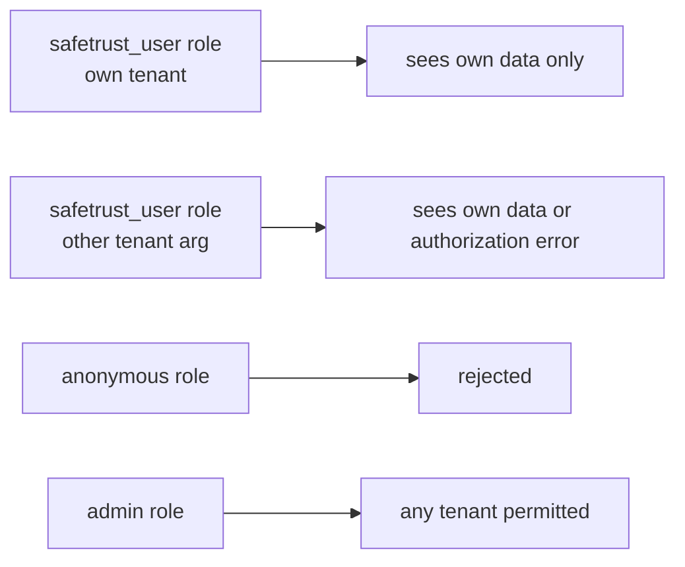

# SafeTrust Analytics: Hasura Console Runbook & Verification Guide

This runbook provides step-by-step procedures to inspect, verify, and test the SafeTrust analytics functions and their Hasura GraphQL contract.

---

## 1. Scope & System Architecture

The SafeTrust Analytics Dashboard depends on two PostgreSQL functions exposed as GraphQL query roots:
- `safetrust.get_escrow_analytics_by_day`: Generates a contiguous daily time-series combining webhook events, new users, active escrows, and escrow value over a specified date range.
- `safetrust.get_escrow_status_summary`: Aggregates lifecycle counts (`total_escrows`, `active_escrows`, `completed_escrows`, `disputed_escrows`) and amounts (`total_value`, `pending_value`) for dashboard metric cards.

```
┌─────────────────────────────────┐
│   SafeTrust Frontend Dashboard  │ (useAnalyticsData hook, 60s polling)
└────────────────┬────────────────┘
                 │ GraphQL POST (query_root)
┌────────────────▼────────────────┐
│      Hasura GraphQL Engine      │ (Role-based access & argument mapping)
└────────────────┬────────────────┘
                 │ SQL SETOF Function Invocation
┌────────────────▼────────────────┐
│      PostgreSQL (safetrust)     │
│  - get_escrow_analytics_by_day  │
│  - get_escrow_status_summary    │
└─────────────────────────────────┘
```

> [!IMPORTANT]
> **Environment Restriction**: All verification steps, queries, and integration tests documented here MUST be run against a **migrated local instance** (via Docker Compose / `bin/start` / `docker-compose-test.yml`), **never** against a production Cloud endpoint.

---

## 2. Test Framework Selection: Karate

### Framework Evaluation
| Framework | Evaluation & Rationale | Selected? |
| :--- | :--- | :---: |
| **Karate** | **Existing pattern** in `tests/karate/features/hotels/top_rooms_function.feature`. Natively handles GraphQL HTTP POSTs, JSON schema assertions, role impersonation headers (`x-hasura-role`), and direct database fixture seeding via JDBC (`db.execute`). Runs inside Docker Compose without extra host dependencies. | **Yes (Chosen)** |
| **pgTAP** | Unit tests SQL inside Postgres, but cannot validate Hasura metadata tracking, GraphQL schema generation, or GraphQL HTTP role rejection. | No |
| **Node.js Integration** | Capable of HTTP and DB queries, but introduces duplicate test runner infrastructure alongside the existing Karate suite. | No |

**Decision**: We use **Karate** to remain 100% consistent with the existing hotel ranking test suite and to validate both the database layer and the GraphQL engine contract in a single test run.

---

## 3. Local Environment Setup

1. Start the local stack with the required tenants (`safetrust` and `hotel_industry`):
   ```bash
   bin/start safetrust hotel_industry
   ```
2. Alternatively, for automated tests, run the test compose stack:
   ```bash
   bin/test
   ```
3. Open the Hasura Console locally:
   - When running `bin/start`: navigate to `http://localhost:8080/console` (Admin Secret: `myadminsecretkey`).
   - When running the CLI test container: navigate to `http://localhost:9696`.

---

## 4. GraphQL Introspection Query

Run this introspection query in the Hasura Console GraphiQL tab or via `curl` to verify that both analytics query roots are registered with their expected arguments and return types.

```graphql
# 1. Query root field verification
query IntrospectAnalyticsRoots {
  __schema {
    queryType {
      fields {
        name
        description
        args {
          name
          type {
            name
            kind
            ofType {
              name
              kind
            }
          }
        }
        type {
          name
          kind
          ofType {
            name
            kind
            fields {
              name
              type {
                name
                kind
              }
            }
          }
        }
      }
    }
  }
}

# 2. Targeted type introspection for analytics return types
query IntrospectAnalyticsTypes {
  analyticsByDay: __type(name: "escrow_analytics_by_day") {
    name
    kind
    fields {
      name
      type {
        name
        kind
      }
    }
  }
  statusSummary: __type(name: "escrow_status_summary") {
    name
    kind
    fields {
      name
      type {
        name
        kind
      }
    }
  }
}
```

### Expected Introspection Response
```json
{
  "data": {
    "__schema": {
      "queryType": {
        "fields": [
          {
            "name": "get_escrow_analytics_by_day",
            "args": [
              { "name": "args" }
            ],
            "type": {
              "kind": "LIST",
              "ofType": {
                "name": "escrow_analytics_by_day",
                "kind": "OBJECT",
                "fields": [
                  { "name": "day", "type": { "name": "date" } },
                  { "name": "event_count", "type": { "name": "bigint" } },
                  { "name": "processed_count", "type": { "name": "bigint" } },
                  { "name": "new_users", "type": { "name": "bigint" } },
                  { "name": "active_escrows", "type": { "name": "bigint" } },
                  { "name": "escrow_value", "type": { "name": "numeric" } }
                ]
              }
            }
          },
          {
            "name": "get_escrow_status_summary",
            "args": [
              { "name": "args" }
            ],
            "type": {
              "kind": "LIST",
              "ofType": {
                "name": "escrow_status_summary",
                "kind": "OBJECT",
                "fields": [
                  { "name": "total_escrows", "type": { "name": "bigint" } },
                  { "name": "active_escrows", "type": { "name": "bigint" } },
                  { "name": "completed_escrows", "type": { "name": "bigint" } },
                  { "name": "disputed_escrows", "type": { "name": "bigint" } },
                  { "name": "total_value", "type": { "name": "numeric" } },
                  { "name": "pending_value", "type": { "name": "numeric" } }
                ]
              }
            }
          }
        ]
      }
    }
  }
}
```

---

## 5. SQL Inspection Queries

Execute these queries in the Hasura Console **Data -> SQL** tab or via `psql` to inspect installed function bodies, schemas, and return types.

### A. Verify Installed Function Signatures and Schemas
```sql
SELECT
  n.nspname AS schema_name,
  p.proname AS function_name,
  pg_get_function_identity_arguments(p.oid) AS arguments,
  pg_get_function_result(p.oid) AS return_type,
  p.provolatile AS volatility
FROM pg_proc p
JOIN pg_namespace n ON n.oid = p.pronamespace
WHERE p.proname IN ('get_escrow_analytics_by_day', 'get_escrow_status_summary')
ORDER BY n.nspname, p.proname;
```

### B. View Full Function Source Bodies
```sql
SELECT
  n.nspname || '.' || p.proname AS function_name,
  pg_get_functiondef(p.oid) AS function_definition
FROM pg_proc p
JOIN pg_namespace n ON n.oid = p.pronamespace
WHERE p.proname IN ('get_escrow_analytics_by_day', 'get_escrow_status_summary');
```

### C. Verify Return Type Composite Tables
```sql
SELECT
  table_schema,
  table_name,
  column_name,
  data_type
FROM information_schema.columns
WHERE table_name IN ('escrow_analytics_by_day', 'escrow_status_summary')
ORDER BY table_name, ordinal_position;
```

---

## 6. Sample GraphQL Operations per Role

### Role Coverage Matrix


### A. Admin Role (`admin`)
The admin role has unrestricted privileges and can query metrics for any tenant.

**Headers**:
```http
Content-Type: application/json
x-hasura-admin-secret: myadminsecretkey
```

**Query**:
```graphql
query AdminAnalyticsOverview {
  get_escrow_status_summary(args: { tenant_id_input: "safetrust" }) {
    total_escrows
    active_escrows
    completed_escrows
    disputed_escrows
    total_value
    pending_value
  }
  get_escrow_analytics_by_day(
    args: {
      start_date: "2026-10-01T00:00:00Z"
      end_date: "2026-10-05T00:00:00Z"
      tenant_id_input: "safetrust"
    }
  ) {
    day
    event_count
    processed_count
    new_users
    active_escrows
    escrow_value
  }
}
```

### B. SafeTrust User Role (`safetrust_user`)
A tenant-authenticated user querying their own tenant (`safetrust`).

**Headers**:
```http
Content-Type: application/json
x-hasura-admin-secret: myadminsecretkey
x-hasura-role: safetrust_user
x-hasura-user-id: usr_st_7721
x-hasura-tenant-id: safetrust
```

**Query**:
```graphql
query UserEscrowSummary {
  get_escrow_status_summary(args: { tenant_id_input: "safetrust" }) {
    total_escrows
    active_escrows
    completed_escrows
    disputed_escrows
    total_value
    pending_value
  }
}
```

> [!NOTE]
> If a `safetrust_user` supplies `tenant_id_input: "hotel_industry"`, the request must either return an authorization error or return isolated empty data (`0` counts) without leaking records from `hotel_industry`.

### C. Anonymous Role (`anonymous`)
Unauthenticated clients must be rejected by Hasura.

**Headers**:
```http
Content-Type: application/json
# (No x-hasura-admin-secret or Authorization header provided)
```

**Query**:
```graphql
query AnonymousAttempt {
  get_escrow_status_summary {
    total_escrows
  }
}
```

**Expected Response**:
```json
{
  "errors": [
    {
      "message": "field 'get_escrow_status_summary' not found in type: 'query_root'",
      "extensions": {
        "path": "$.selectionSet.get_escrow_status_summary",
        "code": "validation-failed"
      }
    }
  ]
}
```

---

## 7. Frontend Polling Semantics (60-Second Default)

The frontend analytics dashboard utilizes polling rather than GraphQL subscriptions for metrics:
- **Default Polling Interval**: `60,000 ms` (60 seconds).
- **Rationale**:
  - `get_escrow_analytics_by_day` executes a `generate_series` date join across multiple tables (`trustless_work_webhook_events`, `trustless_work_escrows`, and `users`).
  - Escrow transactions and webhook events arrive asynchronously via block confirmations (every ~5 seconds on Stellar); polling every 60 seconds captures state changes without thrashing PostgreSQL execution plans or exhausting connection pools.
  - GraphQL subscriptions on composite SETOF functions place continuous diffing load on Hasura; periodic polling provides a lean, deterministic query pattern.
- **Frontend Hook Example**:
  ```ts
  const { data, loading, error } = useQuery(GET_ANALYTICS_DASHBOARD, {
    variables: { startDate, endDate, tenant: 'safetrust' },
    pollInterval: 60000, // 60-second polling default
    fetchPolicy: 'cache-and-network',
  });
  ```

---

## 8. Running Automated Karate Tests Locally

Execute the automated suite against your local containerized environment:

```bash
# Run entire Karate suite (including analytics)
bin/test

# Inspect test results
open tests/results/karate-summary.html
```

The analytics suite verifies:
1. `tests/karate/features/analytics/analytics-by-day.feature`: Schema types, zero-fill continuity, event deduplication, multi-asset aggregation, and range boundaries.
2. `tests/karate/features/analytics/escrow-status-summary.feature`: Metric totals, status categorizations, multi-asset amounts, and default arguments.
3. `tests/karate/features/analytics/roles-and-permissions.feature`: Admin versatility, own-tenant visibility, cross-tenant isolation, and anonymous rejection.
