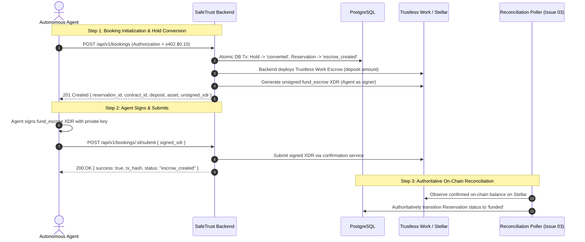

# Agent Bookings API (Issue #778)

Documentation for autonomous AI agents and API clients booking apartment stays on SafeTrust with separated x402 booking fees and Trustless Work on-chain security deposit escrows.

---

## 🎯 Architecture & Security Overview

Agent bookings on SafeTrust separate platform compensation from trustless collateral:
1. **Platform Booking Fee ($0.10 USDC)**: Paid immediately via the [x402 payment protocol](../../stellar/x402-protocol.md) directly to SafeTrust's platform fee account.
2. **Security Deposit Escrow**: Server-calculated warranty deposit held on Stellar via Trustless Work Soroban smart contracts. The deposit is **never** processed via x402.



---

## 🔑 Crucial Architectural Principles ("Must Explain")

### 1. Escrow Role Mapping
Trustless Work smart contracts enforce multi-party governance on the Stellar network:

| Role | Entity | Stellar Address Source | Responsibility |
|---|---|---|---|
| **Funder / Guest** (`approver` / `signer`) | Autonomous Agent | Agent's verified Stellar wallet | Signs the `fund_escrow` transaction depositing the security collateral. |
| **Receiver / Host** (`receiver` / `marker`) | Apartment Owner | Host's registered Stellar wallet | Receives released funds after completed milestone / successful stay. |
| **Platform** (`releaser` / `platformAddress`) | SafeTrust | `SAFETRUST_PLATFORM_WALLET` | Authorizes milestone release upon approved checkout or arbitrates disputes. |

### 2. Signing Responsibilities & Trust Boundary
- **Why the Backend Deploys the Escrow**: The SafeTrust backend deploys the Trustless Work Soroban smart contract and pays the initial Soroban contract deployment network fees. This ensures that the smart contract code hash, configuration parameters (platform address, receiver address, milestone definitions, asset contract ID), and immutable terms are validated and non-tamperable by the client.
- **Why the Agent Only Signs `fund_escrow`**: The agent retains complete self-custody of its Stellar wallet and USDC funds. The agent signs **only** the `fund_escrow` transaction that transfers the server-quoted deposit amount from its own account into the deployed escrow contract. The agent never signs arbitrary contract deployments or platform management calls.

### 3. Why the Deposit is NOT Paid via x402
- **x402** is an HTTP-native micropayment challenge/response standard designed for platform fees and API calls (such as the $0.10 USDC booking fee and $0.01 hold fee). x402 settles directly to the platform's revenue account.
- **Security deposits are trustless collateral**, not platform revenue. If security deposits were collected via x402, SafeTrust would act as a custodial escrow and central counterparty. Instead, deposits are locked directly inside an on-chain Soroban escrow contract on Stellar, governed by Trustless Work's multi-party milestone and dispute rules.

### 4. What Happens if the Agent Never Submits the Signed XDR
- When the reservation and escrow are generated, the reservation enters **`escrow_created`** status with an on-chain balance of `0`.
- The originating booking hold transitions to `converted`.
- If the agent crashes, abandons the flow, or never submits the signed XDR, the escrow remains unfunded (`balance: 0`).
- The background hold expiry sweep (`expireHolds`) expires only `pending_payment` and `active` holds whose `expires_at` has passed and does not modify reservations. A `converted` hold and its `escrow_created` reservation remain blocked until cancelled through `POST /api/reservations/:id/cancel`.

### 5. Escrow Locks Only the Quoted Deposit (Not the Full Stay)
- The Trustless Work contract amount locks **strictly the security deposit** (`warranty_deposit`), as calculated by the server-side quote service.
- The stay total (`total_amount = price * nights`) is recorded on the reservation for booking settlement and display, but is not locked in this initial deposit escrow.

---

## 📡 API Endpoints

### 1. Create Booking

**`POST /api/v1/bookings`**

Converts a booking hold (or direct property dates) into a reservation, deploys the Trustless Work escrow, and generates the unsigned `fund_escrow` transaction.

#### Headers
```http
Authorization: Bearer <firebase_session_id_token>
X-Payment: <x402_base64_payment_proof>   # 0.10 USDC required
Content-Type: application/json
```

#### Request Body (Option A - Preferred: With `hold_id`)
```json
{
  "hold_id": "4b6c3e76-0f3d-4c81-8b83-a7442ebda192"
}
```

#### Request Body (Option B - Direct without hold)
```json
{
  "property_id": "11111111-1111-4111-8111-111111111111",
  "check_in": "2026-12-15",
  "check_out": "2026-12-20",
  "guests": 2
}
```

#### Responses

**`201 Created` (or `200 OK` on idempotent retry of converted hold)**
```json
{
  "reservation_id": "84c8a29b-7341-47d3-9fa1-0fa19bf3e810",
  "contract_id": "CAATN5DTEST000000000000000000000000000000000000000000001",
  "deposit": "45.00",
  "asset": "USDC",
  "unsigned_xdr": "AAAAAgAAAAB..."
}
```

**`402 Payment Required`** (Missing or invalid x402 payment proof for the $0.10 booking fee)
```json
{
  "error": "Payment Required",
  "x402Version": 2,
  "accepts": [
    {
      "maxAmountRequired": 0.10,
      "network": "stellar:testnet",
      "recipient": "GD5JPEHGGTDTK2N7OMDDCOW3DPO5KSFWACYWNYZNNOXD2UC7LQ4DHXMM"
    }
  ]
}
```

**`409 Conflict`** (Hold not found, hold expired, not owned by caller, or not active)
```json
{
  "error": "Hold has expired",
  "code": "hold_expired"
}
```

**`401 Unauthorized`** (Missing or invalid session Bearer token)

---

### 2. Submit Signed Booking XDR

**`POST /api/v1/bookings/:id/submit`**

Submits the agent-signed `fund_escrow` XDR to the Stellar network via the confirmation service.

> **Important**: This endpoint submits the transaction to the network, but **never** marks the reservation as `funded`. The transition to `funded` is exclusively driven by the Issue 03 on-chain balance poller after Stellar ledger execution is verified.

#### Headers
```http
Authorization: Bearer <firebase_session_id_token>
Content-Type: application/json
```

#### Request Body
```json
{
  "signed_xdr": "AAAAAgAAAAB...[signed_by_agent_wallet]"
}
```

#### Responses

**`200 OK`**
```json
{
  "success": true,
  "reservation_id": "84c8a29b-7341-47d3-9fa1-0fa19bf3e810",
  "contract_id": "CAATN5DTEST000000000000000000000000000000000000000000001",
  "tx_hash": "e3b0c44298fc1c149afbf4c8996fb92427ae41e4649b934ca495991b7852b855",
  "status": "escrow_created"
}
```

**`400 Bad Request`** (Invalid XDR or on-ledger failure during submission)
```json
{
  "success": false,
  "error": "Transaction failed on-ledger",
  "stage": "pending_confirmation"
}
```

**`403 Forbidden`** (Authenticated user does not own this reservation)
```json
{
  "error": "Not your reservation"
}
```

**`404 Not Found`** (Reservation not found)
```json
{
  "error": "Reservation not found"
}
```

---

## 🔄 Idempotency Guarantees

- **Hold-to-Booking Idempotency**: If an agent retries `POST /api/v1/bookings` with the same `hold_id` (e.g., due to an HTTP client timeout), the backend detects that the hold has already been converted. It returns the existing `reservation_id`, `contract_id`, `deposit`, `asset`, and `unsigned_xdr` without deploying a second smart contract or charging a second deposit.
- **Transaction Submission Deduplication**: Transaction submissions via `POST /api/v1/bookings/:id/submit` are recorded in `safetrust.escrow_confirmation_retries` with a unique constraint on `(tx_hash, escrow_action)`. Re-submitting the same signed XDR produces zero duplicate on-chain executions.
