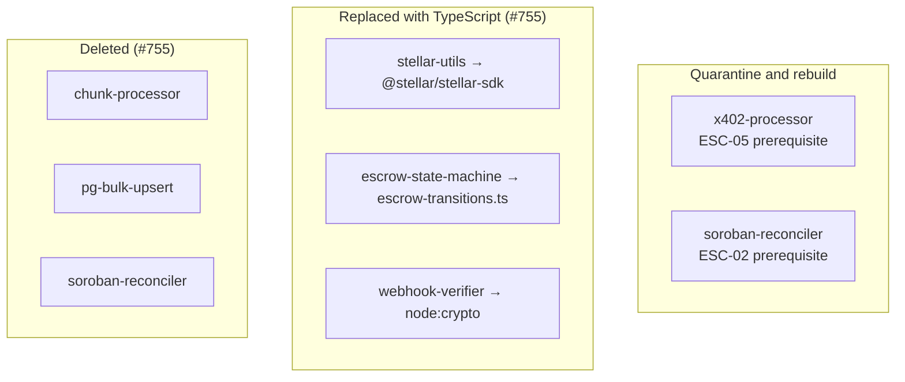
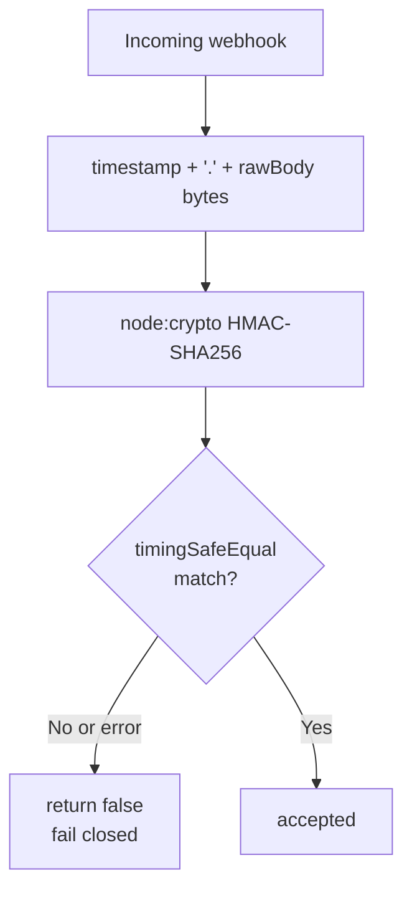

# Rust Crate Boundaries and Integration Quarantine

The Cargo workspace contains one functional Rust crate, `x402-processor`, and
one feature-gate package. `x402-processor` is excluded from the default build
until ESC-05 is resolved.

The six other crates were replaced with TypeScript in #755 (`zk-verifier` was
removed earlier, in #753). §8 records each removal against the removal policy.
The Cargo workspace contains six functional Rust crates and one feature-gate
package. Five functional crates are included in the default webhook build;
`soroban-reconciler` is excluded until its prerequisites are resolved
(`zk-verifier` was removed in #763 and `x402-processor` was removed in #754).

This page records, for every crate, its responsibility, consumers, exports,
fallback, build artifact, and disposition. It is the ownership boundary for the
`crates/` workspace. For the high-level story, see
[Rust crates in SafeTrust](./rust-crates.md).

Five functional crates remain in the default build; `soroban-reconciler`
remains available behind an explicit, default-off Cargo feature gate.

---

## 1. Disposition map



---

## 2. Inventory

| Crate | Responsibility | Consumers |
|---|---|---|
| `x402-processor` | Parse `X-Payment` headers and verify them with an allowlisted facilitator. | `webhook/src/middleware/x402-payment.middleware.ts` → `initialize.route.ts`, gated by `X402_ENABLED`. |

| Crate | Native exports | Fallback when the addon is absent | Build script / deployment artifact |
|---|---|---|---|
| `x402-processor` | `validateX402Payment`, `buildPaymentRequirement` | None in TypeScript: the middleware never returns `is_valid: true` without the addon; it fails closed. | Built by `npm run build:rust` and the shared `scripts/copy-native.js`; artifact `crates/x402-processor/index.node`, copied into the image for the x402 Karate suite. Opt in with `cargo build --manifest-path crates/Cargo.toml -p safetrust-native-gates --features x402-processor`. |
| `stellar-utils` | Stellar strkey validation and Ed25519 signature verification. | `webhook/src/routes/auth/sync-wallet.handler.ts`. |
| `escrow-state-machine` | Canonical escrow status enum, transition table, and `getValidPriorStates()` filters. | `webhook/src/services/escrow.service.ts` (`executeEscrowLifecycleTransition`), `milestone.service.ts`, `webhook/src/lib/escrow-transitions.ts`. |
| `webhook-verifier` | Constant-time HMAC-SHA256 verification of Trustless Work callbacks. | Retired; no runtime consumers after polling became authoritative. |
| `chunk-processor` | Fetch Trustless Work indexer chunks concurrently on Tokio, bounded by a concurrency limit. | `webhook/src/lib/reconciliation.ts` (`syncAllChunks`), gated by `RUST_CHUNKS_ENABLED`. |
| `pg-bulk-upsert` | Fold a chunk of escrow rows into one ordered `INSERT … ON CONFLICT … UNNEST`. | `webhook/src/lib/reconciliation.ts` (`upsertEscrowBatch`), gated by `RUST_BULK_UPSERT_ENABLED`. |
| `soroban-reconciler` | Compare database escrow state with Soroban state and report drift. | `webhook/src/services/reconciliation.service.ts` (`validateSorobanDrift`), gated by `SOROBAN_VALIDATION_ENABLED`. |
| `x402 (TypeScript)` | Official `@x402/express`, `@x402/core`, and `@x402/stellar` packages protect escrow initialization. | `webhook/src/routes/escrows/initialize.route.ts`, gated by `X402_ENABLED`. |

| Crate | Native exports | Fallback when the addon is absent | Build script / deployment artifact |
|---|---|---|---|
| `stellar-utils` | `validateStellarAddress`, `verifyStellarEd25519` | JS regex `^G[A-Z2-7]{55}$` in `sync-wallet.handler.ts` (weaker; native path keeps CRC/version checks). | Default build + shared `scripts/copy-native.js`; artifact `crates/stellar-utils/native/index.node`. |
| `escrow-state-machine` | `validateTransition`, `getValidPriorStates`, `getTransitionTable`, `getGraphqlFilter` | JS transition table in `crates/escrow-state-machine/index.ts` (same eight rules). | Default build + shared `scripts/copy-native.js`; artifact `crates/escrow-state-machine/index.node`. |
| `webhook-verifier` | `verifyHmacSignature`, `validateStellarAddress` | `crates/webhook-verifier/fallback.ts` (Node `crypto`, same raw bytes, fail closed). | Default build + shared `scripts/copy-native.js`; artifact `crates/webhook-verifier/index.node`. |
| `chunk-processor` | `processChunksParallel` | Sequential JS chunk loop in `reconciliation.ts`. | Default build + shared `scripts/copy-native.js`; artifact `crates/chunk-processor/index.node`. |
| `pg-bulk-upsert` | `bulkUpsertEscrows` | Row-by-row `UPSERT_ESCROW_SQL` loop in `reconciliation.ts`. | Default build + shared `scripts/copy-native.js`; artifact `crates/pg-bulk-upsert/index.node`. |
| `soroban-reconciler` | `queryEscrowStateBatch`, `reconcileBatch` | **None.** The service logs and skips the contract; the reader is disabled by default (see §4). | Excluded from the default build. Opt in with `cargo build --manifest-path crates/Cargo.toml -p safetrust-native-gates --features soroban-reconciler` only after ESC-02; artifact is not copied into the default image. |
| `x402 (TypeScript)` | N/A (Node SDK) | Returns 402 with `PAYMENT-REQUIRED` when unpaid; 503 when disabled. | Built into TypeScript service dependencies (`@x402/*`). |

The workspace and optional dependency feature map are in
[`crates/Cargo.toml`](../../crates/Cargo.toml). `crates/**/*.node` is a build
output and is intentionally git-ignored.

---

## 3. Disposition and rationale

### Quarantine and rebuild

- **`x402-processor`** — quarantined. Findings F2, F3, and F8 remain
  unresolved, and payment success must not grant booking eligibility. It is
  isolated from the eligibility path and settlement is default-off (see §6).
  ESC-05 must be closed before it is re-enabled; it is tracked for removal in
  issue 05 (official x402).

### Replaced or deleted (#755)

None of these needed native code at SafeTrust's scale: reconciliation reads at
most 50 escrows per indexer request, once every 15 minutes.

| Crate | Replacement | Where |
|---|---|---|
| `stellar-utils` | `StrKey.isValidEd25519PublicKey`, `Keypair.fromPublicKey(address).verify(data, signature)` from `@stellar/stellar-sdk` | `webhook/src/lib/stellar-wallet.ts` |
| `escrow-state-machine` | One TypeScript transition table | `webhook/src/lib/escrow-transitions.ts` (used by `escrow.service.ts`, the route handlers, and `escrow-freshness.ts`, whose `CANONICAL_TRANSITIONS` is now derived from it) |
| `webhook-verifier` | `createHmac` + `timingSafeEqual` from `node:crypto` (the crate's former Node fallback). No runtime caller since the callback routes were removed; kept with its tests as the rollback path. | `webhook/src/lib/hmac-signature.ts` |
| `chunk-processor` | Deleted. The sequential chunk loop was already the default. | `syncAllChunks` in `webhook/src/services/reconciliation.service.ts` |
| `pg-bulk-upsert` | Deleted. The per-row UPSERT was already the default. | `upsertEscrows` in `webhook/src/repositories/reconciliation.repository.ts` |
| `soroban-reconciler` | Deleted, with `SOROBAN_*` settings and the `soroban*` fields of the sync response. It was off by default and its reader fabricated state. | — |
- **`soroban-reconciler`** — quarantined. The current reader does not read
  contract storage; it fabricates state. The reader is disabled by default and
  the pure diff engine is retained (see §4). ESC-02 must establish an
  authoritative state source before it is re-enabled.

---

## 4. Soroban drift check

The `soroban-reconciler` crate and its adapter are gone, along with
`SOROBAN_VALIDATION_ENABLED`, `SOROBAN_AUTO_CORRECT_ENABLED`,
`SOROBAN_RPC_URL`, and the `sorobanEnabled` / `sorobanDrift` /
`sorobanCorrected` / `sorobanUnresolved` fields of
`POST /reconciliation/sync-escrows`. The check was never enabled in any
environment, and its reader fabricated state (Security Review Finding F1).

If an on-chain drift check is needed later (ESC-02), write it in TypeScript
with `@stellar/stellar-sdk/rpc`, against an authoritative state source. The
gap analysis in [Reconciliation and Indexer Sync](../stellar/reconciliation.md#5-authoritative-state-source-architecture) still
applies.

---

## 5. HMAC verification: raw bytes and fail-closed comparison



The removed callback middleware built the canonical payload as
`Buffer.concat([timestamp, ".", req.rawBody])`, so the digest covered the exact
request bytes. `verifyHmacSignature` accepts a `Buffer`/`Uint8Array` (raw
bytes) or a string (UTF-8 encoded once). It has no runtime caller since the
callback routes were removed (#769, #837); it stays, with its tests, as the
rollback path.

Every failure path returns `false`: empty secret, malformed signature,
length mismatch, unsupported payload type, and any exception during
comparison. Nothing throws and nothing returns `true` on error.
[`hmac-signature.test.ts`](../../webhook/src/lib/__tests__/hmac-signature.test.ts)
checks the digests the Rust crate produced for the former parity vectors,
including invalid UTF-8 and a `Uint8Array` view.

---

## 6. `x402`: official `@x402` Stellar integration and eligibility gate

x402 payments are managed by the official `@x402/express`, `@x402/core`, and `@x402/stellar` packages:

- `X402_ENABLED=false` is the default. The initialize route only evaluates
  x402 when the flag is exactly `true`.
- With x402 disabled, every request on the x402-gated routes fails closed with `503 Feature Unavailable`.
- When `X402_ENABLED=true`, unpaid requests receive `402 Payment Required`. Valid payment headers are verified by the configured facilitator before the handler executes. The handler runs before settlement, and a settlement failure after `initializeEscrowHandler` persists the escrow can leave it persisted without a settled payment.
- The eligibility authority remains local escrow validation; reconciliation is authoritative for externally confirmed lifecycle state.

The x402 Karate suite runs with `X402_ENABLED=true` in the isolated test compose file to exercise the payment gate.

---

## 7. Circuit and prover sources

Noir circuit sources, proving keys, and prover scripts do **not** belong in a
Rust verification crate. (`crates/zk-verifier` was removed in #753, and the
proof-of-funds feature in #763.)

---

## 8. Removal policy

A crate may only be removed after all of the following are recorded in this
document and the PR:

1. **Consumer audit** — every consumer listed above is either migrated or
   confirmed unused (`rg` over `webhook/src`, tests, and build scripts).
2. **Replacement contract** — the replacement's exports, input/output shape,
   and failure mode are documented.
3. **Equivalent supported behavior** — a test demonstrates the replacement
   handles the same vectors, including error paths.
4. **Build/deployment updates** — remove the member from `crates/Cargo.toml`,
   drop its shared `copy-native.js --crate=<name>` invocation from
   `webhook/package.json`, and remove its
   `COPY` lines from `webhook/Dockerfile`.
5. **Rollback path** — document how to restore the crate and rebuild the
   artifact.

Artifacts are built from source on every image build, so a rollback is a revert
of the removal commit followed by a normal `npm run build`; no binary needs to
be restored from an untracked cache.

### Record for #755

1. **Consumer audit.** `rg "crates/" webhook/src webhook/tests` matches only
   `x402-payment.middleware.ts` and `x402-processor.test.ts`.
2. **Replacement contract.** See the table in §3. `isStellarAccountAddress`
   and `verifyStellarEd25519` never throw and return `false` on malformed
   input, as the addon did. The transition functions keep the addon's names
   and errors (`Unknown escrow status`, `Unknown webhook event`,
   `No valid prior states`) but return arrays instead of JSON strings.
   `verifyHmacSignature` is the crate's former fallback, unchanged.
3. **Equivalent behavior.** Vectors were captured from the Rust crates with
   `cargo test` before deletion:
   - [`escrow-state-machine.test.ts`](../../webhook/src/lib/__tests__/escrow-state-machine.test.ts)
     ports every Rust unit test and compares the full table (order, reasons),
     every `can_transition_status` pair, every `is_valid_transition` triple,
     and every `valid_prior_states` result with the Rust output.
   - [`stellar-wallet.test.ts`](../../webhook/src/lib/__tests__/stellar-wallet.test.ts)
     ports the Rust tests and checks `ed25519-dalek` signatures over the
     wallet-challenge message format (including non-ASCII text); the SDK
     reproduces each one byte for byte. `Keypair.verify` runs in strict mode
     (`zip215: false`): like `verify_strict`, it rejects non-canonical `S`
     and small-order public keys, both covered by tests.
   - [`hmac-signature.test.ts`](../../webhook/src/lib/__tests__/hmac-signature.test.ts)
     checks the Rust digests and ports the Rust tests.
4. **Build/deployment.** Members, `copy-native.js` entries, `build:rust`
   invocations, Dockerfile `COPY` lines and the CI build/smoke steps were
   removed; the image smoke test now exercises the compiled TypeScript.
5. **Rollback.** `git revert` the removal commit, then `npm --prefix webhook
   run build` (rebuilds every crate and copies its artifact).

---

## 9. No new custom cryptography

The webhook adds no signature, hash, or key-derivation construction of its
own. It uses existing, vetted implementations only:

- HMAC-SHA256 from Node's `crypto`;
- Ed25519 verification from `@stellar/stellar-sdk` (`@noble/ed25519`, strict
  RFC 8032 mode).

The rule for future work is the same: use an existing vetted scheme and a
pinned implementation. Do not invent a production signature or hash
construction.

---

## 10. Verification

Run these checks before changing a crate boundary:

```bash
# TypeScript + native helper sources
npm --prefix webhook run type-check

# Ported-crate suites
npx --prefix webhook jest --runInBand escrow-state-machine stellar-wallet hmac-signature

# x402 addon (needed by x402-processor.test.ts)
npm --prefix webhook run build:rust
cargo test --manifest-path crates/Cargo.toml --workspace

# Image smoke test
docker build -t safetrust-webhook:verify -f webhook/Dockerfile .
```

Expected invariants:

- `x402-processor` still exports the symbols listed in §2;
- `verifyHmacSignature` accepts a valid signature and returns `false` for
  empty secrets, malformed signatures, and invalid UTF-8 mismatches;
- `validateTransition('disputed', 'cancelled', 'escrow.cancelled')` is `true`;
- no x402 payment can reach `initializeEscrowHandler` while
  `X402_ENABLED=false`.
