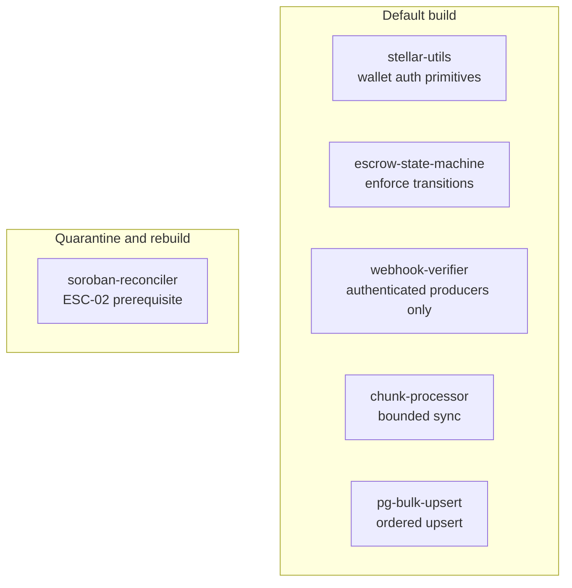
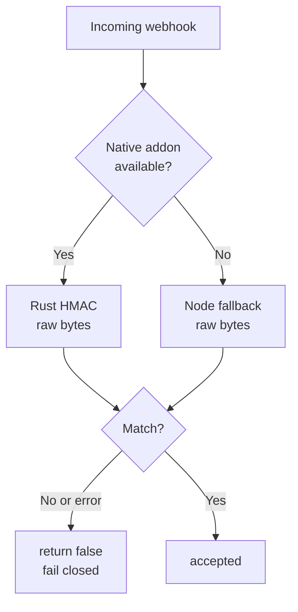

# Rust Crate Boundaries and Integration Quarantine

The Cargo workspace contains six functional Rust crates and one feature-gate
package. Five functional crates are included in the default webhook build;
`soroban-reconciler` is excluded until its prerequisites are resolved
(`zk-verifier` was removed in #763 and `x402-processor` was removed in #754).

This page records, for every crate, its responsibility, consumers, exports,
fallback, build artifact, and disposition. It is the ownership boundary for the
`crates/` workspace. For the high-level crate story, see
[Rust crates in SafeTrust](./rust-crates.md).

Five functional crates remain in the default build; `soroban-reconciler`
remains available behind an explicit, default-off Cargo feature gate.

---

## 1. Crate disposition map



---

## 2. Inventory

| Crate | Responsibility | Consumers |
|---|---|---|
| `stellar-utils` | Stellar strkey validation and Ed25519 signature verification. | `webhook/src/routes/auth/sync-wallet.handler.ts`. |
| `escrow-state-machine` | Canonical escrow status enum, transition table, and `getValidPriorStates()` filters. | `webhook/src/services/escrow.service.ts` (`executeEscrowLifecycleTransition`), `milestone.service.ts`, `webhook/src/lib/escrow-transitions.ts`. |
| `webhook-verifier` | Constant-time HMAC-SHA256 verification of Trustless Work callbacks. | Retired; no runtime consumers after polling became authoritative. |
| `chunk-processor` | Fetch Trustless Work indexer chunks concurrently on Tokio, bounded by a concurrency limit. | `webhook/src/lib/reconciliation.ts` (`syncAllChunks`), gated by `RUST_CHUNKS_ENABLED`. |
| `pg-bulk-upsert` | Fold a chunk of escrow rows into one ordered `INSERT … ON CONFLICT … UNNEST`. | `webhook/src/lib/reconciliation.ts` (`upsertEscrowBatch`), gated by `RUST_BULK_UPSERT_ENABLED`. |
| `soroban-reconciler` | Compare database escrow state with Soroban state and report drift. | `webhook/src/services/reconciliation.service.ts` (`validateSorobanDrift`), gated by `SOROBAN_VALIDATION_ENABLED`. |
| `x402 (TypeScript)` | Official `@x402/express`, `@x402/core`, and `@x402/stellar` packages protect escrow initialization. | `webhook/src/routes/escrows/initialize.route.ts`, gated by `X402_ENABLED`. |

| Crate | Native exports | Fallback when the addon is absent | Build script / deployment artifact |
|---|---|---|---|
| `stellar-utils` | `validateStellarAddress`, `verifyStellarEd25519` | JS regex `^G[A-Z2-7]{55}$` in `sync-wallet.handler.ts` (weaker; native path keeps CRC/version checks). | Default build + shared `scripts/copy-native.js`; artifact `crates/stellar-utils/native/index.node`. |
| `escrow-state-machine` | `validateTransition`, `getValidPriorStates`, `getTransitionTable`, `getGraphqlFilter` | JS transition table in `crates/escrow-state-machine/index.ts` (same eight rules). | Default build + shared `scripts/copy-native.js`; artifact `crates/escrow-state-machine/index.node`. |
| `webhook-verifier` | `verifyHmacSignature`, `validateStellarAddress` | `crates/webhook-verifier/fallback.ts` (Node `crypto`, same raw bytes, fail closed). | Default build + shared `scripts/copy-native.js`; artifact `crates/webhook-verifier/index.node`. |
| `chunk-processor` | `processChunksParallel` | Sequential JS chunk loop in `reconciliation.ts`. | Default build + shared `scripts/copy-native.js`; artifact `crates/chunk-processor/index.node`. |
| `pg-bulk-upsert` | `bulkUpsertEscrows` | Row-by-row `UPSERT_ESCROW_SQL` loop in `reconciliation.ts`. | Default build + shared `scripts/copy-native.js`; artifact `crates/pg-bulk-upsert/index.node`. |
| `soroban-reconciler` | `queryEscrowStateBatch`, `reconcileBatch` | **None.** The service logs and skips the contract; the reader is disabled by default (see §4). | Excluded from the default build. Opt in with `cargo build --manifest-path crates/Cargo.toml -p safetrust-native-gates --features soroban-reconciler` only after ESC-02; artifact is not copied into the default image. |
| `x402 (TypeScript)` | N/A (Node SDK) | Returns 402 with `PAYMENT-REQUIRED` when unpaid; 503 when disabled. | Built into TypeScript service dependencies (`@x402/*`). |

The workspace and optional dependency feature map are in
[`crates/Cargo.toml`](../../crates/Cargo.toml).
The production image runs `npm run build` in
[`webhook/Dockerfile`](../../webhook/Dockerfile), which builds only the default
members and copies only their runtime artifacts. `crates/**/*.node` and
`crates/**/native/` are build outputs and are intentionally git-ignored.

---

## 3. Disposition and rationale

### Retain and harden

- **`stellar-utils`** — retained. It is the authoritative wallet-address check
  used during auth; the JS regex is a degraded fallback only.
- **`escrow-state-machine`** — retained. It prevents illegal prior-state
  transitions in the reconciliation lifecycle service and is shared by the
  remaining escrow services. `disputed → cancelled` was added so the local
  table matches the database `valid_escrow_status` constraint.
- **`webhook-verifier`** — retained but retired from runtime use. The callback
  routes and their HMAC middleware were removed after polling became
  authoritative; the native and Node paths remain for tests and rollback. Both
  paths hash the same raw bytes and return `false` on every comparison error
  (see §5).
- **`chunk-processor`** — retained. It is an opt-in performance path with
  bounded concurrency and per-chunk timeouts; the sequential loop remains the
  default and the fallback.
- **`pg-bulk-upsert`** — retained. It mirrors the row-by-row SQL exactly and
  falls back on any error; it is opt-in.

### Quarantine and rebuild

- **`soroban-reconciler`** — quarantined. The current reader does not read
  contract storage; it fabricates state. The reader is disabled by default and
  the pure diff engine is retained (see §4). ESC-02 must establish an
  authoritative state source before it is re-enabled.

---

## 4. `soroban-reconciler`: validated read adapter & fabricated state removal

Security Review Finding F1 identified that `query_escrow_state()` previously
fabricated on-chain escrow state by returning hardcoded values (`ACTIVE`,
`1_000_000_000` stroops) whenever `getHealth` returned healthy, or for any `mock_`
or `test_` prefixed identifier. When `SOROBAN_VALIDATION_ENABLED=true` was set,
this drove automated mutations that corrupted database records.

Issue #659 completely removes fabricated responses and replaces them with a
validated read adapter:

- **Removal of fabrication:** `getHealth` alone never returns escrow state or
  triggers database updates. Node reachability does not establish contract state.
- **Prohibition of shortcuts:** Production code paths reject `mock_` and `test_`
  identifiers. Contract IDs must be valid 56-character base32 Stellar Contract
  StrKeys (`C...` format), verified via `stellar_strkey`.
- **Network identity verification:** The adapter validates network passphrases
  against canonical constants (`testnet` vs `mainnet`), rejecting cross-network
  queries.
- **Exact asset amounts:** All balances are parsed into exact integer Stroops
  (10^7 Stroops = 1 token unit). Float threshold comparisons (`.abs() > 0.0001`)
  are replaced with exact integer diffs.
- **Bounded timeouts:** All network calls have a strict 5-second timeout.
- **The "preserve last confirmed" rule:** When external sources are unavailable
  or return unrecognized shapes, last confirmed DB values are preserved and
  flagged as unresolved — never silently overwritten with defaults.
- **Automated corrections disabled:** Automatic database mutations are disabled
  by default (`SOROBAN_AUTO_CORRECT_ENABLED=false`).

For the full decision record, gap analysis between Trustless Work API and direct
Stellar RPC reads, and adapter validation boundary diagrams, see
[Reconciliation and Indexer Sync](../stellar/reconciliation.md).


---

## 5. `webhook-verifier`: raw-byte parity and fail-closed comparison



The removed callback middleware built the canonical payload as
`Buffer.concat([timestamp, ".", req.rawBody])`, so the digest covered the exact
request bytes. The native addon accepts a `Buffer`/`Uint8Array` (raw bytes) or a
string (UTF-8 encoded once); the Node fallback normalizes the same union to a
`Buffer`. This removes the previous mismatch where one path could hash a
JavaScript string while the other hashed bytes.

Every failure path returns `false`: empty secret, malformed signature,
length mismatch, unsupported payload type, and any exception during
comparison. Nothing throws across the boundary and nothing returns `true` on
error. The parity test
[`webhook-verifier-parity.test.ts`](../../webhook/src/lib/__tests__/webhook-verifier-parity.test.ts)
runs the same vectors through both implementations, including invalid UTF-8 and
a `Uint8Array` view, and asserts equal accept/reject results.

---

## 6. `x402`: official `@x402` Stellar integration and eligibility gate

x402 payments are managed by the official `@x402/express`, `@x402/core`, and `@x402/stellar` packages:

- `X402_ENABLED=false` is the default. The initialize route only evaluates
  x402 when the flag is exactly `true`.
- With x402 disabled, every request on the x402-gated routes fails closed with `503 Feature Unavailable`.
- When `X402_ENABLED=true`, unpaid requests receive `402 Payment Required`, and valid payment headers are verified and settled via the configured facilitator before the handler executes.
- The eligibility authority remains local escrow validation; reconciliation is authoritative for externally confirmed lifecycle state.

The x402 Karate suite runs with `X402_ENABLED=true` in the isolated test compose file to exercise the payment gate.

---

## 7. Circuit and prover sources

Noir circuit sources, proving keys, and prover scripts do **not** belong in the
Rust verification crate. (`crates/zk-verifier` was removed in #753). Keeping
any future circuit separate prevents a verifier change from silently changing
the statement being proven.

---

## 8. Removal policy

There are no removals in this change. A crate may only be removed after all of
the following are recorded in this document and the PR:

1. **Consumer audit** — every consumer listed above is either migrated or
   confirmed unused (`rg` over `webhook/src`, tests, and build scripts).
2. **Replacement contract** — the replacement's exports, input/output shape,
   and failure mode are documented.
3. **Equivalent supported behavior** — a test demonstrates the replacement
   handles the same vectors, including error paths.
4. **Build/deployment updates** — remove the member from `crates/Cargo.toml`,
   drop its shared `copy-native.js --crate=<name>` invocation from
   `webhook/package.json`, and remove its
   `COPY` lines from `webhook/Dockerfile`.
5. **Rollback path** — document how to restore the crate and rebuild the
   artifact, and test that rollback.

Artifacts are built from source on every image build, so a rollback is a revert
of the removal commit followed by a normal `npm run build`; no binary needs to
be restored from an untracked cache.

---

## 9. No new custom cryptography

This change adds no new signature, hash, or key-derivation construction. It
selects existing, vetted schemes only:

- HMAC-SHA256 from the RustCrypto `hmac`/`sha2` crates and Node's `crypto`;
- Ed25519 verification from `ed25519-dalek` and `stellar-strkey`;
- UltraHonk verification from the pinned Barretenberg release.

The rule for future work is the same: use an existing vetted scheme and a
pinned implementation. Do not invent a production signature or hash
construction, and do not add a crate to duplicate one that already exists.

---

## 10. Verification

Run these checks before changing a crate boundary:

```bash
# TypeScript + native helper sources
npm --prefix webhook run build:tooling
npm --prefix webhook run type-check

# Targeted Node regression tests (native addon must be built for parity/native suites)
npm --prefix webhook run build:rust
npm --prefix webhook test -- --runInBand webhook-verifier escrow-state-machine x402

# Rust ABI / pure-logic regression checks for the default build
cargo test --manifest-path crates/Cargo.toml
cargo build --release --manifest-path crates/Cargo.toml

# Default image smoke test (builds only default members inside the container)
docker build -t safetrust-webhook:verify -f webhook/Dockerfile .
```

Expected invariants:

- every crate still exports the symbols listed in §2;
- `verifyHmacSignature` accepts a valid signature and returns `false` for
  empty secrets, malformed signatures, and invalid UTF-8 mismatches;
- `validateTransition('disputed', 'cancelled', 'escrow.cancelled')` is `true`;
- `queryEscrowStateBatch` validates contract and network identity, rejecting
  `getHealth`-only responses, mock shortcuts, and wrong-network responses;

- no x402 payment can reach `initializeEscrowHandler` while
  `X402_ENABLED=false`.
