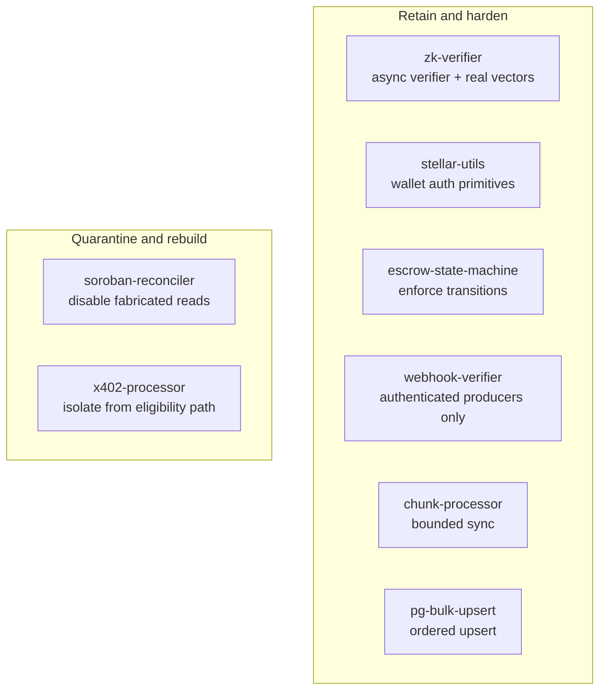
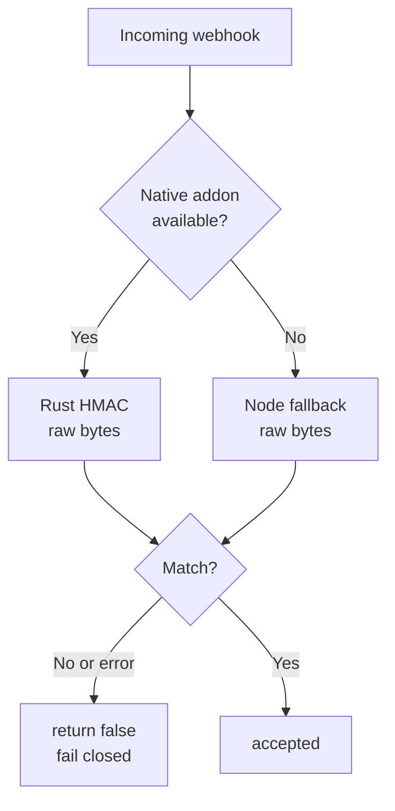
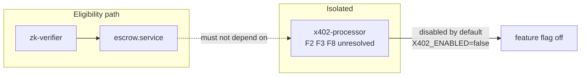

# Rust Crate Boundaries and Integration Quarantine

SafeTrust loads eight Rust crates into the Node.js webhook through Neon
(Node-API v6). They are not one product: some are small, well-tested
primitives, and two are incomplete integrations that must not be trusted with
production state yet.

This page records, for every crate, its responsibility, consumers, exports,
fallback, build artifact, and disposition. It is the ownership boundary for the
`crates/` workspace. For the high-level crate story, see
[Rust crates in SafeTrust](./rust-crates.md).

**No crate is deleted by this change.** Six crates are retained and hardened;
two are quarantined and remain buildable behind explicit, default-off gates.

---

## 1. Crate disposition map



---

## 2. Inventory

| Crate | Responsibility | Consumers |
|---|---|---|
| `zk-verifier` | Verify Noir UltraHonk proof-of-funds proofs with a pinned Barretenberg build. | `webhook/src/lib/zk-verifier.ts` → `initialize.handler.ts`, `escrow.service.ts`. |
| `stellar-utils` | Stellar strkey validation and Ed25519 signature verification. | `webhook/src/routes/auth/sync-wallet.handler.ts`. |
| `escrow-state-machine` | Canonical escrow status enum, transition table, and `getValidPriorStates()` filters. | `dispute.handler.ts`, `resolve-dispute.handler.ts`, `fund.handler.ts`, `milestone.service.ts`, `routes/index.ts`. |
| `webhook-verifier` | Constant-time HMAC-SHA256 verification of Trustless Work callbacks. | `webhook/src/middleware/trustlesswork-signature.middleware.ts`. |
| `chunk-processor` | Fetch Trustless Work indexer chunks concurrently on Tokio, bounded by a concurrency limit. | `webhook/src/lib/reconciliation.ts` (`syncAllChunks`), gated by `RUST_CHUNKS_ENABLED`. |
| `pg-bulk-upsert` | Fold a chunk of escrow rows into one ordered `INSERT … ON CONFLICT … UNNEST`. | `webhook/src/lib/reconciliation.ts` (`upsertEscrowBatch`), gated by `RUST_BULK_UPSERT_ENABLED`. |
| `soroban-reconciler` | Compare database escrow state with Soroban state and report drift. | `webhook/src/services/reconciliation.service.ts` (`validateSorobanDrift`), gated by `SOROBAN_VALIDATION_ENABLED`. |
| `x402-processor` | Parse `X-Payment` headers and verify them with an allowlisted facilitator. | `webhook/src/middleware/x402-payment.middleware.ts` → `initialize.route.ts`, gated by `X402_ENABLED`. |

| Crate | Native exports | Fallback when the addon is absent | Build script / deployment artifact |
|---|---|---|---|
| `zk-verifier` | `verifyProofOfFunds` | **None — fail closed.** `webhook/src/lib/zk-verifier.ts` throws `ZK_VERIFIER_UNAVAILABLE`, and the init handler returns `503`. | `npm run build:rust` → `cargo build --release --workspace` + `install-bb.js` + shared `scripts/copy-native.js`; artifact `crates/zk-verifier/index.node` and `bb`. |
| `stellar-utils` | `validateStellarAddress`, `verifyStellarEd25519` | JS regex `^G[A-Z2-7]{55}$` in `sync-wallet.handler.ts` (weaker; native path keeps CRC/version checks). | Same workspace build + shared `scripts/copy-native.js`; artifact `crates/stellar-utils/native/index.node`. |
| `escrow-state-machine` | `validateTransition`, `getValidPriorStates`, `getTransitionTable`, `getGraphqlFilter` | JS transition table in `crates/escrow-state-machine/index.ts` (same eight rules). | Workspace build + shared `scripts/copy-native.js`; artifact `crates/escrow-state-machine/index.node`. |
| `webhook-verifier` | `verifyHmacSignature`, `validateStellarAddress` | `crates/webhook-verifier/fallback.ts` (Node `crypto`, same raw bytes, fail closed). | Workspace build + shared `scripts/copy-native.js`; artifact `crates/webhook-verifier/index.node`. |
| `chunk-processor` | `processChunksParallel` | Sequential JS chunk loop in `reconciliation.ts`. | Workspace build + shared `scripts/copy-native.js`; artifact `crates/chunk-processor/index.node`. |
| `pg-bulk-upsert` | `bulkUpsertEscrows` | Row-by-row `UPSERT_ESCROW_SQL` loop in `reconciliation.ts`. | Workspace build + shared `scripts/copy-native.js`; artifact `crates/pg-bulk-upsert/index.node`. |
| `soroban-reconciler` | `queryEscrowStateBatch`, `reconcileBatch` | **None.** The service logs and skips the contract; the reader is disabled by default (see §4). | Workspace build + shared `scripts/copy-native.js`; artifact `crates/soroban-reconciler/native/index.node`. |
| `x402-processor` | `validateX402Payment`, `buildPaymentRequirement` | JS fallback in `crates/x402-processor/index.ts` never returns `is_valid: true`; it fails closed. | Workspace build + shared `scripts/copy-native.js`; artifact `crates/x402-processor/index.node`. |

The workspace manifest is [`crates/Cargo.toml`](../../crates/Cargo.toml). The
production image runs `npm run build` in [`webhook/Dockerfile`](../../webhook/Dockerfile),
which builds the whole workspace and copies each runtime artifact into the
final stage. `crates/**/*.node` and `crates/**/native/` are build outputs and
are intentionally git-ignored.

---

## 3. Disposition and rationale

### Retain and harden

- **`zk-verifier`** — retained. It performs a real UltraHonk verification with
  a pinned Barretenberg version and fails closed when the addon is unavailable.
  The verification key pin (`ZK_PROOF_OF_FUNDS_VK_SHA256`) is mandatory by
  default (exempt only in explicit development or test environments) to prevent circuit
  substitution attacks (see ADR-0001).
- **`stellar-utils`** — retained. It is the authoritative wallet-address check
  used during auth; the JS regex is a degraded fallback only.
- **`escrow-state-machine`** — retained. It prevents handlers from requesting
  an XDR for an illegal prior state and is shared by every escrow callback.
  `disputed → cancelled` was added so the local table matches the database
  `valid_escrow_status` constraint.
- **`webhook-verifier`** — retained. It is the authentication boundary for all
  Trustless Work callbacks. The native and Node paths now hash the same raw
  bytes and return `false` on every comparison error (see §5).
- **`chunk-processor`** — retained. It is an opt-in performance path with
  bounded concurrency and per-chunk timeouts; the sequential loop remains the
  default and the fallback.
- **`pg-bulk-upsert`** — retained. It mirrors the row-by-row SQL exactly and
  falls back on any error; it is opt-in.

### Quarantine and rebuild

- **`soroban-reconciler`** — quarantined. The current reader does not read
  contract storage; it fabricates state. The reader is disabled by default and
  the pure diff engine is retained (see §4).
- **`x402-processor`** — quarantined. Findings F2, F3, and F8 remain
  unresolved, and payment success must not grant booking eligibility. It is
  isolated from the eligibility path and settlement is default-off (see §6).

---

## 4. `soroban-reconciler`: validated read adapter & fabricated state removal

Security Review Finding F1 identified that `query_escrow_state()` previously
fabricated on-chain escrow state by returning hardcoded values (`ACTIVE`,
`1_000_000_000` stroops) whenever `getHealth` returned healthy, or for any `mock_`
or `test_` prefixed identifier. When `SOROBAN_VALIDATION_ENABLED=true` was set,
this drove automated mutations that corrupted database records.

Issue #659 completely removes fabricated responses and replaces them with a
validated read adapter:

- **Removal of fabrication:** `getHealth` alone never returns escrow state or
  triggers database updates. Node reachability does not establish contract state.
- **Prohibition of shortcuts:** Production code paths reject `mock_` and `test_`
  identifiers. Contract IDs must be valid 56-character base32 Stellar Contract
  StrKeys (`C...` format), verified via `stellar_strkey`.
- **Network identity verification:** The adapter validates network passphrases
  against canonical constants (`testnet` vs `mainnet`), rejecting cross-network
  queries.
- **Exact asset amounts:** All balances are parsed into exact integer Stroops
  (10^7 Stroops = 1 token unit). Float threshold comparisons (`.abs() > 0.0001`)
  are replaced with exact integer diffs.
- **Bounded timeouts:** All network calls have a strict 5-second timeout.
- **The "preserve last confirmed" rule:** When external sources are unavailable
  or return unrecognized shapes, last confirmed DB values are preserved and
  flagged as unresolved — never silently overwritten with defaults.
- **Automated corrections disabled:** Automatic database mutations are disabled
  by default (`SOROBAN_AUTO_CORRECT_ENABLED=false`).

For the full decision record, gap analysis between Trustless Work API and direct
Stellar RPC reads, and adapter validation boundary diagrams, see
[Escrow State Source](../stellar/escrow-state-source.md).


---

## 5. `webhook-verifier`: raw-byte parity and fail-closed comparison



The middleware builds the canonical payload as
`Buffer.concat([timestamp, ".", req.rawBody])`, so the digest covers the exact
request bytes. The native addon accepts a `Buffer`/`Uint8Array` (raw bytes) or a
string (UTF-8 encoded once); the Node fallback normalizes the same union to a
`Buffer`. This removes the previous mismatch where one path could hash a
JavaScript string while the other hashed bytes.

Every failure path returns `false`: empty secret, malformed signature,
length mismatch, unsupported payload type, and any exception during
comparison. Nothing throws across the boundary and nothing returns `true` on
error. The parity test
[`webhook-verifier-parity.test.ts`](../../webhook/src/lib/__tests__/webhook-verifier-parity.test.ts)
runs the same vectors through both implementations, including invalid UTF-8 and
a `Uint8Array` view, and asserts equal accept/reject results.

---

## 6. `x402-processor`: isolation from the eligibility path



`x402-processor` is not deleted, but it cannot grant eligibility:

- `X402_ENABLED=false` is the default. The initialize route only evaluates
  x402 when the flag is exactly `true`, and it lazy-loads the x402 middleware
  only on that path — so the default eligibility path never requires the
  `x402-processor` module or its native addon.
- With x402 disabled, a request carrying `X-Payment`,
  `X-Payment-Protocol`, or `X-Payment-Required` is **not** evaluated by x402;
  it must pass the Trustless Work HMAC check like any other callback.
- The middleware itself also fails closed with `503` if it is invoked while the
  flag is off, so a future route cannot accidentally mount it.
- `X402_SETTLE_ENABLED=false` is the default. A successful facilitator
  `/verify` does not trigger `/settle`. The current settlement task has no
  durable retry, idempotency record, or reconciliation, so it must not run in
  production until F2/F3/F8 are closed.
- The eligibility authority remains the HMAC-verified Trustless Work callback
  and the `zk-verifier` proof check. `escrow.service.ts` does not import
  `x402-processor`.

The x402 Karate suite runs with `X402_ENABLED=true` in the isolated test
compose file to exercise the payment gate; settlement stays disabled.

---

## 7. Circuit and prover sources

Noir circuit sources, proving keys, and prover scripts do **not** belong in the
Rust verification crate. They belong in a clearly documented circuit package
(for example a `zk/` directory in this repository or the separate
`safetrust-ZK` package). `crates/zk-verifier` contains only the verifier
binding and the pinned Barretenberg integration; it consumes artifacts, it does
not define the circuit. Keeping the two separate prevents a verifier change
from silently changing the statement being proven.

---

## 8. Removal policy

There are no removals in this change. A crate may only be removed after all of
the following are recorded in this document and the PR:

1. **Consumer audit** — every consumer listed above is either migrated or
   confirmed unused (`rg` over `webhook/src`, tests, and build scripts).
2. **Replacement contract** — the replacement's exports, input/output shape,
   and failure mode are documented.
3. **Equivalent supported behavior** — a test demonstrates the replacement
   handles the same vectors, including error paths.
4. **Build/deployment updates** — remove the member from `crates/Cargo.toml`,
   drop its shared `copy-native.js --crate=<name>` invocation from
   `webhook/package.json`, and remove its
   `COPY` lines from `webhook/Dockerfile`.
5. **Rollback path** — document how to restore the crate and rebuild the
   artifact, and test that rollback.

Artifacts are built from source on every image build, so a rollback is a revert
of the removal commit followed by a normal `npm run build`; no binary needs to
be restored from an untracked cache.

---

## 9. No new custom cryptography

This change adds no new signature, hash, or key-derivation construction. It
selects existing, vetted schemes only:

- HMAC-SHA256 from the RustCrypto `hmac`/`sha2` crates and Node's `crypto`;
- Ed25519 verification from `ed25519-dalek` and `stellar-strkey`;
- UltraHonk verification from the pinned Barretenberg release.

The rule for future work is the same: use an existing vetted scheme and a
pinned implementation. Do not invent a production signature or hash
construction, and do not add a crate to duplicate one that already exists.

---

## 10. Verification

Run these checks before changing a crate boundary:

```bash
# TypeScript + native helper sources
npm --prefix webhook run build:tooling
npm --prefix webhook run type-check

# Targeted Node regression tests (native addon must be built for parity/native suites)
npm --prefix webhook run build:rust
npm --prefix webhook test -- --runInBand webhook-verifier escrow-state-machine x402

# Rust ABI / pure-logic regression checks
cargo test --workspace --manifest-path crates/Cargo.toml
cargo build --release --workspace --manifest-path crates/Cargo.toml

# Full image smoke test (builds all eight addons inside the container)
docker build -t safetrust-webhook:verify -f webhook/Dockerfile .
```

Expected invariants:

- every crate still exports the symbols listed in §2;
- `verifyHmacSignature` accepts a valid signature and returns `false` for
  empty secrets, malformed signatures, and invalid UTF-8 mismatches;
- `validateTransition('disputed', 'cancelled', 'escrow.cancelled')` is `true`;
- `queryEscrowStateBatch` validates contract and network identity, rejecting
  `getHealth`-only responses, mock shortcuts, and wrong-network responses;

- no x402 payment can reach `initializeEscrowHandler` while
  `X402_ENABLED=false`.
