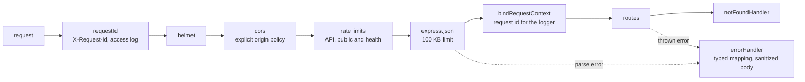

# Error Handling, Logging and CORS

How the webhook service classifies errors, what a client may see in an error
response, how logs are correlated with requests, and which browser origins may
call the API.

## Request pipeline



| File | Responsibility |
|---|---|
| `webhook/src/utils/errors.ts` | `AppError` hierarchy and `classifyError` |
| `webhook/src/middleware/error-handler.ts` | Global error handler and JSON 404 |
| `webhook/src/middleware/logger.ts` | Structured logger, request id and access log |
| `webhook/src/utils/response.ts` | Canonical response helpers, including `sendError` |
| `webhook/src/config/cors.ts` | CORS origin policy |

## Typed errors

Services and middleware throw `AppError` subclasses. The global error handler,
and `sendError` inside a handler, map them to a status:

| Class | Status | Code | Message to client |
|---|---|---|---|
| `ValidationError` | 400 | `validation_error` | its message |
| `AuthError` | 401 | `unauthorized` | its message |
| `ForbiddenError` | 403 | `forbidden` | its message |
| `NotFoundError` | 404 | `not_found` | its message |
| `ConflictError` | 409 | `conflict` | its message |
| `ServiceUnavailableError` | 503 | `service_unavailable` | `Service unavailable` |
| any other error | 500 | `internal_error` | `Internal server error` |

The existing domain errors are part of the hierarchy and keep their names, so
`instanceof` checks are unchanged: `EscrowNotFoundError`,
`ReservationNotFoundError` and `MilestoneNotFoundError` are `NotFoundError`s;
`StateConflictError`, `StaleStateError` and `EscrowStateConflictError` are
`ConflictError`s; and `TenantMismatchError` is a `ForbiddenError`.
`EscrowValidationError` and `MilestoneValidationError` keep their configurable
status. Each sets a specific code such as `escrow_not_found` or
`tenant_mismatch`.

Errors that body-parser raises before any route runs are classified too:
malformed JSON is `400 invalid_json`, an oversized body `413
payload_too_large`, and an unsupported encoding or charset `415`.

## What a client may see

Every error body has the shape `{ success: false, error, code?, requestId? }`.

- **4xx** bodies carry the error's message, which is written for the client.
- **5xx** bodies never carry `err.details`, `err.message`, a stack, or a
  database, Hasura or provider name. They carry a fixed message, the code, and
  the `requestId`. This holds even if a 5xx `AppError` is created with
  `expose: true`.
- The full error, including `details` and the stack, goes to the log under the
  same `requestId`. Quote the id from the response or the `X-Request-Id`
  header to find it.

`serverError()` and `serviceUnavailable()` enforce the 5xx rule: they keep only
the message string and code they are given, whatever else is passed.

### Moving handlers to the canonical helpers

`utils/response.ts` is the single response helper. Handlers move to it
incrementally, because the frontend may depend on the shapes they return
today. The escrow lifecycle and reconciliation handlers already use it. The
others (auth, wallets, apartments, bid requests, escrow claims, reservations,
and some middleware) still write their own shapes. Their 5xx bodies are
fixed strings with no internal detail. When you touch one of them, replace
`res.status(...).json(...)` with the matching helper, or throw an `AppError` and
let `sendError` or the global handler respond.

## Structured logs

`logger` writes one JSON object per line:

```json
{"time":"2026-11-15T03:12:44.120Z","level":"error","event":"escrow.fund.failed","requestId":"6f1c…","contractId":"CAAT…","error":{"name":"Error","message":"…","stack":"…"}}
```

- `event` is a stable dotted name (`<area>.<action>.<outcome>`), so you can
  search and alert on it. Variable data goes in fields, never in the event.
- `requestId` is added automatically inside a request. `bindRequestContext`
  stores it in `AsyncLocalStorage`, so services log with it too, without
  passing it down. It is mounted after the body parser because the parser
  resumes on stream events, which would lose the async context.
- Every response writes one `http.request` line with method, path (without the
  query string), status and `durationMs`. It is `warn` for 4xx and `error` for
  5xx.
- An incoming `X-Request-Id` is reused when it is 8–128 characters of
  `[A-Za-z0-9._:-]`, so ids from a proxy or the frontend carry through;
  otherwise a UUID is generated.
- `LOG_LEVEL` is `debug`, `info` (default), `warn`, `error` or `silent`.

Route handlers and middleware must not call `console.*` directly.
`routes/__tests__/structured-logging-boundary.test.ts` enforces this. Services
and libraries still use `console` in places and move to the logger
incrementally.

## Request-body handling

The JSON parser enforces a 100 KB request limit and does not retain a second raw
copy of request bodies. The old Trustless Work callback HMAC path was retired
with its callback routes; no active webhook route needs raw request bytes.

## CORS origin policy

CORS only affects browsers. TrustlessWork, the Hasura cron trigger and x402
agents send no `Origin` header and are unaffected; signatures and secrets
protect those routes.

| `CORS_ALLOWED_ORIGINS` | `NODE_ENV` | Allowed browser origins |
|---|---|---|
| comma-separated origins | any | exactly those origins |
| `*` | any | any origin (explicit opt-in, never the default) |
| unset | `production` | none (fails closed, warning logged at startup) |
| unset | anything else | `http(s)://localhost` and `127.0.0.1`, any port |

**Production must set `CORS_ALLOWED_ORIGINS` to the frontend's origin(s)**,
for example `https://app.safetrust.example`, plus any staging origin that calls
the production API. Each entry must be an exact `scheme://host[:port]` with no
path, and an invalid entry fails startup. The browser can read the
`X-Request-Id` response header (`exposedHeaders`). An origin that is not
allowed gets no CORS headers, so the browser blocks the response, and the
server still processes the request normally.
