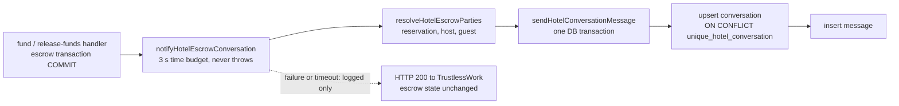

# Hotel Conversation Notifications

When a `hotel_industry` escrow is funded or its funds are released, the
TrustlessWork callback handlers post an automated message into the
reservation's host–guest conversation. This document describes how that
message is delivered and the guarantees it does and does not give.

## Delivery path

| File | Responsibility |
|---|---|
| `webhook/src/services/hotel-conversation-notify.ts` | Resolves the parties for a contract and enforces the time budget |
| `webhook/src/services/hotel-conversation.service.ts` | Shared, in-process conversation write; reuse it from any future internal caller |
| `webhook/src/repositories/hotel-conversation.repository.ts` | Idempotent conversation upsert and message insert |

The handlers call the notifier only after the escrow transaction has
committed. A failure or timeout is logged and the handler still returns
`200`, so the lifecycle response never depends on messaging. The tests in
`webhook/tests/notifications/` cover this for both handlers.

## Time budget

`NOTIFICATION_TIMEOUT_MS` (3 seconds) caps how long a handler waits for the
notification. The budget limits only the wait. It does not cancel the write,
whose transaction commits or rolls back on its own, so a slow write can still
land after the response is sent.

## Idempotent conversation creation

Conversations are unique on `(reservation_id, host_id, guest_id)`
(`unique_hotel_conversation`). The repository relies on that constraint with
`INSERT … ON CONFLICT ON CONSTRAINT unique_hotel_conversation DO UPDATE …
RETURNING id`, not a find-then-create in application code:

- Parallel deliveries for the same reservation get the same conversation id.
  The second transaction waits for the first and takes the conflict path.
- `DO UPDATE` is used instead of `DO NOTHING` because `RETURNING` then yields
  the id on the conflict path too. The update only fills a missing
  `escrow_transaction_id` and never changes existing values.
- The insert sets `host_id` and `guest_id`, which are `NOT NULL`. The previous
  Hasura mutation omitted them, so creating a conversation always failed.

The conversation upsert and the message insert run in one transaction, so a
message is never written without its conversation.

## Removed: internal self-HTTP endpoint and `INTERNAL_SERVICE_SECRET`

Lifecycle notifications used to `fetch` the webhook's own
`POST /api/hotel/conversations/send` endpoint, authenticated with the
`x-internal-secret` header and `INTERNAL_SERVICE_SECRET`. That call had no
timeout, and `docker-compose.yml` never passed the secret to the container,
so under Compose no notification was sent.

Now that the shared service is called in-process, the endpoint, its
`x-internal-secret` middleware and the `INTERNAL_SERVICE_SECRET` variable have
been removed. Deployments can delete the secret from their secret manager.
No caller outside the notifier was found in this repository. An external
service that relied on the endpoint now receives `401` from the Firebase-
authenticated `/api` routes and should call the API through a user session
instead.

## Delivery guarantee and when to strengthen it

Delivery is best effort: a message lost to a failure or timeout is not
retried. If reliable delivery becomes a requirement, the minimal addition is a
small durable notification record written in the same transaction as the
escrow transition, which a retrying worker sends and marks as delivered. This
is an outbox table, not a message broker.
