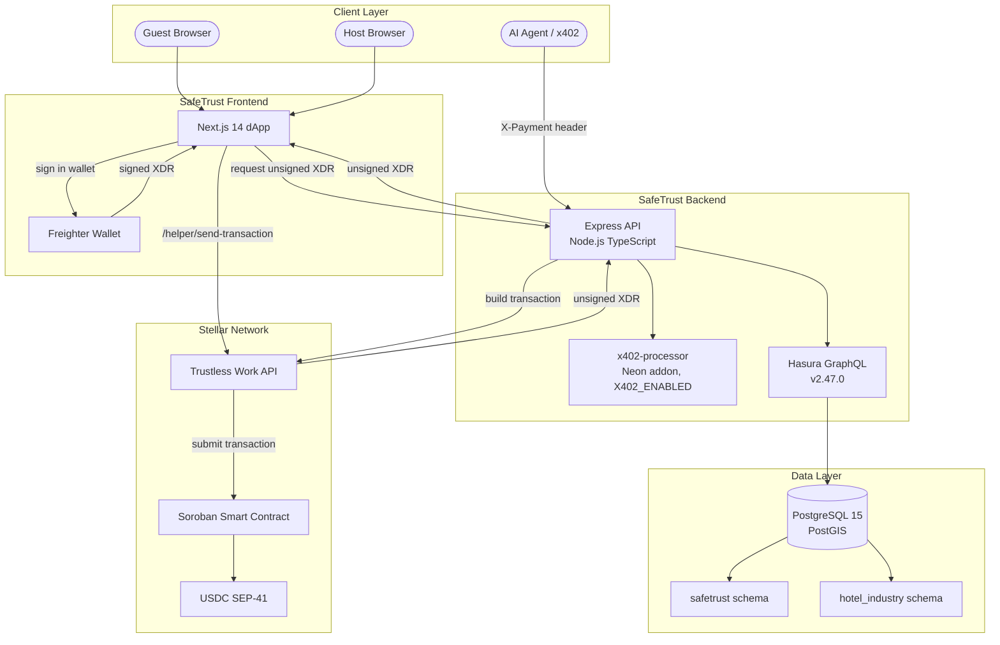
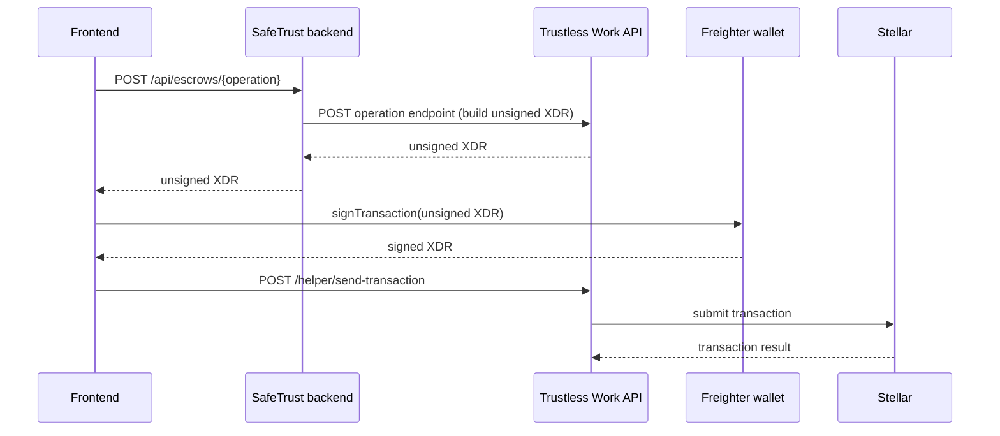
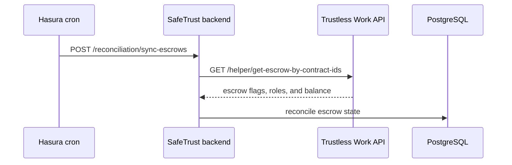
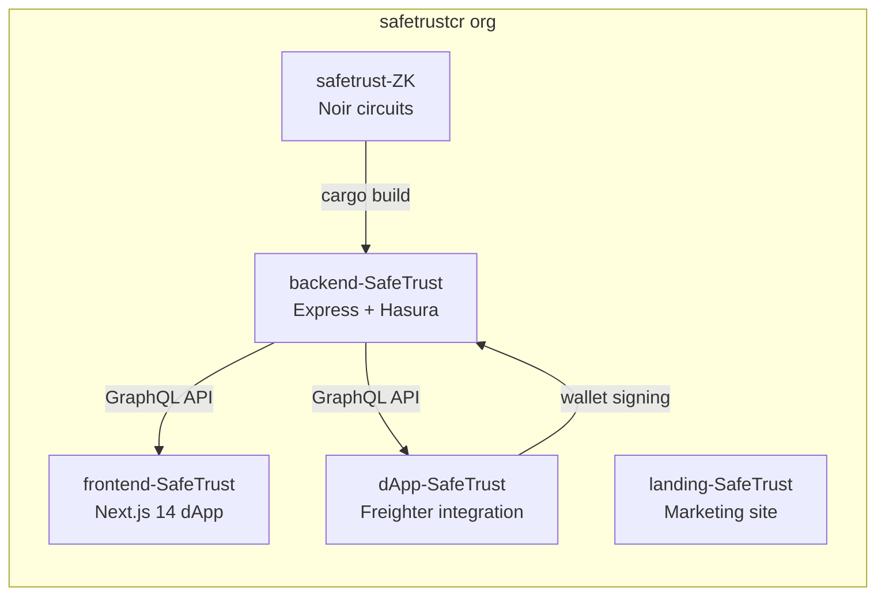

# SafeTrust Architecture Overview

> **Status: Planned — post-Issue-03 behavior.** This page documents the
> polling-based escrow flow planned by Issue 03. The route implementation in
> this checkout has not yet been migrated to this contract.

SafeTrust connects a Next.js frontend, an Express backend, Hasura, PostgreSQL,
and the Stellar blockchain through Trustless Work. The backend is TypeScript;
the only native code left is the quarantined `x402-processor` Neon addon (see
[Rust crates in SafeTrust](./rust-crates.md)).

## System diagram

## Frontend-managed signing and submission

For each escrow operation, the frontend requests an unsigned XDR from the
SafeTrust operation route. SafeTrust asks Trustless Work to build the
operation-specific transaction and returns the unsigned XDR. The connected
wallet signs it locally, and the frontend submits the signed XDR through
Trustless Work's `POST /helper/send-transaction`.

SafeTrust does not hold user private keys. A build response or wallet signature
alone does not mean that an escrow state transition has completed.

## Reconciliation and transaction confirmation

Trustless Work has no webhooks. SafeTrust learns the state of client-submitted
escrow operations through scheduled reconciliation. The Hasura cron trigger
calls `POST /reconciliation/sync-escrows`; SafeTrust polls the V1 indexer and
reconciles escrow state from the returned flags and balance.

For transactions SafeTrust itself submits, the backend confirms the transaction
result before applying the corresponding local state change. The five wallet
flows documented here submit through Trustless Work from the frontend, so
SafeTrust learns their results through reconciliation polling. The indexer's
status and field mapping, including its snapshot-freshness limitation, is
documented in [Reconciliation and Indexer Sync](../stellar/reconciliation.md).

## Who calls what

SafeTrust no longer exposes operation-specific `POST /api/escrows/fund`,
`approve-milestone`, `release-funds`, `dispute` or `resolve-dispute` endpoints.
Those routes, and the corresponding Trustless Work callbacks that used to feed
them, were removed when polling became the only sync source.

The current flow is:

- **The frontend calls Trustless Work directly** to build and submit escrow
  transactions — fund, approve milestone, release, dispute, resolve dispute —
  using the Trustless Work `/escrow/{single-release|multi-release}/…` build
  endpoints and `POST /helper/send-transaction` to broadcast the signed XDR.
- **SafeTrust learns the result through reconciliation.** The sync-escrows
  job polls Trustless Work (`GET /helper/get-escrow-by-contract-ids`) and
  reconciles indexed escrow state into Postgres; there are no inbound
  webhooks from Trustless Work any more.

See [`sync-escrows`](../webhook/src/routes/sync-escrows) for the polling
implementation.

## Repository structure

