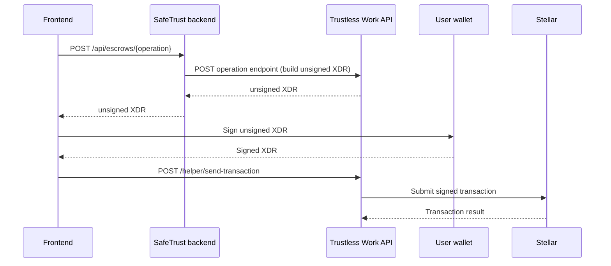

# SafeTrust Architecture Overview

> **Status: Planned — post-Issue-03 behavior.** This document describes the
> polling-based escrow flow intended by Issue 03. The route implementation in
> this checkout has not yet been migrated to this contract.

SafeTrust uses the frontend and backend to prepare escrow transactions, the
user's wallet to sign them, and Trustless Work to submit them to Stellar. The
backend reconciles escrow state from the Trustless Work V1 indexer; it does not
depend on event delivery from Trustless Work.

## Escrow transaction flow

The backend's SafeTrust route validates the request and asks Trustless Work to
build the operation-specific unsigned XDR. The frontend returns that XDR to
the connected wallet for signing, then submits the signed XDR to
`POST /helper/send-transaction`. SafeTrust never receives the user's private
key.

## State reconciliation

Trustless Work has no webhooks. SafeTrust learns the resulting escrow state
from the V1 indexer using the scheduled reconciliation flow:

The cron route polls tracked contract IDs. Trustless Work's flags and balance
are used to derive the escrow state and update SafeTrust's local record.
See [Trustless Work Indexer](../stellar/trustless-work-indexer.md) for request
parameters, status mapping, and field mapping.

For transactions that SafeTrust itself submits, SafeTrust confirms the
transaction result before applying the corresponding local state change. The
five wallet flows in this documentation are client-signed and submitted via
Trustless Work, so their resulting escrow state is learned through indexer
reconciliation.

## Route map

The SafeTrust routes below are the frontend-facing transaction-build routes
specified for Issue 03. The Trustless Work path is selected according to the
escrow type; paths shown here are REST paths relative to the configured
Trustless Work API base URL.

| Operation | SafeTrust route | Trustless Work build endpoint |
|---|---|---|
| Fund | `POST /api/escrows/fund` | `POST /escrow/{single-release\|multi-release}/fund-escrow` |
| Approve milestone | `POST /api/escrows/approve-milestone` | `POST /escrow/{single-release\|multi-release}/approve-milestone` |
| Release | `POST /api/escrows/release-funds` | `POST /escrow/single-release/release-funds` or `POST /escrow/multi-release/release-milestone-funds` |
| Dispute | `POST /api/escrows/dispute` | `POST /escrow/single-release/dispute-escrow` or `POST /escrow/multi-release/dispute-milestone` |
| Resolve | `POST /api/escrows/resolve-dispute` | `POST /escrow/single-release/resolve-dispute` or `POST /escrow/multi-release/resolve-milestone-dispute` |

All five wallet flows submit signed XDR through Trustless Work's
`POST /helper/send-transaction`. SafeTrust's scheduled reconciliation reads
updated state through `GET /helper/get-escrow-by-contract-ids`.
