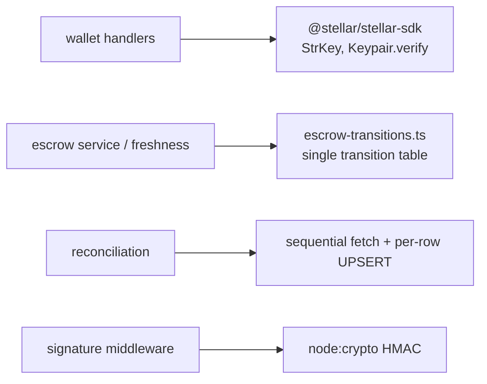

# Rust crates in SafeTrust

One Rust crate remains: `x402-processor`, a Neon addon that parses x402
payment headers and verifies them with an allowlisted facilitator. It is
quarantined behind `X402_ENABLED=false` and is due to be replaced by the
official x402 client (issue 05).

> For the consumer list, fallback, deployment artifact, and the record of each
> removal, see [Crate Boundaries](./crate-boundaries.md).
> For the per-crate consumer list, fallback, deployment artifact, and
> retain/quarantine decision, see [Crate Boundaries](./crate-boundaries.md).
> `soroban-reconciler` is currently quarantined behind a default-off gate.

## What replaced the other crates

The other six crates were replaced with TypeScript in #755. None did work that
needs native code at SafeTrust's scale: reconciliation reads at most 50
escrows per indexer request, once every 15 minutes.



| Former crate | Now |
| --- | --- |
| `stellar-utils` | `webhook/src/lib/stellar-wallet.ts` on `@stellar/stellar-sdk` |
| `escrow-state-machine` | `webhook/src/lib/escrow-transitions.ts` |
| `webhook-verifier` | `webhook/src/lib/hmac-signature.ts` on `node:crypto` |
| `chunk-processor` | Deleted; reconciliation fetches chunks in turn |
| `pg-bulk-upsert` | Deleted; reconciliation writes one UPSERT per escrow |
| `soroban-reconciler` | Deleted; it was off by default and its reader fabricated state |

### Why the parallel and bulk paths were deleted, not ported

Both were opt-in (`RUST_CHUNKS_ENABLED`, `RUST_BULK_UPSERT_ENABLED`, off by
default), so production already ran the sequential fetch and the per-row
UPSERT. Reconciliation runs every 15 minutes over chunks of 50 escrows, which
that default path handles easily. The per-row UPSERT also has a database-level
test (`reconciliation.repository.integration.test.ts`). If parallel fetching is
ever needed, a bounded `Promise.all` over chunks is enough.

### Fewer test failure modes

Node caches a native addon per process, outside Jest's module registry, so a
real addon loaded in one test file bypassed the mocks in another (the
intermittent `wallet-challenge.handler.test` failure fixed in #748). Plain
TypeScript modules have no such failure mode, and the test suite no longer
needs a Rust toolchain except for `x402-processor.test.ts`.
flowchart LR
    subgraph node["Node.js Event Loop"]
        express["Express Handler\nTypeScript"]
        ffi["Neon binding\nrequires crate"]
    end

    subgraph rust["Rust Crates"]
        webhook["webhook-verifier\nHMAC-SHA256\nconstant-time comparison"]
        stellar["stellar-utils\nStellar address validation\nEd25519 address check"]
        chunks["chunk-processor\nTokio HTTP\nTrustlessWork chunks"]
        pg["pg-bulk-upsert\nUNNEST batch SQL\ntokio-postgres"]
        soroban["soroban-reconciler\nSoroban RPC client\ndrift detection"]
        escrow["escrow-state-machine\ntransition table\nstatus enforcement"]
    end

    express --> ffi
    ffi --> webhook
    ffi --> stellar
    ffi --> chunks
    ffi --> pg
    ffi --> soroban
    ffi --> escrow
```

## Crate responsibilities

The Rust layer is organized around six functional crates under the `crates/` tree. Each crate is exposed to the Node.js runtime through a Neon binding and is used only where the native implementation is materially safer or faster than a plain JavaScript version. (x402 payments are implemented via official `@x402` Stellar packages in TypeScript).

| Crate                | Purpose                       | Key dependency                    | Env gate                     |
| -------------------- | ----------------------------- | --------------------------------- | ---------------------------- |
| `webhook-verifier`   | HMAC-SHA256 webhook signature | `hmac`, `constant_time_eq`        | always on                    |
| `stellar-utils`      | Stellar address validation    | `stellar-strkey`, `ed25519-dalek` | always on                    |
| `chunk-processor`    | Parallel TrustlessWork HTTP   | `tokio`, `reqwest`, `futures`     | `RUST_CHUNKS_ENABLED`        |
| `pg-bulk-upsert`     | UNNEST batch upsert           | `tokio-postgres`                  | `RUST_BULK_UPSERT_ENABLED`   |
| `soroban-reconciler` | Soroban RPC drift detection   | `ureq`, `serde`, `stellar-strkey` | `SOROBAN_VALIDATION_ENABLED` (validated read adapter; auto-correct default-off) |
| `escrow-state-machine` | Escrow transition table    | `serde`, `neon`                   | always on                    |

## How they fit the platform

- `webhook-verifier` protects webhook integrity by verifying HMAC signatures in constant time before the request is trusted.
- `stellar-utils` guards addresses and keys before they are used in any decode or contract call path.
- `chunk-processor` splits large TrustlessWork fetches into independent async tasks so Node does not stall while HTTP data is processed.
- `pg-bulk-upsert` moves the costly, repetitive insert/update path into a bulk SQL operation that is much more efficient than row-by-row JavaScript writes.
- `soroban-reconciler` compares on-chain state and local state with Soroban RPC data, identifying drift or missed reconciliation events.
- `escrow-state-machine` supplies the canonical status enum and transition table, so handlers reject illegal status changes before requesting an XDR.

## Summary

Rust is not being added to the project for novelty. It is being used in exactly the places where JavaScript is weakest: signing validation, high-throughput async work, and blockchain-native binary parsing. The result is a safer backend with better runtime guarantees and more predictable performance under load.
