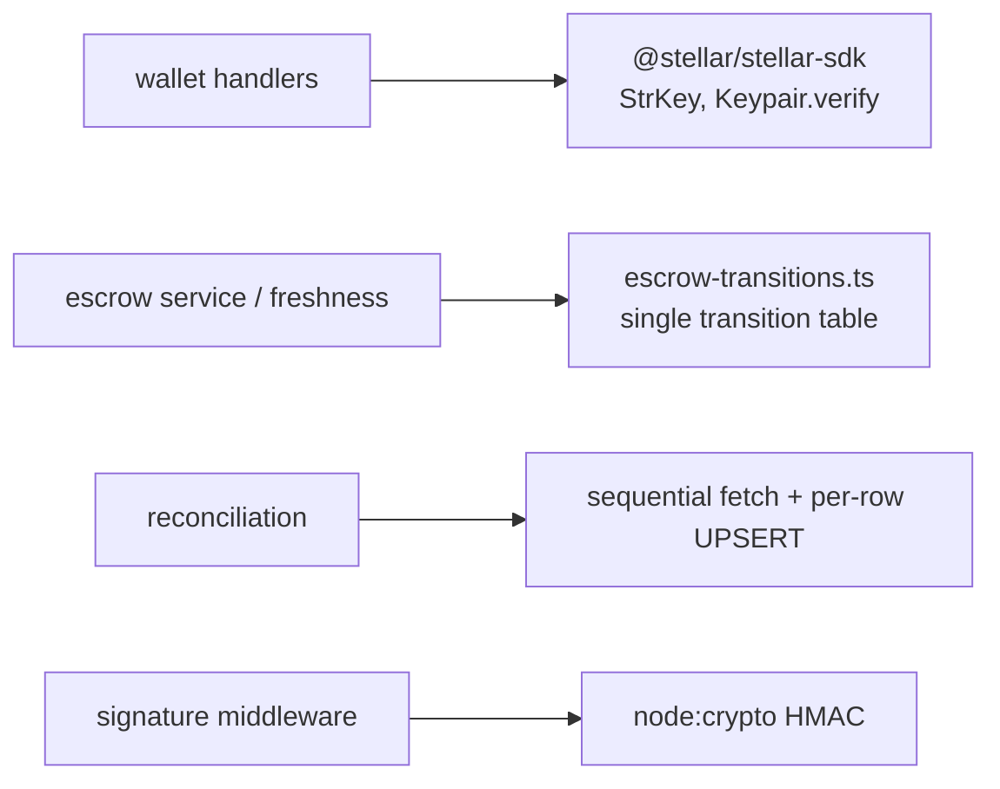

# Rust crates in SafeTrust

No Rust crate remains. The last one, `x402-processor`, was replaced with the
official `@x402/express`, `@x402/core`, and `@x402/stellar` packages in
#767; x402 stays behind `X402_ENABLED=false` by default.

> For the consumer list, fallback, deployment artifact, and the record of each
> removal, see [Crate Boundaries](./crate-boundaries.md).

## What replaced the crates

The other six crates were replaced with TypeScript in #755. None did work that
needs native code at SafeTrust's scale: reconciliation reads at most 50
escrows per indexer request, once every 15 minutes.

| Former crate | Now |
| --- | --- |
| `x402-processor` | `webhook/src/config/x402.ts` on the official `@x402` packages (#767) |
| `stellar-utils` | `webhook/src/lib/stellar-wallet.ts` on `@stellar/stellar-sdk` |
| `escrow-state-machine` | `webhook/src/lib/escrow-transitions.ts` |
| `webhook-verifier` | `webhook/src/lib/hmac-signature.ts` on `node:crypto` |
| `chunk-processor` | Deleted; reconciliation fetches chunks in turn |
| `pg-bulk-upsert` | Deleted; reconciliation writes one UPSERT per escrow |
| `soroban-reconciler` | Deleted; it was off by default and its reader fabricated state |

### Why the parallel and bulk paths were deleted, not ported

Both were opt-in (`RUST_CHUNKS_ENABLED`, `RUST_BULK_UPSERT_ENABLED`, off by
default), so production already ran the sequential fetch and the per-row
UPSERT. Reconciliation runs every 15 minutes over chunks of 50 escrows, which
that default path handles easily. The per-row UPSERT also has a database-level
test (`reconciliation.repository.integration.test.ts`). If parallel fetching is
ever needed, a bounded `Promise.all` over chunks is enough.

### Fewer test failure modes

Node caches a native addon per process, outside Jest's module registry, so a
real addon loaded in one test file bypassed the mocks in another (the
intermittent `wallet-challenge.handler.test` failure fixed in #748). Plain
TypeScript modules have no such failure mode, and the test suite no longer
needs a Rust toolchain.
