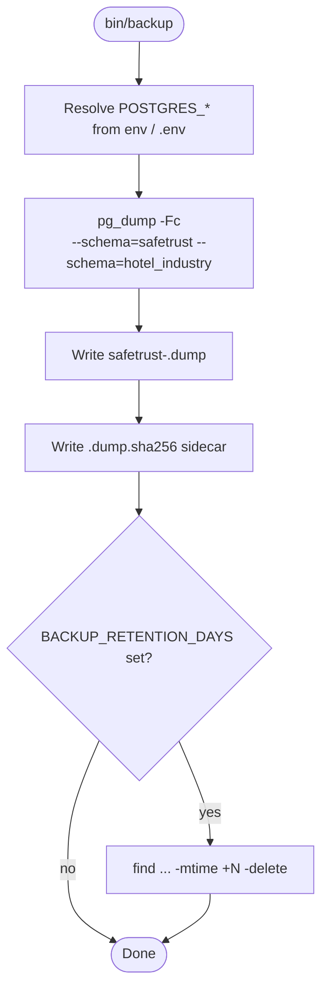

# Backups

SafeTrust runs a single PostgreSQL 15 + PostGIS instance. Both tenants
(`safetrust` and `hotel_industry`) live as schemas in one physical database, so
a single logical dump covers both. This document describes how backups are
taken, protected, retained, and restored.

## Flow



## What is backed up

A logical dump of every table in both tenant schemas:

```bash
pg_dump -Fc --no-owner --schema=safetrust --schema=hotel_industry \
  -f "$BACKUP_DIR/safetrust-<UTC timestamp>.dump"
```

- `-Fc` produces PostgreSQL's custom archive format, which is compressed and
  can be restored selectively with `pg_restore`.
- `--no-owner` keeps the dump portable, so it can be restored by a different
  database user or role.
- `--schema=safetrust --schema=hotel_industry` limits the dump to the two
  tenant schemas and excludes PostGIS system objects that the managed engine
  recreates on its own.
- `bin/backup` uses `date -u +%Y%m%dT%H%M%SZ` for a UTC, sortable filename.

## Backup cadence and frequency

Two options are acceptable; at least one must be in force:

1. **Managed automatic backups (preferred in production).** Run PostgreSQL on a
   managed provider that takes continuous backups with point-in-time recovery
   (PITR). Confirm that PITR is enabled and that the retention window matches
   the policy below. This protects against both operator error and storage
   failure without any scheduled job in this repository.
2. **Daily logical backups.** Schedule `bin/backup` once a day (for example a
   cron entry or a CI scheduled workflow) and ship the resulting `*.dump` and
   `*.dump.sha256` off-host. A logical dump is also the tool of choice for
   local and staging environments.

A daily dump is a *last-resort* artifact. When PITR is available, use it for
recovery and treat the dumps as an additional safety net.

## Encryption

Backups contain personal and financial data, so treat every dump as
confidential:

- **At rest.** Store dumps on an encrypted volume or in a storage bucket with
  server-side encryption and a restricted access policy. Never leave a dump on
  a shared or unencrypted filesystem. Enable encryption on the provider's
  managed-backup storage as well.
- **In transit.** Health checks and application traffic use `sslmode`; the same
  discipline applies to backups. `pg_dump`/`pg_restore` should connect with TLS
  (`sslmode=require` or stricter, via `PGSSLMODE`) whenever the database is not
  on a trusted local network. Replication and snapshot shipping must also use
  TLS. To relocate a dump, transfer it over an encrypted channel (SSH, `scp`,
  or an HTTPS-capable object store) and verify its `.sha256` sidecar after the
  transfer.

A `.sha256` sidecar is written next to each dump by `bin/backup` so integrity
can be checked before a restore (see below). Checksums verify integrity, not
confidentiality — encryption is still required.

## Retention policy

A rolling scheme keeps recent recovery points while bounding storage:

- **7 daily** backups.
- **4 weekly** backups (for example one kept per week for a month).

Managed automatic backups should use the provider's equivalent retention
window. For logical dumps, set `BACKUP_RETENTION_DAYS` and let `bin/backup`
prune automatically:

```bash
# Keep ~7 days of daily dumps in ./backups
BACKUP_RETENTION_DAYS=7 bin/backup
```

When set to a positive integer, `bin/backup` deletes `*.dump` and matching
`*.dump.sha256` files older than that many days in `BACKUP_DIR` using
`find ... -mtime +N -delete`. Values that are not a positive integer are
ignored with a warning. Promoting daily dumps to a separate weekly tier is
outside the script and should be handled by the storage lifecycle policy.

## Who can restore

Restore requires:

- Access to the target database as `POSTGRES_USER` (default `postgres`), the
  database owner. `pg_restore --clean` drops and recreates objects, so a
  least-privilege role without ownership cannot restore successfully.
- The `POSTGRES_PASSWORD` for that role, provided via `.env` or the
  environment. It is never committed and must come from the cloud secret
  manager in production.
- Read access to the dump and its `.sha256` sidecar.

Because `pg_restore` uses `--clean --if-exists`, the operator must explicitly
confirm the target is not production by setting `ALLOW_RESTORE=yes`. Restoring
is intentionally a deliberate, two-signal action: the dump path *and* the
confirmation flag.

## Restore procedure

Use `bin/restore`. It resolves the same `POSTGRES_*` variables as `bin/backup`,
verifies the `.sha256` sidecar when present, and refuses to run unless
`ALLOW_RESTORE=yes`:

```bash
# Verify and restore a dump into a NON-production database
ALLOW_RESTORE=yes bin/restore ./backups/safetrust-20261128T120000Z.dump
```

Under the hood:

```bash
pg_restore --no-owner --clean --if-exists -d "$PGDATABASE" "$dump_path"
```

- If a `<dump>.sha256` sidecar exists, `sha256sum -c` (or `shasum -a 256 -c`)
  verifies it first; the restore is refused on mismatch.
- If no sidecar is present, a warning is printed and verification is skipped.
- `--clean --if-exists` drops existing objects in the target before recreating
  them, so the target's current data is replaced.

After a restore, bring the stack back up and re-run the automated checks:

```bash
bin/start safetrust hotel_industry
bin/test
```

`bin/start` reapplies migrations, metadata, and seeds (idempotently) so Hasura
and the webhook see the restored schema and data.

## Restore drill (recorded in the hardening PR)

The restore path is verified by restoring a fresh dump into an *empty* stack and
then running the API tests against it. Run this against a throwaway
environment only — it is destructive by design.

```bash
# 1. Produce a backup of the running stack.
POSTGRES_PASSWORD="$POSTGRES_PASSWORD" bin/backup
#    → ./backups/safetrust-<TIMESTAMP>.dump + .sha256

# 2. Reset the stack to a clean, empty database.
bin/start --reset safetrust hotel_industry

# 3. Restore the dump into the empty stack.
ALLOW_RESTORE=yes bin/restore ./backups/safetrust-<TIMESTAMP>.dump

# 4. Bring the stack up against the restored data and run the tests.
bin/start safetrust hotel_industry
bin/test
```

What to expect:

- Step 1 prints the dump and checksum paths and exits 0.
- Step 3 verifies the `.sha256` sidecar, prints `✅ Restore complete.`, and
  exits 0. A tampered dump exits non-zero with a checksum-mismatch error.
- Step 4's `bin/test` passes, demonstrating that a dump taken from the running
  stack restores into an empty stack and satisfies the same test suite.

Record the exact commands and their output in the hardening PR. If the drill is
run against a managed database instead of the local Compose stack, replace step
2 with a fresh empty database and keep steps 1, 3, and 4 unchanged.
