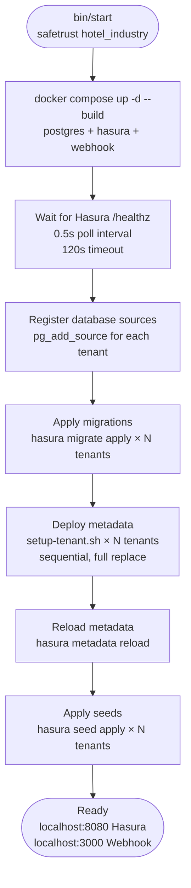

# bin/start

## Flow

Metadata deploys are sequential because each deploy assembles the server's
current metadata plus that tenant's source and applies it with a full
`replace_metadata`. Inside the deploy step, `deploy-tenant.sh` validates
`hasura migrate status` before applying permissions/relationships, then verifies
`get_inconsistent_metadata` and representative guest/host operations after the
apply.

## Prerequisites
- Docker
- hasura CLI
- yq

## Usage

- `bin/start safetrust` vs `bin/start safetrust hotel_industry`
- `bin/start --reset safetrust hotel_industry` — full teardown and fresh start
- `bin/start --restart safetrust hotel_industry` — recreate containers while preserving volumes
- `TRACK_SAFETRUST_TIMINGS=true` output format

## Common failures and fixes
- Port 5433 already in use
- Hasura health timeout
- Seed duplicate key errors
