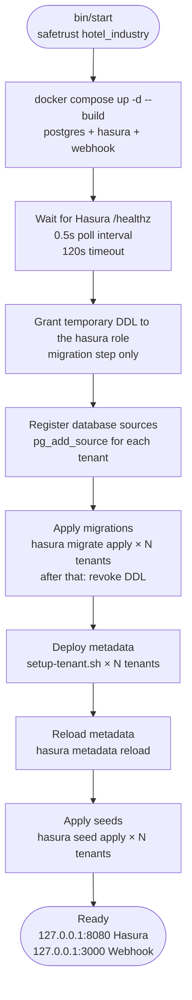

# bin/start

## Flow


## Prerequisites
- Docker
- hasura CLI
- yq
- `.env` created from `.env.example` — `POSTGRES_PASSWORD`,
  `HASURA_DB_PASSWORD`, `HASURA_METADATA_DB_PASSWORD` and `WEBHOOK_DB_PASSWORD`
  are required and have no defaults.

## Usage

- `bin/start safetrust` vs `bin/start safetrust hotel_industry`
- `bin/start --reset safetrust hotel_industry` — full teardown and fresh start
- `bin/start --restart safetrust hotel_industry` — recreate containers while preserving volumes
- `TRACK_SAFETRUST_TIMINGS=true` output format

## Ports
Nothing in `docker-compose.yml` is published on all host interfaces.

| Service | Binding | Notes |
| --- | --- | --- |
| Postgres | not published | `docker compose exec postgres psql -U postgres` |
| Hasura | `127.0.0.1:${HASURA_PORT:-8080}` | reverse proxy / platform exposes it |
| Webhook | `127.0.0.1:${WEBHOOK_PORT:-3000}` | reverse proxy / platform exposes it |

Local tools that need Postgres can copy `docker-compose.override.example.yml`
to `docker-compose.override.yml` (git-ignored); it publishes
`127.0.0.1:${POSTGRES_PORT:-5433}` only. `docker-compose-test.yml` binds every
port — including the Hasura console on 9696 — to `127.0.0.1`.

## Database roles
`docker/postgres/init/01-init-roles.sh` runs once, as the postgres superuser,
when the data directory is empty (it is mounted at
`/docker-entrypoint-initdb.d`). On an existing volume, re-run it:

```bash
docker compose exec -T postgres bash /docker-entrypoint-initdb.d/01-init-roles.sh
```

| Role | Used by | Rights |
| --- | --- | --- |
| `postgres` | migrations only (`bin/start`, `migrate-test`) | superuser, never used by a running service |
| `hasura` | Hasura data source | `USAGE` + table privileges on the `safetrust` and `hotel_industry` schemas; no superuser, no access to the catalog database |
| `hasura_metadata` | Hasura metadata | owns the separate `hasura_metadata` database |
| `webhook` | webhook | `SELECT/INSERT/UPDATE/DELETE` on `safetrust`; no `CREATE`, no `TRUNCATE`, no `COPY … PROGRAM` |

Migrations run through the Hasura data source, so they need DDL. `bin/start`
grants `CREATE` on the tenant schemas (and on `public`, where legacy migrations
stage tables before moving them) immediately before the migration step and
revokes it immediately after — the running service keeps only `USAGE` and DML.
New tables inherit the webhook grants through `ALTER DEFAULT PRIVILEGES`; the
tables moved out of `public` are covered by migration
`1779400000000_grant_webhook_role`.

`bin/test` runs `tests/db/assert-webhook-role.sh` (compose service
`db-privileges`) after migrations; it fails the suite if the webhook role can
`CREATE TABLE`, create a schema, drop/truncate a table, or run
`COPY … PROGRAM`.

## Secrets
Required variables (no defaults, so a missing value fails fast):

- `POSTGRES_PASSWORD` — admin/migration role
- `HASURA_DB_PASSWORD` — `hasura` role
- `HASURA_METADATA_DB_PASSWORD` — `hasura_metadata` role
- `WEBHOOK_DB_PASSWORD` — `webhook` role
- `HASURA_GRAPHQL_ADMIN_SECRET` — Hasura admin secret

Use URL-safe passwords: they are embedded in connection URLs.

For production, prefer file-backed secrets — they are not visible to
`docker inspect` or to every process in the container:

```bash
mkdir -p secrets
install -m 0400 /secure/firebase_private_key secrets/firebase_private_key
install -m 0400 /secure/trustlesswork_api_key secrets/trustlesswork_api_key
install -m 0400 /secure/webhook_db_password secrets/webhook_db_password
cp docker-compose.secrets.example.yml docker-compose.secrets.yml   # git-ignored
docker compose -f docker-compose.yml -f docker-compose.secrets.yml up -d
```

The webhook reads `FIREBASE_PRIVATE_KEY_FILE`, `TRUSTLESS_WORK_API_KEY_FILE`
(and the `TRUSTLESSWORK_API_KEY_FILE` spelling used by Compose) and
`POSTGRES_PASSWORD_FILE`; the official Postgres image reads
`POSTGRES_PASSWORD_FILE` the same way. Plain variables still work for local
development.

## Logs
Every service uses the `json-file` driver with `max-size: 10m` and
`max-file: 5`. Hasura logs `startup, http-log, webhook-log` by default —
`query-log` is off because it writes every GraphQL query and its variables
(emails, phone numbers, wallet addresses) to the log. Enable it per run with
`HASURA_GRAPHQL_ENABLED_LOG_TYPES="startup, http-log, webhook-log, query-log"`.

## Common failures and fixes
- Port already in use — Hasura/webhook bind 127.0.0.1; check `HASURA_PORT` /
  `WEBHOOK_PORT`
- `POSTGRES_PASSWORD is required` — copy `.env.example` to `.env`
- `role "webhook" does not exist` on an existing volume — re-run the init script
  shown above
- Hasura health timeout
- Seed duplicate key errors
