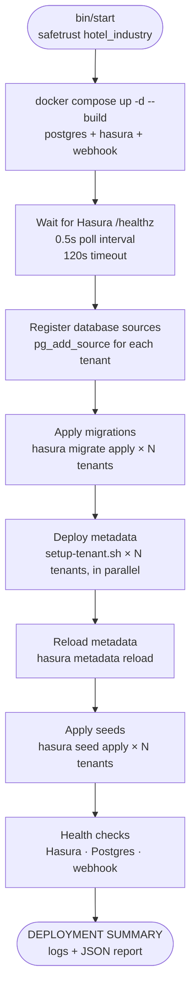

# bin/start

## Flow


## Prerequisites
- Bash 4.3 or newer (on macOS: `brew install bash`)
- Docker with Compose v2
- hasura CLI
- `curl`, `jq`, `yq`

`bin/start` checks for these before it starts anything and names any that are
missing.

## Usage

```bash
bin/start safetrust                              # one tenant
bin/start safetrust hotel_industry               # both tenants
bin/start --reset safetrust hotel_industry       # remove volumes, start fresh
bin/start --restart safetrust hotel_industry     # recreate containers, keep data
bin/start --verbose safetrust hotel_industry     # also print full metadata logs
```

`--restart` skips migrations and seeds. `--reset` and `--restart` cannot be
combined. An unknown tenant name fails before any container starts.

## Deployment summary

Every run ends with one summary covering all tenants, including runs that fail
or are interrupted with Ctrl+C:

```text
════════════════════════════════════════════════════════════════════════
  DEPLOYMENT SUMMARY — ✅ all tenants ready
════════════════════════════════════════════════════════════════════════
  Tenant            Migrations    Metadata       Seeds       Total   Status
  ────────────────────────────────────────────────────────────────────────
  safetrust               1.9s       24.4s        1.3s       27.8s   ✅ ready
  hotel_industry          1.4s       21.2s        1.3s       24.1s   ✅ ready
  ────────────────────────────────────────────────────────────────────────
  Shared steps       containers 15.3s · Hasura health 0.0s · sources 0.1s · metadata reload 1.7s
  Metadata deploy    24.4s wall-clock for 45.7s of work across 2 tenants (parallel)
  Total time         48.1s
  Logs               tests/results/bin-start/20261114-230449/
  Report             tests/results/bin-start-report.json
  ────────────────────────────────────────────────────────────────────────
  Health
    Hasura           ✅ healthy · ✅ metadata consistent
    PostgreSQL       ✅ accepting connections (localhost:5433)
    Webhook          ✅ live · ⚠️  not ready: firebase unavailable (HTTP 503)
    safetrust        23 tables · 14 with select perms · 16 relationships · 7 functions · 6 function perms
    hotel_industry   14 tables · 4 with select perms · 13 relationships · 2 functions · 4 function perms
════════════════════════════════════════════════════════════════════════
```

- **Tenant rows**: time per phase. `skipped` means `--restart` skipped the
  phase, `FAILED` marks the step that failed, `STOPPED` a step cut short by
  Ctrl+C, and `-` a step that was never reached.
- **Metadata deploy**: tenants deploy in parallel, so the wall-clock time is
  shorter than the sum of the per-tenant times.
- **Health**: checks never fail the run; they report what is running. Hasura
  must report no inconsistent metadata objects. The tenant lines count what
  Hasura actually has, so a permission that was never applied shows up here.
  The webhook line names any dependency `/health/ready` reports as down; with
  empty `FIREBASE_*` values in `.env`, `firebase` is expected to be down.

## Logs and reports

| Path | Contents |
|---|---|
| `tests/results/bin-start/<run-id>/` | One log per tenant and phase (`<tenant>-migrations.log`, `<tenant>-metadata.log`, `<tenant>-seeds.log`, `metadata-reload.log`). The last 10 runs are kept. |
| `tests/results/bin-start-report.json` | The last run: status, exit code, failed phase, per-phase and per-tenant durations in milliseconds, Hasura counts per tenant, and health results. |
| `tests/results/dc-prep-timings.json` | Legacy cumulative timings, in whole seconds, read by the `@timing` Karate feature. Written only by a successful `bin/start safetrust`. |

The metadata deploy prints one line per tenant. Its full output goes to the
tenant's log, and is printed with `--verbose`. When a tenant fails, the last 30
lines of its log are printed automatically.

```bash
jq '{status, failed_phase, total_ms, tenants: (.tenants | map_values(.total_ms))}' \
  tests/results/bin-start-report.json
```

## Common failures and fixes
- **Port 5433 already in use**: set `POSTGRES_PORT` in `.env`.
- **Hasura health timeout**: the summary shows `failed during: hasura_health`
  and the last 20 `graphql-engine` log lines are printed. Check
  `docker compose logs graphql-engine`.
- **Failed to register source**: the error from Hasura is printed. Usually a
  wrong `HASURA_ADMIN_SECRET` or an unreachable `PG_DATABASE_URL`.
- **Metadata deployment failed**: the tail of `<tenant>-metadata.log` is
  printed; Hasura's error names the table, role and column at fault.
- **Seed errors**: the summary shows `failed in seeds` for the tenant; the full
  error is in `<tenant>-seeds.log`.
- **Untrack obsolete PostGIS system tables**: on existing environments that previously tracked `geography_columns`, `geometry_columns`, and `spatial_ref_sys`, untrack them with `pg_untrack_table`:
  ```bash
  for tbl in geography_columns geometry_columns spatial_ref_sys; do
    echo "Untracking public.$tbl..."
    curl -fsS --fail-with-body -X POST "${HASURA_ENDPOINT:-http://localhost:8080}/v1/metadata" \
      -H "X-Hasura-Admin-Secret: ${HASURA_ADMIN_SECRET}" \
      -H "Content-Type: application/json" \
      -d "{\"type\":\"pg_untrack_table\",\"args\":{\"table\":{\"name\":\"$tbl\",\"schema\":\"public\"},\"source\":\"safetrust\",\"cascade\":false}}" || {
        echo "Failed to untrack public.$tbl. If dependent objects exist, review and resolve them before retrying." >&2
        break
      }
  done
  ```
  If Hasura reports dependent objects when `cascade` is `false`, review and resolve those dependencies before retrying the untrack.

  > [!WARNING]
  > Alternatively, `bin/start --reset safetrust` starts fresh from clean volumes. Note that `--reset` removes **all** stack Docker volumes, deleting data across all tenants (including `hotel_industry`). Only use `--reset` when all volume data can safely be discarded.
