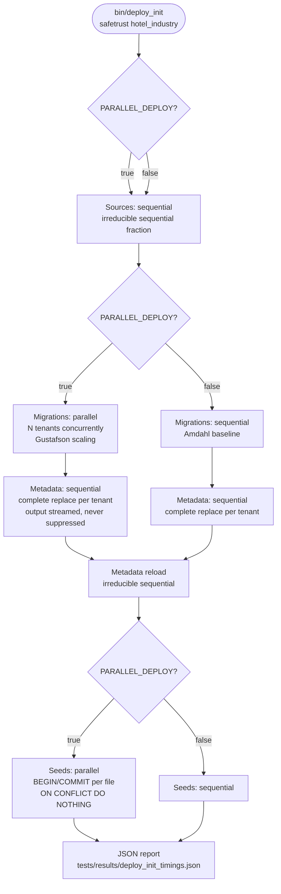

# bin/deploy_init

## Flow

## Gustafson's Law applied to SafeTrust

`S(N) = s + p×N`
where:
- `s` = sequential fraction (sources + metadata + metadata reload)
- `p` = parallel fraction (migrations + seeds)
- `N` = number of tenants

Metadata is deliberately sequential. Each tenant deploy exports the server's
current metadata and applies a full `replace_metadata` document; running those
concurrently would let one tenant's replace erase another tenant's source.
Similarly, `setup-tenant.sh` output is no longer redirected to `/dev/null`, so a
failed metadata apply or reload is visible in CI and deployment logs.

Example measurements:
- N=1 (sequential baseline): ~45s
- N=2 (parallel): ~28s → 1.61× speedup, ~80% efficiency
- N=5 (parallel): ~18s → 2.50× speedup, 50% efficiency

## USE_INIT_SQL=true fast path
- `hasura migrate apply`: ~8s (15+ subprocess calls)
- `psql init.sql`: ~1s (1 transaction)
- Saving: ~7s per tenant

Because `init.sql` runs through `psql` instead of the Hasura CLI, the fast path
follows it with `hasura migrate apply --skip-execution --up all` to record the
versions in Hasura's migration catalog. `deploy-tenant.sh` validates
`hasura migrate status` before applying metadata, so without that step the fast
path would correctly refuse to deploy.

## When to use each tool

| Situation | Use |
| --- | --- |
| First time setup | `bin/start safetrust hotel_industry` |
| Code changed, keep DB | `bin/start --restart safetrust hotel_industry` |
| Full reset | `bin/start --reset safetrust hotel_industry` |
| Benchmark N tenants | `bin/deploy_init safetrust hotel_industry` |
| Measure parallel vs sequential | `PARALLEL_DEPLOY=false bin/deploy_init ...` |
| Test init.sql fast path | `USE_INIT_SQL=true bin/deploy_init ...` |
