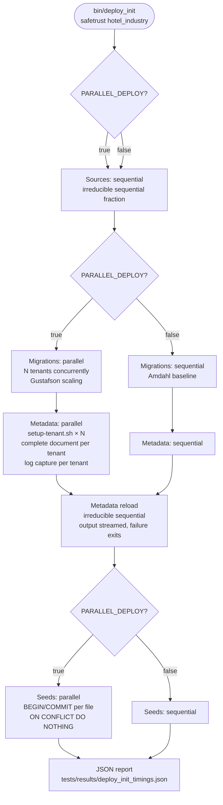

# bin/deploy_init

## Flow


## Gustafson's Law applied to SafeTrust

`S(N) = s + p×N`
where:
- `s` = sequential fraction (sources + metadata reload)
- `p` = parallel fraction (migrations + metadata + seeds)
- `N` = number of tenants

Example measurements:
- N=1 (sequential baseline): ~45s
- N=2 (parallel): ~28s → 1.61× speedup, ~80% efficiency
- N=5 (parallel): ~18s → 2.50× speedup, 50% efficiency

## USE_INIT_SQL=true fast path
- `hasura migrate apply`: ~8s (15+ subprocess calls)
- `psql init.sql`: ~1s (1 transaction)
- Saving: ~7s per tenant

## When to use each tool

| Situation | Use |
| --- | --- |
| First time setup | `bin/start safetrust hotel_industry` |
| Code changed, keep DB | `bin/start --restart safetrust hotel_industry` |
| Full reset | `bin/start --reset safetrust hotel_industry` |
| Benchmark N tenants | `bin/deploy_init safetrust hotel_industry` |
| Measure parallel vs sequential | `PARALLEL_DEPLOY=false bin/deploy_init ...` |
| Test init.sql fast path | `USE_INIT_SQL=true bin/deploy_init ...` |

## Output and failures

`bin/deploy_init` streams `setup-tenant.sh`, migration, and metadata reload
output instead of suppressing it. A non-zero status fails the run, so CI logs
show the actual Hasura error rather than a misleading success line.

Source registration checks the HTTP status as well as the response body:
`curl` exits 0 on a 4xx/5xx response, so a gateway error such as `503
{"message":"Service Unavailable"}` would otherwise look like a registered
source. `already exists` responses still count as success so re-runs stay
idempotent.

Metadata deployment now applies a complete document per tenant and takes a
per-endpoint lock, so parallel tenants preserve each other's sources and shared
metadata. See [Metadata deployment](metadata-deployment.md).

## Cloud endpoints

The script defaults to `http://localhost:8080` (or `http://localhost:$HASURA_PORT`
when only the port is set). An explicit `HASURA_ENDPOINT` overrides that
default, so the example below deploys to the Cloud project. There is no
implicit Cloud fallback:

```bash
HASURA_ENDPOINT=https://<project>.hasura.app \
HASURA_GRAPHQL_ADMIN_SECRET=... \
bin/deploy_init safetrust
```
