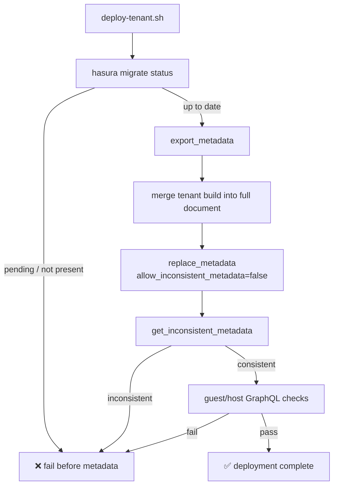

# Metadata deployment

## What `metadata/deploy-tenant.sh` applies

`metadata/deploy-tenant.sh` deploys a tenant's **complete** metadata document:

- the PostgreSQL source definition,
- every table YAML file, including
  - `configuration` (custom names, column config, custom root fields),
  - `select_permissions`, `insert_permissions`, `update_permissions`, and
    `delete_permissions`,
  - `object_relationships` and `array_relationships`,
  - `event_triggers`,
- every function YAML file, including function permissions.

It does **not** stop after registering tracked tables and functions.

## Why the old flow drifted

The previous deployer skipped any table or function that Hasura already
reported as tracked. A table tracked during the first deployment therefore
never received later YAML changes: adding a permission, changing a
relationship, or updating table configuration had no effect on re-deploy.

The current flow exports the endpoint's complete metadata, merges the tenant's
built definitions into it, and replaces the document atomically. Already-
tracked objects are updated, not skipped. Re-running with unchanged YAML
produces the same document and is idempotent.

A table or function defined in YAML **replaces** its exported counterpart
wholesale instead of being deep-merged into it. Removing a `select_permissions`
entry, a relationship, an event trigger, or a `configuration` key from YAML
therefore removes it on the endpoint on the next deploy — revoking access in
the YAML takes effect, which a recursive merge would silently keep alive.

## Deployment sequence



1. **Migration gate** — `hasura migrate status --database-name <tenant>` runs
   first. If any migration is `Pending` or `Not Present`, deployment stops
   before metadata is touched. Applying permissions to a table that has not
   been migrated produces inconsistent metadata.
2. **Export** — `export_metadata` captures all sources, shared metadata
   (`actions`, `cron_triggers`, and so on), and every tenant.
3. **Merge** — the tenant's source, tables, and functions from
   `metadata/build/<tenant>/` replace their counterparts (each table/function
   entry is replaced in full, never merged key by key). Tables/functions not
   defined for this tenant are preserved, and every other source plus all
   shared metadata stays in the document.
4. **Replace** — `replace_metadata` is called with
   `allow_inconsistent_metadata: false`. A failed API response is reported with
   the operation name and server body; the endpoint keeps its previous
   metadata.
5. **Consistency** — `get_inconsistent_metadata` must return
   `is_consistent: true` with no objects. Anything else fails the deployment.
6. **Role verification** — the script introspects the schema as each
   representative role (`guest` and `host` by default), then runs a real
   `limit: 0` query against a field visible to that role that accepts `limit`
   and returns an object type (scalar and action fields are skipped, since a
   selection set would not be valid on them). This exercises role permissions
   rather than relying only on admin introspection.

## Multi-tenant preservation

`replace_metadata` replaces the whole document. Deploying a single tenant's
old metadata directory would delete the other tenant's source and shared
metadata. The merge step prevents that:

- the document starts from the endpoint's exported metadata,
- only the target source is replaced,
- all other sources and shared metadata are left intact,
- whole-document replacements are serialized with a per-endpoint lock, so two
  parallel tenant deploys cannot export the same stale state and overwrite each
  other.

## Local deployment

Defaults stay local:

```bash
# Build and deploy one tenant
metadata/setup-tenant.sh safetrust

# Or build once, then deploy directly
metadata/build-metadata.sh safetrust
metadata/deploy-tenant.sh safetrust --endpoint http://localhost:8080
```

The admin secret is read from `HASURA_GRAPHQL_ADMIN_SECRET` by default. It is
never echoed. `--admin-secret` remains available for local use.

## Hasura Cloud / remote deployment

Remote targets require an explicit endpoint. There is no implicit Cloud
fallback, and local defaults are unchanged.

```bash
export HASURA_GRAPHQL_ADMIN_SECRET='<cloud-admin-secret>'

metadata/build-metadata.sh safetrust
metadata/deploy-tenant.sh safetrust \
  --endpoint https://<project>.hasura.app
```

Or with the wrapper:

```bash
HASURA_GRAPHQL_ADMIN_SECRET='<cloud-admin-secret>' \
  metadata/setup-tenant.sh safetrust \
  --endpoint https://<project>.hasura.app
```

Before a Cloud deployment, ensure the target database has all migrations
applied. The deployer refuses to continue otherwise. Do not put the admin
secret in command output, issue text, or committed files.

## Role verification controls

```bash
# Default
metadata/deploy-tenant.sh safetrust

# Custom representative roles
HASURA_VERIFY_ROLES="guest host admin" metadata/deploy-tenant.sh safetrust

# Disable role checks explicitly (not recommended for production deploys)
HASURA_VERIFY_ROLES="" metadata/deploy-tenant.sh safetrust
```

A role with no queryable fields fails the deployment, because it cannot
represent a working permission set. Use a role set that reflects the
deployment's real consumers.

## Failure behavior

The deployer fails loudly when:

- `hasura migrate status` cannot be read or reports pending migrations,
- source/table/function YAML cannot be read,
- `export_metadata`, `replace_metadata`, or `get_inconsistent_metadata`
  returns a non-2xx response or an `error` body,
- metadata is inconsistent after replacement,
- a representative role schema or query fails.

`bin/deploy_init` streams `setup-tenant.sh` and `hasura metadata reload` output
instead of redirecting it to `/dev/null`, and fails the run on non-zero status.

## Tests

The deployment logic is covered by a stub-driven test suite that needs no
Docker, Hasura, or `yq`:

```bash
metadata/tests/deploy-tenant.test.sh
```

Coverage includes:

- omitted permissions/relationships/event triggers applied on a fresh deploy,
- changed configuration/permissions/relationships applied on re-deploy,
- keys removed from YAML (permissions, relationships, event triggers,
  configuration) removed on re-deploy,
- unchanged re-run idempotency,
- failed `replace_metadata` diagnostics,
- pending migration gating,
- inconsistent metadata detection,
- role-verification failure handling,
- multi-tenant source/shared-metadata preservation.
