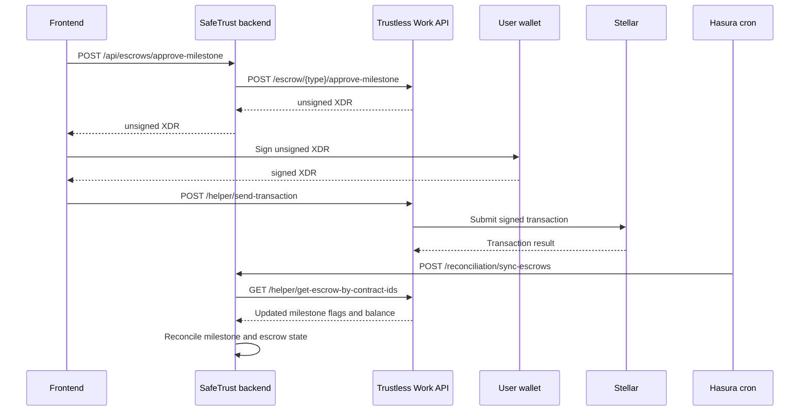

# Approve Milestone

> **Status: Planned — post-Issue-03 behavior.** This is the intended
> polling-based flow; the route implementation in this checkout has not yet
> been migrated to it.

The frontend requests an unsigned milestone-approval transaction from SafeTrust.
The user signs it in their wallet, Trustless Work submits it, and SafeTrust
reconciles the approved milestone from the V1 indexer.

## Sequence

## Routes and state updates

1. The frontend calls SafeTrust `POST /api/escrows/approve-milestone` with the
   contract and milestone details.
2. SafeTrust requests an unsigned XDR from Trustless Work:
   - Single-release: `POST /escrow/single-release/approve-milestone`
   - Multi-release: `POST /escrow/multi-release/approve-milestone`
3. The frontend signs the XDR in the authorized user's wallet and submits it
   through Trustless Work's `POST /helper/send-transaction`.
4. SafeTrust's scheduled `POST /reconciliation/sync-escrows` reads the
   contract using `GET /helper/get-escrow-by-contract-ids`. The indexer's
   milestone flags and balance are the evidence used to reconcile the local
   state.

The unsigned XDR response is not an approval. An approval is reflected only
after the submitted transaction is visible to the indexer and reconciliation
updates SafeTrust. See [Trustless Work Indexer](./trustless-work-indexer.md)
for how milestone flags map to local state.
