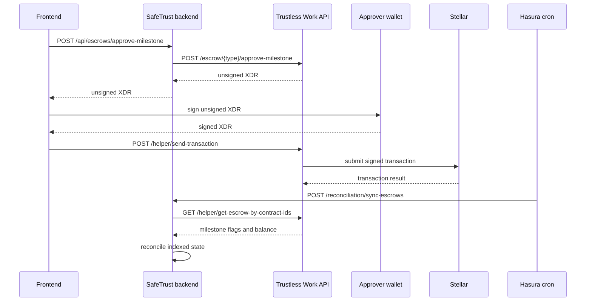

# Approve Milestone

> **Status:** the TrustlessWork `approve-milestone` callback was removed.
> Reconciliation polling at `POST /reconciliation/sync-escrows` can record the
> escrow-level `milestone_approved` status, but it does not update
> `escrow_milestones` rows (approved status, approver, approval timestamp) or
> mirror `checked_in`/`checked_out` to reservations. The client-facing XDR flow
> below is the intended post-Issue-03 integration; its SafeTrust routes are not
> present in this checkout.

The frontend requests an unsigned milestone-approval transaction from SafeTrust.
The authorized user signs it in their wallet, Trustless Work submits it to
Stellar, and SafeTrust reads the resulting milestone flags through indexer
reconciliation.

## Sequence

## Routes and state

1. The frontend calls SafeTrust `POST /api/escrows/approve-milestone` with the
   contract and milestone details.
2. SafeTrust requests an unsigned XDR from Trustless Work:
   - Single-release: `POST /escrow/single-release/approve-milestone`
   - Multi-release: `POST /escrow/multi-release/approve-milestone`
3. The frontend signs the XDR in the authorized user's wallet and submits it
   through `POST /helper/send-transaction`.
4. SafeTrust's scheduled `POST /reconciliation/sync-escrows` reads the
   contract using `GET /helper/get-escrow-by-contract-ids`. The indexer's
   milestone flags and balance determine the observed state.

For single-release escrows, an approved milestone flag derives
`milestone_approved`. For multi-release escrows, any approved or released
milestone derives `milestone_approved`. Reconciliation applies only legal
local-to-observed transitions and checks the observed ledger sequence against
the stored one when available. The V1 indexer snapshot is unversioned, so
polling cannot safely advance an already funded escrow to this state without a
version token or transaction confirmation. See
[Trustless Work Indexer](./trustless-work-indexer.md).
