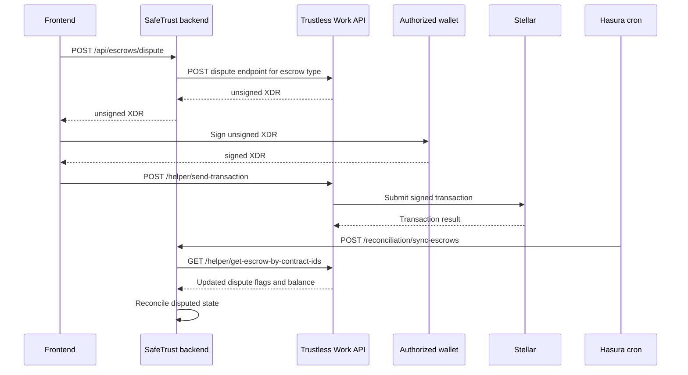
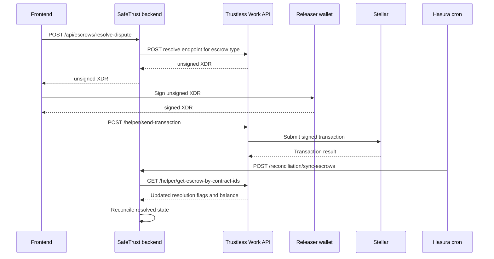

# Dispute and Resolve

> **Status: Planned — post-Issue-03 behavior.** This is the intended
> polling-based flow; the route implementation in this checkout has not yet
> been migrated to it.

A dispute or its resolution is a Stellar transaction, not a local status
update. SafeTrust requests the unsigned XDR, the authorized wallet signs it,
and Trustless Work submits it. SafeTrust learns the resulting state through
indexer reconciliation.

## Raise a dispute

The frontend calls SafeTrust `POST /api/escrows/dispute`. SafeTrust builds the
unsigned XDR using:

- Single-release: `POST /escrow/single-release/dispute-escrow`
- Multi-release milestone: `POST /escrow/multi-release/dispute-milestone`

The frontend signs the XDR and submits it to Trustless Work's
`POST /helper/send-transaction`. The local state becomes disputed only after
the V1 indexer reports the dispute and reconciliation applies that result.

## Resolve a dispute

The frontend calls SafeTrust `POST /api/escrows/resolve-dispute`. SafeTrust
builds the unsigned XDR using:

- Single-release: `POST /escrow/single-release/resolve-dispute`
- Multi-release milestone: `POST /escrow/multi-release/resolve-milestone-dispute`

The Releaser wallet signs the transaction, and the frontend submits it using
`POST /helper/send-transaction`. SafeTrust learns the outcome from
`POST /reconciliation/sync-escrows`, which polls
`GET /helper/get-escrow-by-contract-ids`. Resolution is persisted only after
the indexer reflects the on-chain result.

See [Trustless Work Indexer](./trustless-work-indexer.md) for status derivation
from flags and balance.
