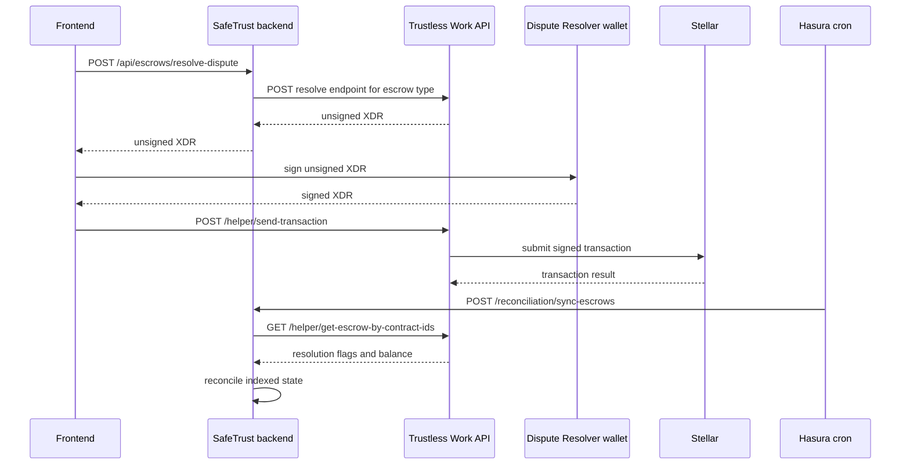

# Dispute and Resolve

> **Status:** the TrustlessWork `dispute` and `resolve-dispute` callbacks were
> removed. Reconciliation polling at `POST /reconciliation/sync-escrows` now
> applies the `disputed` and `resolved` transitions. The client-facing XDR flow
> below is the intended post-Issue-03 integration; its SafeTrust routes are not
> present in this checkout.

A dispute or its resolution is an on-chain transaction, not a local status
update. SafeTrust builds an unsigned XDR through Trustless Work and returns it
to the frontend. The authorized wallet signs it, and the frontend submits it
through Trustless Work. SafeTrust learns the indexed result through
reconciliation, subject to the indexer's freshness rules.

## Raise a dispute

The frontend calls SafeTrust `POST /api/escrows/dispute`. SafeTrust requests
the unsigned XDR from Trustless Work using:

- Single-release: `POST /escrow/single-release/dispute-escrow`
- Multi-release milestone: `POST /escrow/multi-release/dispute-milestone`

The frontend signs the XDR with the authorized wallet and submits it using
`POST /helper/send-transaction`. `flags.disputed` derives the `disputed`
state. Reconciliation polling applies the `disputed` transition when the
observed ledger sequence is newer than the stored one; an unversioned snapshot
cannot safely advance a funded escrow on its own. See
[Trustless Work Indexer](./trustless-work-indexer.md).

## Resolve a dispute

The frontend calls SafeTrust `POST /api/escrows/resolve-dispute`. SafeTrust
builds the unsigned XDR with:

- Single-release: `POST /escrow/single-release/resolve-dispute`
- Multi-release milestone: `POST /escrow/multi-release/resolve-milestone-dispute`

The **Dispute Resolver** wallet signs the resolution transaction; this role is
distinct from the Release Signer. The frontend submits the signed XDR through
`POST /helper/send-transaction`. `flags.resolved` derives the `resolved`
state. Reconciliation polling applies the `resolved` transition from `disputed`
when the observed ledger sequence is newer than the stored one; the V1 snapshot
is unversioned, so a versioned snapshot or transaction confirmation is required
to advance safely.

Resolution is distinct from cancellation. `resolved` records a dispute outcome;
`cancelled` is the other terminal dispute outcome when funds are returned to the
tenant, and is also legal from `created`, `pending_funding`, and `funded`. See
the [escrow lifecycle](./escrow-lifecycle.md) and [Trustless Work
Indexer](./trustless-work-indexer.md) documentation.

## Reconciliation synchronization

`POST /reconciliation/sync-escrows` is the authoritative recording leg. It reads
tracked contracts through `GET /helper/get-escrow-by-contract-ids`, detects legal
local-to-observed transitions (`funded` → `disputed`, `disputed` → `resolved`),
and calls
[`executeEscrowLifecycleTransition`](../../webhook/src/services/escrow.service.ts)
inside a single transaction that records the business event, enforces the
state machine's prior-state guard, mirrors reservation status, and persists the
accepted ledger sequence. Only after those effects succeed are the remaining
indexer fields upserted; records whose transition failed are withheld so they
remain retryable on the next poll.
