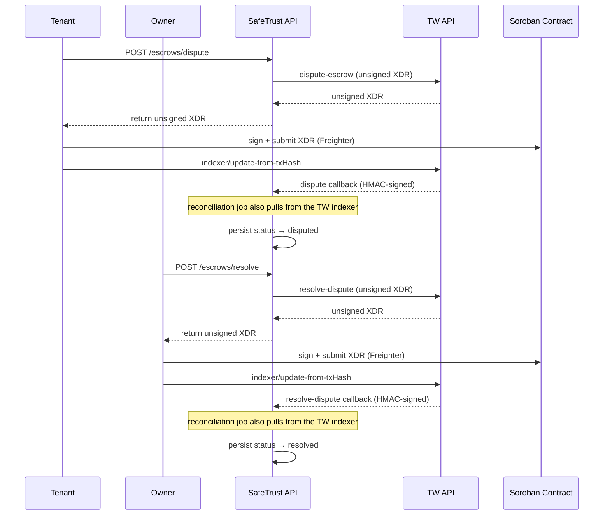
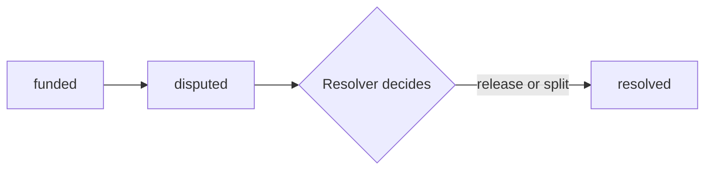
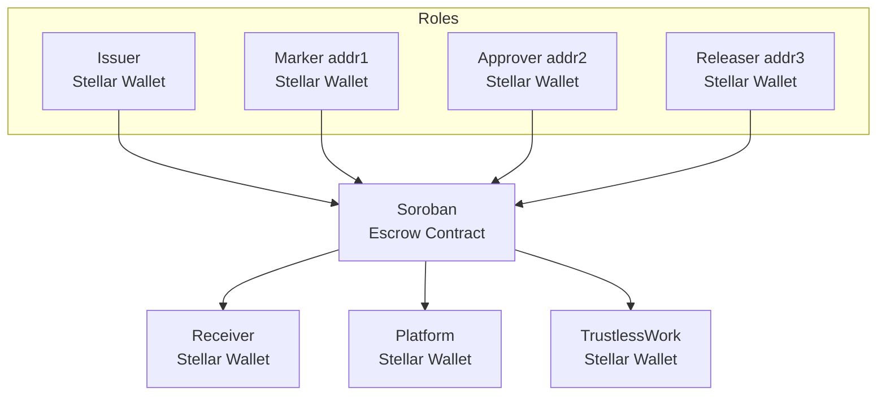

# Dispute Lifecycle and Resolution

SafeTrust escrows are single-release or multi-release Soroban contracts
managed through Trustless Work. A dispute does not move funds by itself: it
freezes the escrow in `disputed`, then the on-chain **Releaser** address signs
the terminal resolution that releases or splits the funds. Cancellation
(`escrow.cancelled`) is a separate, pre-check-in transition — it is not a
dispute outcome.

This page documents that lifecycle, the two-phase XDR signing pattern, the
database states, and the four Soroban roles. For the surrounding escrow flow,
see the [architecture overview](../architecture/overview.md) and the
[escrow lifecycle](./escrow-lifecycle.md). For the agent payment path that is
quarantined from this flow, see the [x402 protocol](./x402-protocol.md).

**Sources of truth**

| Concern | Source |
|---|---|
| Dispute callback handlers | [`dispute.handler.ts`](../../webhook/src/routes/escrows/dispute.handler.ts), [`resolve-dispute.handler.ts`](../../webhook/src/routes/escrows/resolve-dispute.handler.ts) |
| Valid states and transitions | [`crates/escrow-state-machine/src/states.rs`](../../crates/escrow-state-machine/src/states.rs), [`transitions.rs`](../../crates/escrow-state-machine/src/transitions.rs) |
| `escrow_transactions` status constraint | [`1771690624593_create_escrows_table/up.sql`](../../migrations/safetrust/1771690624593_create_escrows_table/up.sql) |
| `trustless_work_escrows` status constraint | [`1731909059420_create_trustless_work_escrows/up.sql`](../../migrations/safetrust/1731909059420_create_trustless_work_escrows/up.sql) |

---

## 1. Dispute lifecycle sequence



### How a dispute is raised

1. The tenant (or owner) calls `POST /escrows/dispute` with `contractId`,
   `disputeFlag: true`, and `disputer`.
2. SafeTrust asks the Rust state machine which prior states may become
   `disputed`. The only legal prior states are `funded`, `active`, and
   `milestone_approved`; anything else is rejected before an XDR is requested.
3. The SafeTrust request layer asks the Trustless Work API to build a
   `dispute-escrow` transaction. Trustless Work returns an **unsigned** XDR.
4. The API returns that unsigned XDR to the caller. It does not sign it and
   does not submit it.
5. The tenant or owner signs in Freighter and submits the signed transaction to
   the Stellar network (through Trustless Work's send-transaction helper or a
   Soroban RPC client).
6. The submitter calls Trustless Work's `indexer/update-from-txHash` endpoint
   with the transaction hash so the indexer records `disputed`. Soroban does
   not call SafeTrust; the backend learns the result from the Trustless Work
   callback and/or its reconciliation sync, then persists it.

### How a dispute is resolved

1. The owner (or another authorized caller) calls `POST /escrows/resolve`.
2. SafeTrust verifies that the escrow is `disputed`, then its request layer asks
   Trustless Work to build a `resolve-dispute` transaction and receives an
   unsigned XDR.
3. The unsigned XDR is returned to the caller. The **Releaser** wallet signs it;
   SafeTrust never holds that key.
4. The signed transaction is submitted to Soroban. The contract releases or
   splits the disputed balance according to the resolution.
5. The submitter calls `indexer/update-from-txHash` so Trustless Work records
   the outcome, and SafeTrust syncs it from the Trustless Work callback or the
   reconciliation job. The result is persisted as `resolved`; a resolution is
   never persisted as `cancelled` (see
   [resolve versus cancel](#6-resolve-dispute-versus-cancel)).

> **Where the backend sits today.** "SafeTrust API" in the sequence is the
> client-facing request layer; it may be the same service or a separate one.
> The webhook routes in this repository
> (`POST /api/escrows/dispute` and `POST /api/escrows/resolve-dispute`) are the
> recording/callback leg: they verify the Trustless Work HMAC, enforce the
> local state machine, and mirror the result into PostgreSQL. They do not
> create, sign, or submit XDR, and they expose no private key. The
> unsigned-XDR leg above is the integration contract the client uses with the
> Trustless Work API.

---

## 2. Status transition flowchart



| Transition | Event | Persisted status | Meaning |
|---|---|---|---|
| `funded` → `disputed` | `dispute.raised` | `disputed` | Funds remain locked; neither party can release them unilaterally. |
| `disputed` → `resolved` | `dispute.resolved` | `resolved` | The Releaser signed a resolution that releases/splits the balance. |

`active` and `milestone_approved` can also enter `disputed`; they are omitted
from the diagram to keep the happy path readable. `resolved` is terminal: it
has no transition to `completed`. Cancellation is not a dispute outcome and is
not reachable from `disputed`; it is a separate pre-check-in transition (see
[resolve versus cancel](#6-resolve-dispute-versus-cancel)).

### Database constraint

The `escrow_transactions.status` column has a `valid_escrow_status` CHECK
constraint that lists the permitted values:

```sql
CONSTRAINT valid_escrow_status CHECK (status IN (
  'deploying', 'pending_signature', 'funded', 'completed',
  'disputed', 'resolved', 'cancelled'
))
```

This constraint is a value allowlist: it restricts which status strings the
column may hold. It cannot see the row's previous value, so it does not
validate prior-state transitions and does not, by itself, authorize any
transition. Transition legality belongs to the `escrow-state-machine` Rust
crate (`transitions.rs` / `validator.rs`) and its JavaScript fallback in
`crates/escrow-state-machine/index.ts`. `disputed → resolved` is legal because
that rule exists in the transition table, not because both values appear in the
CHECK.

The mirror table `trustless_work_escrows` has a separate CHECK constraint with
the same name and nine lifecycle values (`created`, `pending_funding`, `funded`,
`active`, `milestone_approved`, `completed`, `disputed`, `resolved`,
`cancelled`). It is likewise an allowlist only.

> **`resolved` is terminal.** `resolved` is the dispute outcome stored on the
> escrow; `completed` is the normal milestone-release outcome. A resolved
> escrow does not emit `funds.released`, and the Rust table has no
> `resolved → completed` rule.

### Local enforcement

The `escrow-state-machine` Rust crate is the local authority before any XDR is
requested. It defines the status enum, a single transition table, and
`getValidPriorStates(to, event)`; the dispute and resolve handlers parse that
JSON list and use it as the Hasura `_in` status filter. The crate's `index.ts`
provides a JavaScript fallback when the native addon is not built. An illegal
prior state produces zero affected rows and a `404` instead of a transaction.

---

## 3. Role mapping



| Role | Contract responsibility | SafeTrust wallet source |
|---|---|---|
| **Issuer** | Deploys/initializes the escrow contract and pays the deployment fee. | The platform deployment wallet (`G…`) used when the contract is created. It is a contract-level identity, not an `escrow_transactions` column. |
| **Marker** | Marks/creates the escrow. | `trustless_work_escrows.marker`; the host/owner wallet (`G…`) that created the escrow, per the column comment. In the business log this corresponds to `escrow_transactions.receiver_address` (the owner). |
| **Approver** | Approves milestones (check-in/check-out). | `trustless_work_escrows.approver`; the guest/tenant wallet (`G…`), per the column comment. In the business log this corresponds to `escrow_transactions.sender_address` (the tenant). |
| **Releaser** | Releases funds and acts as the on-chain resolver for a dispute. | `trustless_work_escrows.releaser`; the arbitration/release wallet (`G…`). `trustless_work_escrows.resolver` records the same authority when present. |

All four are Stellar `G…` ed25519 public keys. A `C…` value is a contract
address, not a role wallet, and must not be accepted in these columns.

### The resolver is the Releaser address

The resolver is the `Releaser` address (role 3) on the Soroban contract — **not
a SafeTrust-controlled centralized arbiter and not an API flag**. Only a
transaction signed by that key can move a disputed balance. SafeTrust's backend
can request that Trustless Work build the XDR and can record the result, but it
has no resolver override and does not hold user signing keys. If the Releaser
is a platform-operated wallet in a given deployment, the authority still comes
from that on-chain key, not from an API role or a database update.

If the database's `resolver` column is present, it is descriptive metadata and
must match the contract's Releaser. The contract remains authoritative.

---

## 4. Two-phase XDR signing

Every state-changing escrow operation, including dispute and resolution, uses
the same two-phase pattern:

```text
SafeTrust API → Trustless Work API → unsigned XDR
             → client → Freighter sign → Stellar network
```

**Phase 1 — build, do not sign.** The backend validates the request and the
local transition, asks Trustless Work for the operation, and receives an
unsigned XDR. The XDR describes the Soroban invocation, but it has no valid
signature and cannot be submitted yet.

**Phase 2 — sign in the wallet, submit from the client.** The client receives
the unsigned XDR and hands it to Freighter. Freighter displays the operation
and signs locally with the user's key. The signed XDR is submitted to Stellar
(directly or through Trustless Work's `/helper/send-transaction`). The
transaction is only final after the network accepts it.

### Why the backend never holds the private key

- **Non-custodial by construction.** The backend has no user private key, so a
  database leak, a compromised container, or a malicious admin cannot move
  escrowed funds.
- **User consent is cryptographic.** Freighter shows the operation before the
  key is used. A backend that signed silently would remove that consent step.
- **Smaller blast radius.** The backend can be compromised for data without
  becoming a signing oracle for every escrow.
- **No submission authority.** The backend does not submit the signed
  transaction, so a forged callback cannot be turned into an on-chain action.
  It only mirrors state that the chain and Trustless Work already accepted.

The backend's job is therefore: validate the local state, request the unsigned
XDR, return it, and later persist the result. "Never holds the key" and "never
submits the signed transaction" are invariants, not implementation details.

---

## 5. Indexer synchronization after external submission

The signed transaction is submitted outside SafeTrust. Trustless Work's
Firebase-backed indexer does not see it automatically, so the submitting client
or service calls Trustless Work's **`indexer/update-from-txHash`** endpoint with
the transaction hash. That endpoint asks Trustless Work to read the transaction
and update its Firebase/indexer record for the escrow.

SafeTrust then synchronizes that external record into PostgreSQL:

1. `indexer/update-from-txHash` has Trustless Work read the submitted
   transaction and update its indexer/Firebase state for the contract (the
   canonical off-chain mirror). Soroban sends nothing to SafeTrust directly.
2. SafeTrust learns about the change either from the Trustless Work callback
   (`POST /api/escrows/dispute` or `POST /api/escrows/resolve-dispute`, both
   HMAC-verified in this repository) or from its reconciliation job
   (`POST /reconciliation/sync-escrows`), which fetches escrow state through
   `GET /helper/get-escrows-by-contract-ids` and upserts
   `safetrust.trustless_work_escrows` (`status`, `balance`, roles, amounts).
3. The callback handlers record the business event in
   `trustless_work_webhook_events` and mirror the state onto
   `safetrust.escrow_transactions` / `reservations`.

`indexer/update-from-txHash` is a **Trustless Work** endpoint. It does not write
SafeTrust PostgreSQL directly. Its purpose is to close the gap between an
externally submitted transaction and the indexer; the PostgreSQL write remains
SafeTrust's reconciliation responsibility.

---

## 6. `resolve-dispute` versus `cancel`

These are different operations and must not be used interchangeably.

| | `resolve-dispute` | `cancel` |
|---|---|---|
| Trigger | A dispute is open (`disputed`). | A booking is cancelled before check-in. |
| Who signs | The Releaser/resolver address. | The authorized escrow party / Releaser, depending on the contract state. |
| Funds | Split or released according to the resolution. | Returned to the tenant. |
| Webhook event | `dispute.resolved` | `escrow.cancelled` |
| Resulting status | `resolved` | `cancelled` |
| Local prior states | `disputed` | `created`, `pending_funding`, `funded` |
| DB constraint | `valid_escrow_status` permits the `resolved` value. | `valid_escrow_status` permits the `cancelled` value. |

A partial refund or a split is a **resolution**, not a cancellation.
Cancellation occurs before check-in and is permitted only from `created`,
`pending_funding`, or `funded`; it returns the balance to the tenant and ends
the escrow without a `resolved` row. `disputed` is not a valid prior state for
cancellation. Both `resolved` and `cancelled` are terminal.

---

## 7. Idempotency and failure handling

- **Idempotency key.** `(contract_id, event_type)` in
  `trustless_work_webhook_events`; a duplicate `dispute.raised` or
  `dispute.resolved` callback returns `200 { received: true }` without
  re-running mutations.
- **Status guard.** The Hasura mutation filters on the state machine's valid
  prior states. A callback for an escrow in the wrong state affects zero rows
  and returns `404`.
- **HMAC authentication.** Callback routes require
  `x-trustlesswork-signature` and a fresh `x-trustlesswork-timestamp`; the
  verifier fails closed.
- **No XDR in the callback.** A callback only records state. It cannot create a
  transaction, so replaying a callback cannot move funds.

---

## Related documentation

- [Architecture overview](../architecture/overview.md) — system layers and the
  frontend-managed XDR flow.
- [x402 protocol](./x402-protocol.md) — agent payments, quarantined from the
  escrow eligibility path.
- [Escrow lifecycle](./escrow-lifecycle.md) — the full state machine and
  handler mapping.
