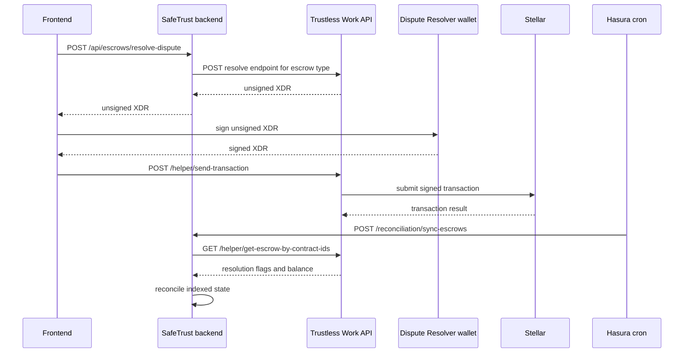

# Dispute and Resolve

> **Status: Planned — post-Issue-03 behavior.** This is the intended
> polling-based flow; the route implementation in this checkout has not yet
> been migrated to it.

A dispute or its resolution is an on-chain transaction, not a local status
update. SafeTrust builds an unsigned XDR through Trustless Work and returns it
to the frontend. The authorized wallet signs it, and the frontend submits it
through Trustless Work. SafeTrust learns the indexed result through
reconciliation, subject to the indexer's freshness rules.

## Raise a dispute

The frontend calls SafeTrust `POST /api/escrows/dispute`. SafeTrust requests
the unsigned XDR from Trustless Work using:

- Single-release: `POST /escrow/single-release/dispute-escrow`
- Multi-release milestone: `POST /escrow/multi-release/dispute-milestone`

The frontend signs the XDR with the authorized wallet and submits it using
`POST /helper/send-transaction`. `flags.disputed` derives the `disputed`
state. The current unversioned-snapshot policy does not allow polling alone to
advance a funded escrow to `disputed`; see
[Trustless Work Indexer](./trustless-work-indexer.md).

## Resolve a dispute

The frontend calls SafeTrust `POST /api/escrows/resolve-dispute`. SafeTrust
builds the unsigned XDR with:

- Single-release: `POST /escrow/single-release/resolve-dispute`
- Multi-release milestone: `POST /escrow/multi-release/resolve-milestone-dispute`

The **Dispute Resolver** wallet signs the resolution transaction; this role is
distinct from the Release Signer. The frontend submits the signed XDR through
`POST /helper/send-transaction`. `flags.resolved` derives the `resolved`
state. The current V1 snapshot policy cannot safely advance a funded escrow
through polling alone to this terminal state. SafeTrust requires a versioned
snapshot or transaction confirmation before applying the transition.

Resolution is distinct from cancellation. `resolved` records a dispute outcome;
`cancelled` is a separate pre-check-in transition. See the [escrow
lifecycle](./escrow-lifecycle.md) and [Trustless Work
Indexer](./trustless-work-indexer.md) documentation.
