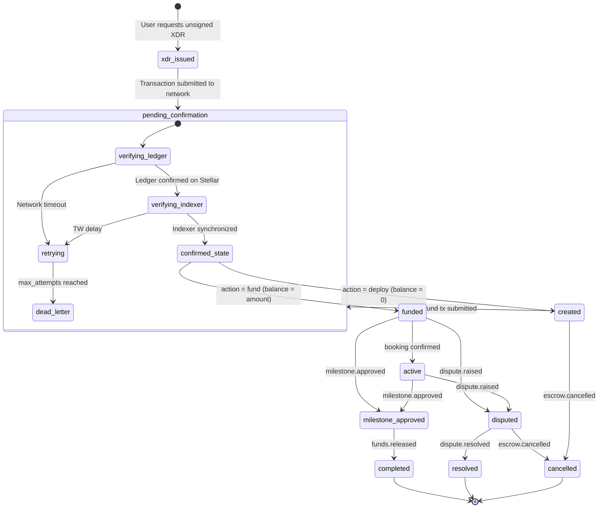

# Escrow Lifecycle Documentation

This document describes the full escrow lifecycle: canonical state machine, strict transaction lifecycle stages, dual submission paths, independent Stellar ledger confirmation, Trustless Work (TW) indexer synchronization, and durable PostgreSQL-backed retry mechanics.

**Sources of truth referenced by this document**

| Concern | Source of truth |
|---|---|
| Valid states | [`crates/escrow-state-machine/src/states.rs`](../../crates/escrow-state-machine/src/states.rs) (`EscrowStatus`) |
| Valid transitions | [`crates/escrow-state-machine/src/transitions.rs`](../../crates/escrow-state-machine/src/transitions.rs) (`transition_table()`) |
| Persisted escrow values | [`migrations/safetrust/1731909059420_create_trustless_work_escrows/up.sql`](../../migrations/safetrust/1731909059420_create_trustless_work_escrows/up.sql) |
| Retry & tx confirmation schema | [`migrations/safetrust/1793000000000_create_escrow_confirmation_retries/up.sql`](../../migrations/safetrust/1793000000000_create_escrow_confirmation_retries/up.sql) |
| Confirmation Engine | [`webhook/src/services/confirmation.service.ts`](../../webhook/src/services/confirmation.service.ts) |
| Confirmation API Endpoint | [`webhook/src/routes/escrows/confirm-transaction.route.ts`](../../webhook/src/routes/escrows/confirm-transaction.route.ts) |
| End-to-end tests | [`webhook/src/services/__tests__/confirmation.service.test.ts`](../../webhook/src/services/__tests__/confirmation.service.test.ts) |

---

## 1. Strict Lifecycle Stages & PostgreSQL Representation

The escrow transaction lifecycle strictly separates wallet signing, XDR submission, Stellar ledger execution, Trustless Work (TW) Firebase indexing, and local PostgreSQL synchronization. No stage may be skipped or fabricated.

| Stage | Action & Location | PostgreSQL Representation (`trustless_work_escrows` / `escrow_confirmation_retries`) | Status Guardrail |
|---|---|---|---|
| **`xdr_issued`** | Unsigned XDR requested from TW API and returned to client. | `escrow_transactions.status = 'pending_signature'` (or unpersisted in `trustless_work_escrows`). | No on-chain action has occurred. |
| **Client Signing** | User signs XDR in wallet (e.g., Freighter). Purely client-side. | **Untracked in DB**. A signed-but-unsubmitted XDR **must never** advance escrow status or create a confirmation record. | Status remains unchanged; client signature alone does not prove submission or execution. |
| **`pending_confirmation`** | Signed XDR is submitted to the network (via TW Helper or directly). SafeTrust immediately persists the submission attempt. | `escrow_confirmation_retries` row inserted with `status = 'retrying'`, `attempt_count = 1`, `next_retry_at = NOW() + backoff`, `tx_hash`, `network`, `escrow_action` (`deploy` vs `fund`), and `submission_path` (`helper` vs `external`). | Guarantees crash survivability and deduplication via `UNIQUE(tx_hash, escrow_action)`. |
| **`ledger_confirmed`** | SafeTrust independently queries the target Stellar network (Horizon / Soroban RPC). | `escrow_confirmation_retries` records successful verification. Rejection occurs if tx is failed (`successful = false`), pending/expired (404), or executed on the wrong network. | Prevents fake tx submissions from advancing off-chain state. |
| **`tw_indexed`** | Trustless Work Firebase state is synchronized (either automatically via `helper/send-transaction` or via `indexer/update-from-txHash`). | Intermediate confirmation condition satisfied. SafeTrust tracks indexer completion. | Guardrail: `indexer/update-from-txHash` is only callable for TW-generated transactions. |
| **`confirmed`** | SafeTrust local DB state promoted. | **Deploy**: `trustless_work_escrows.status = 'created'`, `balance = 0`.<br/>**Fund**: `trustless_work_escrows.status = 'funded'`, `balance = amount`.<br/>`escrow_confirmation_retries.status = 'completed'`. | Promoted only when **both** `ledger_confirmed` and `tw_indexed` succeed. |

---

## 2. Dual Submission Paths

SafeTrust supports and distinguishes two distinct submission flows:

```mermaid
flowchart TD
    subgraph PathA["Path A: Helper Submission (helper/send-transaction)"]
        A1[Client signs XDR] --> A2[POST /helper/send-transaction to TW]
        A2 --> A3[TW submits to Stellar & auto-indexes]
        A3 --> A4[Return txHash to SafeTrust]
        A4 --> A5[SafeTrust persists txHash + network into retries table]
        A5 --> A6[SafeTrust independently verifies Stellar ledger execution]
        A6 --> A7[SafeTrust promotes local DB to confirmed]
    end

    subgraph PathB["Path B: External Submission (Direct Stellar Submission)"]
        B1[Client signs XDR] --> B2[Client submits directly to Stellar RPC / Horizon]
        B2 --> B3[Client POSTs txHash to SafeTrust]
        B3 --> B4[SafeTrust persists txHash + network: pending_confirmation]
        B4 --> B5[SafeTrust verifies Stellar ledger execution & network match]
        B5 --> B6[SafeTrust calls TW: POST indexer/update-from-txHash]
        B6 --> B7[Both ledger & TW index verified -> promote DB to confirmed]
    end
```



### Path A: `helper/send-transaction`
- TW handles transaction submission to the Stellar network and performs automatic indexing into its internal Firebase store.
- **SafeTrust Guard**: SafeTrust does not blindly trust TW's response. It immediately persists `txHash` and `network`, independently queries Stellar Horizon to verify ledger execution (`ledger_confirmed`), and verifies TW response behavior before marking `confirmed`.

### Path B: External Submission (`indexer/update-from-txHash`)
- The client submits the signed XDR directly to Stellar Horizon/Soroban RPC and sends the resulting `txHash` to SafeTrust (`POST /api/escrows/confirm-transaction`).
- SafeTrust enters the transaction into `pending_confirmation`, verifies ledger execution on the matching Stellar network (`ledger_confirmed`), and then invokes TW's `indexer/update-from-txHash` endpoint (`tw_indexed`).
- **Guardrail**: `indexer/update-from-txHash` must **only** be called for externally submitted, TW-generated XDRs—never for arbitrary or unrelated Stellar transactions.
- **Webhook Independence**: Webhook delivery from TW is **not assumed**. SafeTrust relies on active ledger verification and the `indexer/update-from-txHash` endpoint.

---

## 3. Why `indexer/update-from-txHash` is Insufficient on Its Own

`indexer/update-from-txHash` is an endpoint hosted by Trustless Work. Calling it only recovers TW's internal queue into TW Firebase.
1. It does **not** write to SafeTrust's PostgreSQL database.
2. It does **not** guarantee that the transaction succeeded on the correct network from SafeTrust's security perspective.
3. Therefore, SafeTrust **must independently verify** Stellar ledger execution (`ledger_confirmed`) and perform local PostgreSQL synchronization (`confirmed`).

---

## 4. Separation of Deployment vs. Funding Confirmation

A common anti-pattern is treating contract deployment and funding as a single state. SafeTrust strictly separates them:

```
[Contract Deployment]
xdr_issued ──► Client Signing ──► pending_confirmation ──► ledger_confirmed + tw_indexed ──► confirmed: status = "created", balance = 0

[Escrow Funding]
xdr_issued ──► Client Signing ──► pending_confirmation ──► ledger_confirmed + tw_indexed ──► confirmed: status = "funded", balance = amount
```

- **Deployment Confirmation**: A deployed contract without funds is **not** a ready or funded escrow. Deployment confirmation sets `trustless_work_escrows.status = 'created'` with `balance = 0`.
- **Funding Confirmation**: Funding requires its own independent transaction lifecycle, on-chain verification of the deposit amount, and promotion of `status = 'funded'` with `balance = amount`.

---

## 5. Durable Retry Mechanism (PostgreSQL-backed)

SafeTrust implements a database-driven, durable retry mechanism without external message brokers (no Redis or RabbitMQ required).

```mermaid
flowchart TD
    Start[Transaction Submitted: txHash] --> InsertRetry[Insert retry record: status = 'retrying', attempt_count = 1]
    InsertRetry --> CheckLedger{Verify on Stellar Ledger?}
    CheckLedger -- Failed/Invalid --> TerminalFail[Mark dead_letter: Halt retries]
    CheckLedger -- Not Ready/Pending --> ScheduleRetry[Calculate next_retry_at via bounded exponential backoff]
    CheckLedger -- Confirmed --> CheckTW{Sync TW Indexer?}
    CheckTW -- Error/Timeout --> ScheduleRetry
    CheckTW -- Succeeded --> Success[Promote DB to 'confirmed' & mark retry 'completed']
    
    ScheduleRetry --> WorkerCheck{attempt_count >= MAX_ATTEMPTS?}
    WorkerCheck -- Yes --> DLQ[Transition to 'dead_letter' status for manual review]
    WorkerCheck -- No --> Wait[Reconciliation Worker picks up when next_retry_at <= NOW()]
    Wait --> CheckLedger
```

### Table Schema (`safetrust.escrow_confirmation_retries`)
- `id`: UUID primary key
- `tx_hash`: 64-character hex transaction hash
- `escrow_id`: Unique escrow contract or engagement identifier
- `escrow_action`: `'deploy'` or `'fund'`
- `network`: `'testnet'` or `'mainnet'`
- `submission_path`: `'helper'` or `'external'`
- `status`: `'retrying'`, `'dead_letter'`, or `'completed'`
- `attempt_count`: Current execution attempt (starts at 1)
- `max_attempts`: Maximum attempts before DLQ (default: 5)
- `next_retry_at`: Scheduled timestamp for the next retry attempt
- `last_error`: Text message describing the last failure
- `tenant_id`: Multi-tenant partition key (`safetrust`)

### Bounded Exponential Backoff Formula
$$\text{delay} = \min\left(\text{BASE\_DELAY} \times 2^{\text{attempt\_count} - 1},\, \text{MAX\_DELAY}\right)$$
- `BASE_DELAY`: 1,000 ms (1 second)
- `MAX_DELAY`: 300,000 ms (5 minutes)
- Attempt 1: 1s, Attempt 2: 2s, Attempt 3: 4s, Attempt 4: 8s, Attempt 5: 16s.

### Crash Survivability & Background Reconciliation
If the service restarts while a transaction is pending confirmation, records in `safetrust.escrow_confirmation_retries` persist. The background reconciliation worker (`POST /reconciliation/sync-escrows` or worker loop) queries:
```sql
SELECT * FROM safetrust.escrow_confirmation_retries
 WHERE status = 'retrying' AND next_retry_at <= NOW()
 ORDER BY next_retry_at ASC LIMIT 50;
```
It picks up pending transactions and resumes verification and indexing.

### Dead-Letter Queue (DLQ)
When `attempt_count >= MAX_ATTEMPTS` (5), the record transitions to `status = 'dead_letter'`. Automatic retries halt, and `last_error` preserves the failure cause for operator inspection.

### Strict Idempotency
- Unique constraint: `CONSTRAINT unique_tx_action UNIQUE (tx_hash, escrow_action)`.
- Concurrent or repeated submissions of the exact same `txHash` produce zero duplicate records and zero double-confirmations using atomic `ON CONFLICT (tx_hash, escrow_action) DO UPDATE`.

---

## 6. Network Identity Enforcement

Every confirmation enforces network identity (`testnet` vs `mainnet`):
- SafeTrust queries the Horizon/RPC endpoint matching the escrow's declared network:
  - `testnet`: `https://horizon-testnet.stellar.org/transactions/{txHash}`
  - `mainnet`: `https://horizon.stellar.org/transactions/{txHash}`
- A transaction submitted to testnet will return 404 on mainnet Horizon and is immediately rejected. Cross-network replay or configuration confusion is impossible.

---

## 7. Controlled Testnet Walkthrough

Below is a step-by-step testnet walkthrough demonstrating both stages:

### Step 1: Deploy Escrow (Deployment Confirmation)
1. **Request XDR (`xdr_issued`)**:
   Frontend requests unsigned initialization XDR from TW API. SafeTrust creates draft record (`pending_signature`).
2. **Freighter Wallet Signing**:
   Guest signs XDR in wallet. Status remains untracked in DB.
3. **Submission (External Path B)**:
   Client submits signed XDR to Stellar Testnet Horizon and receives `txHash = "e3b0c44298fc1c149afbf4c8996fb92427ae41e4649b934ca495991b7852b855"`.
4. **POST to SafeTrust**:
   Client calls `POST /api/escrows/confirm-transaction`:
   ```json
   {
     "submissionPath": "external",
     "txHash": "e3b0c44298fc1c149afbf4c8996fb92427ae41e4649b934ca495991b7852b855",
     "escrowId": "CAATN5DTEST00001",
     "action": "deploy",
     "network": "testnet",
     "isTWGenerated": true
   }
   ```
5. **State Progression**:
   - `pending_confirmation`: Retry record inserted (`status = 'retrying'`, `action = 'deploy'`).
   - `ledger_confirmed`: Verified on `horizon-testnet.stellar.org` (`successful = true`, ledger: `1245012`).
   - `tw_indexed`: Called `POST /indexer/update-from-txHash`.
   - `confirmed`: SafeTrust updates `trustless_work_escrows` status to **`created`** (balance: `0`). Retry record updated to **`completed`**.

### Step 2: Fund Escrow (Funding Confirmation)
1. **Request Deposit XDR (`xdr_issued`)**:
   Frontend requests deposit XDR for 2,500 USDC.
2. **Freighter Wallet Signing**:
   Guest signs funding XDR. Status remains `created` in DB.
3. **Submission (Helper Path A)**:
   Client calls `POST /api/escrows/confirm-transaction`:
   ```json
   {
     "submissionPath": "helper",
     "signedXdr": "AAAA_FUNDING_SIGNED_XDR...",
     "escrowId": "CAATN5DTEST00001",
     "action": "fund",
     "network": "testnet"
   }
   ```
4. **State Progression**:
   - Helper submits to Stellar Testnet -> `txHash = "f4c1b55398fc1c149afbf4c8996fb92427ae41e4649b934ca495991b7852c966"`.
   - `pending_confirmation`: Retry record inserted (`status = 'retrying'`, `action = 'fund'`).
   - `ledger_confirmed`: SafeTrust verifies ledger execution independently.
   - `tw_indexed`: TW helper automatically indexes deposit in Firebase.
   - `confirmed`: SafeTrust updates `trustless_work_escrows` status to **`funded`** (balance: `2500`). Retry record updated to **`completed`**.

---

## 8. State Machine Diagram


