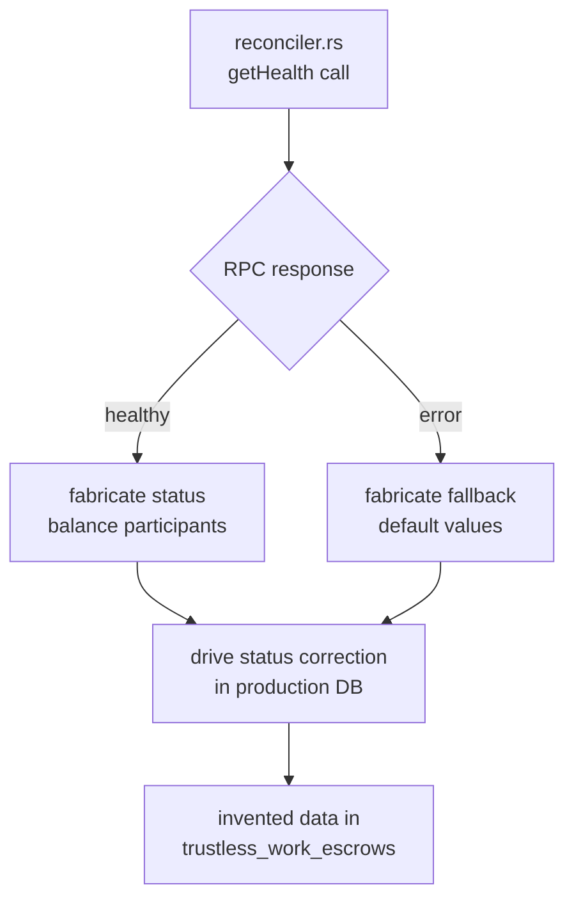
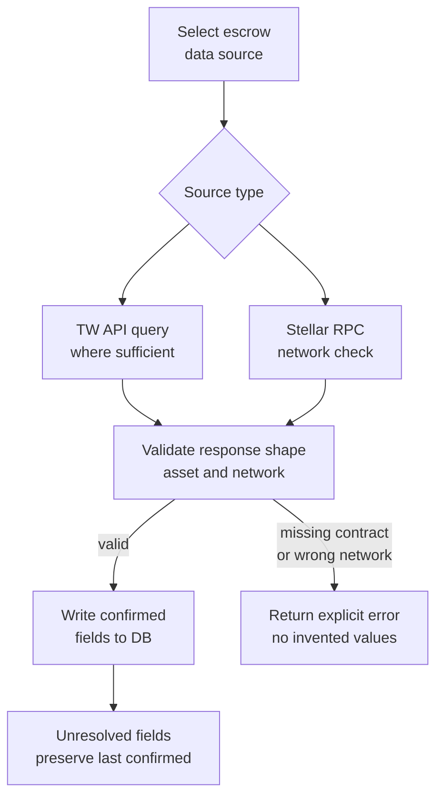
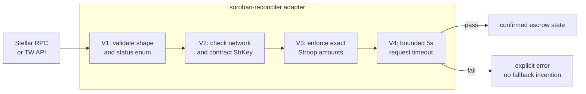

# Escrow State Source Selection and Reconciliation Architecture

This document records the architectural decision regarding authoritative escrow
state sources for SafeTrust, the removal of fabricated responses (Security Review
Finding F1), the adapter validation boundaries, and the gap analysis between
direct Stellar Soroban RPC reads and Trustless Work indexer API queries.

---

## 1. Context and Problem Statement (Security Review F1)

In prior releases, `crates/soroban-reconciler/src/rpc_client.rs` contained an
unsafe implementation that returned fabricated on-chain escrow state:

1. **`mock_` and `test_` shortcuts in production:** Any contract ID prefixed with
   `mock_` or `test_` returned a hardcoded state (`status: "ACTIVE"`,
   `balance: 1_000_000_000` stroops / 100 XLM, and dummy participant addresses).
2. **`getHealth` confusion:** For any real contract ID, the adapter issued only
   a `getHealth` JSON-RPC call. If the RPC node returned `{"status": "healthy"}`,
   the adapter fabricated and returned the exact same hardcoded active state.
3. **Automated DB corruption:** In `webhook/src/services/reconciliation.service.ts`,
   when `SOROBAN_VALIDATION_ENABLED=true` was activated, `runSorobanValidation`
   evaluated discrepancies between the database and this fabricated state. Any
   deviation was flagged as critical drift and triggered an automated Hasura
   GraphQL mutation (`CorrectDriftFromSoroban`), overwriting production
   `trustless_work_escrows` records with invented status and balance values.

### Why `getHealth` Cannot Establish Contract State

A `getHealth` JSON-RPC response from a Stellar Soroban node (`{"status": "healthy"}`)
confirms only that the RPC daemon process is reachable, listening for requests,
and synced within ledger thresholds. It takes **zero contract parameters** and
provides **zero cryptographic or ledger guarantees** about any smart contract:

- It does not prove that a contract address has been deployed on-chain.
- It does not read contract bytecode or check executable validity.
- It does not inspect ledger storage entries (`LedgerKey::ContractData`).
- It does not query SEP-41 Stellar Asset Contract (SAC) token balances.
- It does not verify participant roles (Marker, Approver, Releaser).

Treating `getHealth` reachability as contract ground truth resulted in total
fabrication of financial state.

---

## 2. Inventory of Fabricated State and Impacted Paths

### Exact Fields Fabricated

| Field | Fabricated Value | Ground Truth Source Required |
|---|---|---|
| `status` | Hardcoded `"ACTIVE"` | Smart contract storage enum (`created`, `funded`, `active`, `completed`, `disputed`, `resolved`, `cancelled`) |
| `balance` | Hardcoded `1_000_000_000` (100 XLM) | Exact token balance in Stroops from SEP-41 SAC ledger entry or indexed events |
| `marker` | Hardcoded `"marker_on_chain"` | Initiator/Hotel wallet address in contract instance storage |
| `approver` | Hardcoded `"approver_on_chain"` | Guest wallet address in contract instance storage |

### Production Code Paths Consuming Fabricated State

1. **`crates/soroban-reconciler/src/rpc_client.rs` (`query_escrow_state`)**:
   Emitted the fabricated `SorobanEscrowState` struct.
2. **`crates/soroban-reconciler/src/lib.rs` (`queryEscrowStateBatch`)**:
   Exposed the fabricated reader to Node.js via Neon bindings.
3. **`webhook/src/services/reconciliation.service.ts` (`runSorobanValidation`)**:
   Queried the native addon, computed diffs via `reconcileBatch`, and executed
   `CorrectDriftFromSoroban` to mutate database records with fabricated values.
4. **`webhook/src/routes/reconciliation/sync-escrows.handler.ts`**:
   The scheduled cron endpoint triggered by Hasura periodically called
   `validateSorobanDrift`, propagating corrupted data across all tenant escrows.

---

## 3. Data Source Selection and Gap Analysis

To resolve F1, SafeTrust evaluated two candidate state sources:
**Trustless Work (TW) Indexer API** and **Direct Stellar Soroban RPC**.

### Gap Analysis Matrix

| Criterion | Trustless Work API (`tw_api`) | Direct Stellar RPC (`stellar_rpc`) |
|---|---|---|
| **Protocol role** | SafeTrust contract coordinator & event indexer | Raw blockchain JSON-RPC node |
| **`contract_id` verification** | Direct key lookup | Validates presence in ledger keys |
| **Lifecycle `status`** | Decoded into canonical SafeTrust lifecycle enum | Requires decoding raw Soroban contract storage `SCVal` |
| **Participant roles** | Structured `marker`, `approver`, `releaser`, `resolver` | Requires parsing contract instance storage map |
| **Escrow balance** | Normalized token balance and target amounts | Requires querying SEP-41 SAC contract ledger entries for the escrow contract |
| **Network validation** | Environment routing (`dev` vs `prod` indexer) | Authoritative `getNetwork` passphrase verification |
| **XDR decoding complexity** | Pre-decoded JSON payload | Requires full base64 XDR serialization of `LedgerKey` and deserialization of `SCVal` types |
| **Latency & indexing lag** | 5–15 seconds (1–3 ledgers) indexing delay | Real-time ledger state (0 delay) |
| **Failure modes** | HTTP 404, 5xx, gateway timeout, rate limiting | RPC node unavailability, ledger pruning, JSON-RPC errors |

### Decision

1. **Primary Structured Source (`tw_api`):** Trustless Work API is selected as
   the primary structured source for high-level escrow lifecycle fields (`status`,
   `balance`, `roles`, `escrow_type`). It already performs verified decoding of
   Soroban contract storage and SEP-41 token balances. Rebuilding a complete custom
   XDR decoder inside `soroban-reconciler` to duplicate the indexer's job is
   unnecessary and increases attack surface.
2. **Authoritative Network Verification (`stellar_rpc`):** Direct Stellar RPC is
   retained and used for network identity verification (`getNetwork`) and
   authoritative on-chain ledger presence checks (`getLedgerEntries`).
3. **Unified Validation Boundary:** Regardless of source, all data must pass
   through the adapter validation boundary before reaching the service layer.

---

## 4. Adapter Validation Boundary

The `soroban-reconciler` adapter enforces four strict validation stages:

### V1 — Response Shape Validation
- Verifies required fields: `contractId`, `status`, `balance` or `amount`.
- Validates that `status` strictly belongs to the SafeTrust lifecycle allowlist:
  `created`, `pending_funding`, `funded`, `active`, `milestone_approved`,
  `completed`, `disputed`, `resolved`, `cancelled`.
- Rejects empty arrays, null values, or missing fields.
- Explicitly rejects pure `getHealth` responses (`{"status": "healthy"}`) as
  lacking contract state.

### V2 — Network and Contract Identity Checks
- **Contract Identity:** Contract addresses must be valid 56-character base32
  Stellar Contract StrKeys (`C...` format), verified via `stellar_strkey`
  with SEP-23 version byte and CRC16-XMODEM checksum verification.
- **No Mock Shortcuts:** All `mock_` and `test_` shortcuts are rejected in
  production code paths. Mocks belong in test fixtures only.
- **Network Identity:** Verifies network passphrase against canonical constants:
  - `testnet`: `"Test SDF Network ; September 2015"`
  - `mainnet`: `"Public Global Stellar Network ; September 2015"`
  - Reject cross-network responses immediately (`NetworkMismatch`).

### V3 — Exact Asset Amounts
- All balances are converted to exact integer **Stroops** (10^7 Stroops = 1 token
  unit, matching Stellar's 7-decimal fixed precision).
- Float rounding thresholds (such as `.abs() > 0.0001`) are removed. Diffs are
  evaluated using exact integer comparison: `db_stroops != on_chain_stroops`.
- Negative balances and numbers exceeding 7 decimal places are rejected.

### V4 — Bounded Request Timeout
- All network interactions use an explicit timeout of **5 seconds**
  (`timeout_connect`, `timeout_read`, `timeout`).
- Unbounded blocking calls are prohibited.

---

## 5. Operational Guarantees and Rules

### The "Preserve Last Confirmed" Rule
When an external source is unavailable, times out, returns an unrecognized shape,
or reports a missing contract:
1. The contract record in PostgreSQL is **never** silently overwritten with
   default or fabricated values.
2. The existing database state is preserved as the last confirmed truth.
3. The contract is flagged as **unresolved** (`unresolved++`) and logged for
   operator inspection.
4. Auto-correction is skipped for all unresolved records.

### Automated Correction Containment
Automatic DB mutations (`CorrectDriftFromSoroban`) are disabled by default:
- `SOROBAN_AUTO_CORRECT_ENABLED=false` is the default in all environments.
- Even when `SOROBAN_VALIDATION_ENABLED=true` is used to monitor drift, discrepancies
  are logged and reported in telemetry without mutating the database.
- Any future activation of automatic corrections requires verified authoritative
  signatures and explicit operator configuration (coordinated with ESC-05).

### External Provider Trust Dependency
Both TW API and Stellar RPC are external network dependencies subject to network
partitions, upstream latency, and maintenance windows:
- Failure of either external provider must fail closed.
- Downstream business processes (dispute resolution, fund release) must never
  proceed on unconfirmed or invented fallback states.

---

## 6. Verification and Test Vectors

The implementation is verified across three layers:

1. **Rust Adapter Unit & Fixture Tests (`crates/soroban-reconciler`):**
   - `test_healthy_rpc_with_no_contract_data_rejected`: Proves `getHealth` alone
     never returns escrow state.
   - `test_rejects_mock_and_test_shortcuts`: Proves `mock_` / `test_` identifiers
     are rejected by contract validation.
   - `test_network_identity_verification`: Proves wrong-network passphrases trigger
     explicit `NetworkMismatch` errors.
   - `test_malformed_and_unrecognized_response_shapes`: Proves missing fields,
     empty lists, and invalid statuses fail closed.
   - `test_exact_asset_amounts_enforcement`: Proves exact 7-decimal Stroop parsing.
   - `test_bounded_timeout_guarantee`: Proves request timeouts are strictly bounded.
   - `test_controlled_testnet_escrow_end_to_end`: Validates an end-to-end controlled
     testnet escrow fixture with exact roles and balance.
2. **Service Integration Tests (`webhook/src/services`):**
   - Verifies `validateSorobanDrift` preserves last confirmed DB values when
     auto-correction is disabled by default.
   - Verifies `runSorobanValidation` handles per-contract errors without crashing
     the batch and increments `unresolved`.
   - Confirms `reconciliation.service.ts` does not call fabricated-state paths.
3. **Workspace Native Builds:**
   - Released Neon Node-API addon builds cleanly via `npm run build:rust`.
   - Full TypeScript type-checking passes with 0 errors across all tsconfigs.
