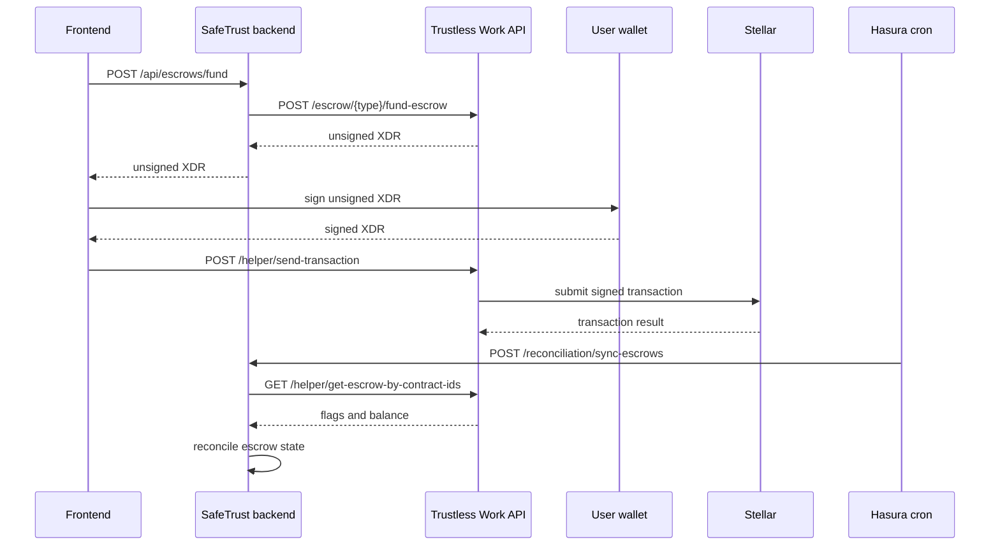

# Fund Escrow

> **Status: Planned — post-Issue-03 behavior.** This is the intended
> polling-based flow; the route implementation in this checkout has not yet
> been migrated to it.

The frontend requests an unsigned funding transaction from SafeTrust. SafeTrust
asks Trustless Work to build it and returns the XDR to the frontend. The user
signs in their wallet, and the frontend submits the signed transaction through
Trustless Work. SafeTrust learns the indexed result during reconciliation.

## Sequence

## Routes and state

1. The frontend calls SafeTrust `POST /api/escrows/fund` with the contract
   identifier and funding details.
2. SafeTrust requests an unsigned XDR from Trustless Work:
   - Single-release: `POST /escrow/single-release/fund-escrow`
   - Multi-release: `POST /escrow/multi-release/fund-escrow`
3. The frontend signs the returned XDR in the user's wallet and submits the
   signed XDR to `POST /helper/send-transaction`.
4. The Hasura cron trigger invokes SafeTrust's
   `POST /reconciliation/sync-escrows`. SafeTrust reads the tracked contract
   through `GET /helper/get-escrow-by-contract-ids` and applies the indexed
   flags and balance according to its reconciliation rules.

Funding is reflected when the indexer reports a positive balance or `fundedBy`.
An unsigned XDR or wallet signature by itself does not prove that the deposit
was submitted.

The V1 indexer returns an unversioned snapshot. Under the current freshness
policy, polling may advance `created` or `pending_funding` to `funded`, but
cannot safely advance later states without a version token or transaction
confirmation. See [Trustless Work Indexer](./trustless-work-indexer.md) for
status derivation, field mapping, and freshness rules.
