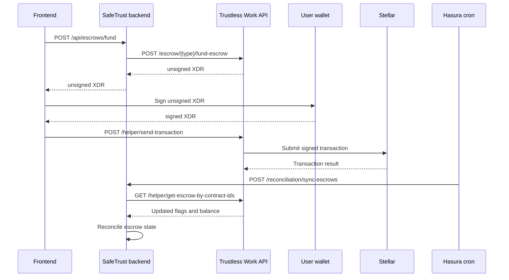

# Fund Escrow

> **Status: Planned — post-Issue-03 behavior.** This is the intended
> polling-based flow; the route implementation in this checkout has not yet
> been migrated to it.

Funding uses the connected user's wallet. SafeTrust obtains an unsigned
transaction from Trustless Work, the frontend signs it, and Trustless Work
submits it to Stellar. SafeTrust learns the resulting balance and status from
indexer reconciliation.

## Sequence

## Routes and state updates

1. The frontend calls SafeTrust `POST /api/escrows/fund` with the contract
   identifier and funding details.
2. SafeTrust asks Trustless Work to build the unsigned XDR:
   - Single-release: `POST /escrow/single-release/fund-escrow`
   - Multi-release: `POST /escrow/multi-release/fund-escrow`
3. The frontend signs the returned XDR in the user's wallet and submits the
   signed XDR to `POST /helper/send-transaction`.
4. The Hasura cron trigger invokes SafeTrust's
   `POST /reconciliation/sync-escrows`. SafeTrust reads the escrow through
   `GET /helper/get-escrow-by-contract-ids` and updates its local record from
   the indexer flags and balance.

This flow does not treat the build response as proof that funds were deposited.
The deposit is reflected in SafeTrust only after reconciliation observes it.
See [Trustless Work Indexer](./trustless-work-indexer.md) for the polling
contract and field mapping.
