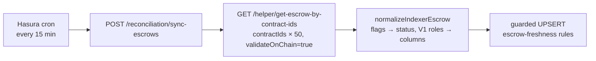
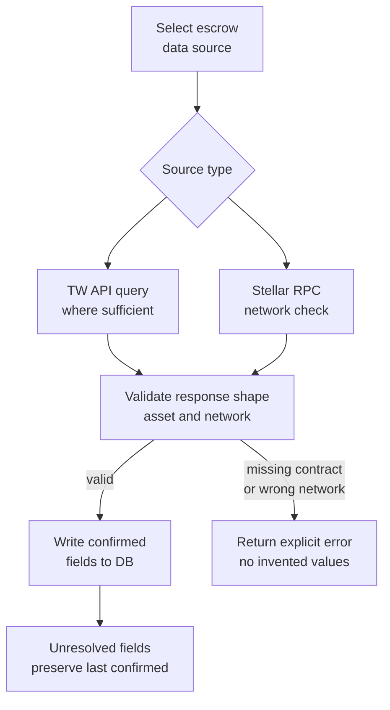

# Escrow State Source & Reconciliation

SafeTrust learns the authoritative state of Trustless Work escrows by polling the
Trustless Work V1 indexer (`POST /reconciliation/sync-escrows`) on a scheduled
Hasura cron trigger (every 15 minutes) and verifying transactions on Stellar.
Trustless Work sends no webhooks.



| File | Responsibility |
|---|---|
| `webhook/src/lib/source-adapters/tw.adapter.ts` | Configuration, request URL, sequential fetch |
| `webhook/src/lib/source-adapters/tw-indexer.types.ts` | V1 response type |
| `webhook/src/lib/source-adapters/tw-indexer.normalize.ts` | Mapping onto table columns |
| `webhook/src/repositories/reconciliation.repository.ts` | Guarded UPSERT |
| `webhook/src/services/reconciliation.service.ts` | Reconciliation orchestration and lifecycle transitions |

---

## 1. Configuration

| Variable | Default | Purpose |
|---|---|---|
| `TRUSTLESSWORK_API_URL` | `https://dev.api.trustlesswork.com` | V1 API base URL; mainnet is `https://api.trustlesswork.com` |
| `TRUSTLESSWORK_API_KEY` | empty | Sent as `x-api-key` |

`TRUSTLESSWORK_API_URL` and `TRUSTLESSWORK_API_KEY` are passed by `docker-compose.yml`.
The legacy `TRUSTLESS_WORK_API_URL` / `TRUSTLESS_WORK_API_KEY` spelling is still
read with a `trustlesswork.legacy_env_name` warning; the current spelling wins
when both are set.

---

## 2. Trustless Work V1 Indexer Request

```
GET {TRUSTLESSWORK_API_URL}/helper/get-escrow-by-contract-ids
    ?contractIds=<id>&contractIds=<id>…&validateOnChain=true
x-api-key: {TRUSTLESSWORK_API_KEY}
```

- **Endpoint path:** `/helper/get-escrow-by-contract-ids` (singular `get-escrow`).
  The earlier plural path `/helper/get-escrows-by-contract-ids` returns `404 Resource not found`.
- **Batch size:** Up to 50 contract IDs per request, passed as repeated `contractIds`
  query parameters (`string[]` encoding).
- **`validateOnChain=true`:** Forces the indexer to verify its copy against the
  contract before answering so stale indexer rows are not returned. Trustless
  Work rate-limits to 50 requests per 60 seconds, and each sync sends one request
  per 50 tracked escrows.

---

## 3. Status Derivation & Field Mapping

The V1 response has no top-level `status` field. Lifecycle state is derived from
`flags` on the escrow (single-release) or across milestones (multi-release); the
first matching rule wins.

### Single-release derivation

| Condition | Derived status |
|---|---|
| `flags.resolved` | `resolved` |
| `flags.released` | `completed` |
| `flags.disputed` | `disputed` |
| any milestone `approved` | `milestone_approved` |
| `balance > 0` or `fundedBy` set | `funded` |
| otherwise | `created` |

### Multi-release derivation

| Condition | Derived status |
|---|---|
| every milestone released or resolved | `resolved` if any was resolved, else `completed` |
| any milestone disputed and not resolved | `disputed` |
| any milestone approved or released | `milestone_approved` |
| `balance > 0` or `fundedBy` set | `funded` |
| otherwise | `created` |

**Not derivable from the V1 indexer:**

- `active` and `pending_funding` are SafeTrust-internal states with no V1 flag.
- `cancelled`: V1 has no cancel operation.
- Single-release `withdraw-remaining-funds`: V1 emits no event for it.

### Field mapping

| V1 indexer field | Database column | Note |
|---|---|---|
| `contractId` | `contract_id` | |
| derived (above) | `status` | |
| `amount`, or sum of milestone `amount` (multi-release) | `amount` | |
| `balance` | `balance` | `0` when unreported; never overwrites a stored nonzero balance |
| `type` (`single-release` / `multi-release`) | `escrow_type` (`single_release` / `multi_release`) | |
| `roles.serviceProvider` | `marker` | Pre-V1 column name |
| `roles.approver` | `approver` | |
| `roles.releaseSigner` | `releaser` | Pre-V1 column name |
| `roles.platformAddress`, `roles.disputeResolver`, `roles.receiver` | — | No column yet |

---

## 4. Unversioned Snapshot Freshness Rules

The V1 indexer response carries no ledger sequence. Under the unversioned
snapshot policy in `webhook/src/lib/escrow-freshness.ts`, a snapshot without a
ledger sequence may only update escrows that are still `created` or
`pending_funding`.

- A sync records initial funding (`created` / `pending_funding` → `funded`),
  and preserves already-confirmed rows, invalid transitions, other networks, and
  nonzero balances.
- Later transitions (`funded` → `milestone_approved`, `completed`, `disputed`,
  or `resolved`) require a version token (such as a newer ledger sequence) or
  explicit transaction confirmation before polling can advance them.
- The guarded UPSERT in `reconciliation.repository.ts` applies the same rules
  as `evaluateFreshness` (`webhook/src/lib/escrow-freshness.ts`), verified
  against PostgreSQL by `reconciliation.repository.integration.test.ts`
  (opt-in with `RECONCILIATION_DB_TEST=true`).
- Chunks are fetched one after another and each escrow is written with its own
  UPSERT. The opt-in Rust parallel-fetch and bulk-UPSERT paths were removed in
  #755.

---

## 5. Authoritative State Source Architecture

SafeTrust evaluated **Trustless Work Indexer API (`tw_api`)** vs. **Direct
Stellar Soroban RPC (`stellar_rpc`)** and separates their responsibilities:



| Criterion | Trustless Work API (`tw_api`) | Direct Stellar RPC (`stellar_rpc`) |
|---|---|---|
| **Protocol role** | SafeTrust contract coordinator & event indexer | Raw blockchain JSON-RPC node |
| **`contract_id` verification** | Direct key lookup | Validates presence in ledger keys |
| **Lifecycle `status`** | Decoded into canonical SafeTrust lifecycle enum | Requires decoding raw Soroban contract storage `SCVal` |
| **Participant roles** | Structured `marker`, `approver`, `releaser`, `resolver` | Requires parsing contract instance storage map |
| **Escrow balance** | Normalized token balance and target amounts | Requires querying SEP-41 SAC ledger entries |
| **Network validation** | Environment routing (`dev` vs `prod` indexer) | Authoritative `getNetwork` passphrase verification |
| **XDR decoding complexity** | Pre-decoded JSON payload | Full base64 XDR `LedgerKey` / `SCVal` serialization |
| **Latency & indexing lag** | 5–15 seconds (1–3 ledgers) indexing delay | Real-time ledger state |
| **Failure modes** | HTTP 404, 5xx, gateway timeout, rate limiting | RPC unavailability, ledger pruning, JSON-RPC errors |

### Why `getHealth` Cannot Establish Contract State

A Soroban RPC `getHealth` response (`{"status": "healthy"}`) confirms only node
liveness and ledger sync status. It accepts zero contract parameters and proves
nothing about contract deployment, bytecode, `LedgerKey::ContractData`, SEP-41
balances, or participant roles. Production paths must never substitute `getHealth`
or `mock_`/`test_` shortcuts for contract state.

### Selected Boundary

1. **Primary structured source (`tw_api`):** Provides decoded `status`,
   `balance`, `roles`, and `escrow_type` without duplicating Soroban XDR
   decoding inside SafeTrust.
2. **Authoritative network verification (`stellar_rpc`):** Verifies network
   identity (`getNetwork`) and ledger presence (`getLedgerEntries`).
3. **Fail-closed guarantees ("Preserve Last Confirmed"):** If an external source
   is unavailable, times out, reports a missing contract, or fails validation,
   existing PostgreSQL rows are preserved untouched; nothing is corrected
   automatically.

---

## 6. On-chain drift check (removed)

The optional Soroban drift check, the `soroban-reconciler` crate behind it, and
the `SOROBAN_VALIDATION_ENABLED`, `SOROBAN_AUTO_CORRECT_ENABLED` and
`SOROBAN_RPC_URL` settings were removed in #755. The check was never enabled,
and its reader fabricated state (Security Review Finding F1). See
[Crate Boundaries](../architecture/crate-boundaries.md).

If an on-chain check is needed later (ESC-02), write it in TypeScript with
`@stellar/stellar-sdk/rpc`, against the boundary in §5. It must:

- **Validate the response shape:** require `contractId`, a `status` within the
  9-state allowlist, and `balance`; reject empty arrays, nulls, and bare
  `getHealth` payloads.
- **Check network and StrKey identity:** accept only valid 56-character
  Stellar contract StrKeys (`C...`), reject `mock_` / `test_` shortcuts, and
  fail when the network passphrase does not match.
- **Compare exact amounts:** convert balances to integer stroops (`10^7` per
  token unit) and compare exactly; reject negative values and more than 7
  decimal places.
- **Bound every call:** time out network calls after 5 seconds.

---

## 7. Verification

1. **Webhook reconciliation tests (`webhook/src/services`, `webhook/src/repositories`,
   `webhook/tests/reconciliation`):** Verify that guarded UPSERT rules protect
   confirmed rows and that polling applies lifecycle transitions.
2. **Type-checking:** `npm --prefix webhook run type-check` passes with zero
   errors.
