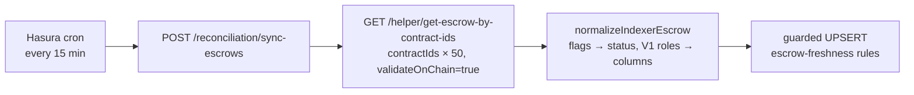
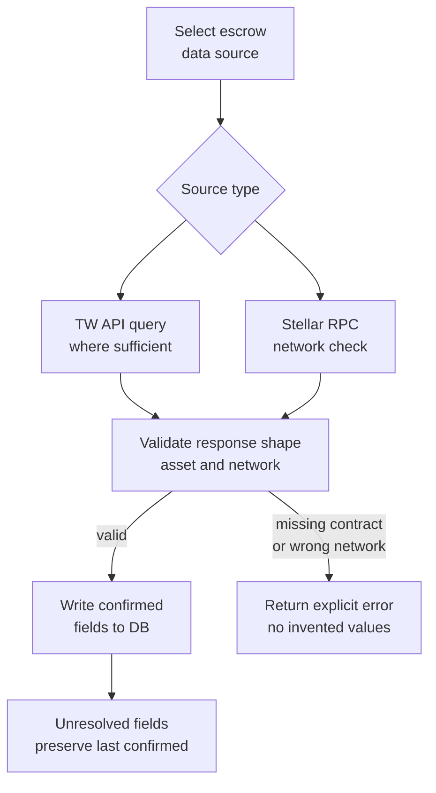
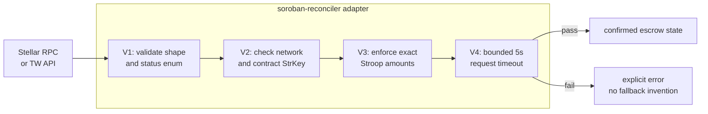

# Escrow State Source & Reconciliation

SafeTrust learns the authoritative state of Trustless Work escrows by polling the
Trustless Work V1 indexer (`POST /reconciliation/sync-escrows`) on a scheduled
Hasura cron trigger (every 15 minutes) and verifying transactions on Stellar.
Trustless Work sends no webhooks.



| File | Responsibility |
|---|---|
| `webhook/src/lib/source-adapters/tw.adapter.ts` | Configuration, request URL, sequential fetch |
| `crates/chunk-processor` | Parallel fetch of the same URL (`RUST_CHUNKS_ENABLED=true`) |
| `webhook/src/lib/source-adapters/tw-indexer.types.ts` | V1 response type |
| `webhook/src/lib/source-adapters/tw-indexer.normalize.ts` | Mapping onto table columns (both paths) |
| `webhook/src/repositories/reconciliation.repository.ts` | Guarded UPSERT |
| `webhook/src/services/reconciliation.service.ts` | Reconciliation orchestration and optional Soroban drift monitor |
| `crates/soroban-reconciler` | Optional Soroban RPC / V1 drift reader (`SOROBAN_VALIDATION_ENABLED`) |

---

## 1. Configuration

| Variable | Default | Purpose |
|---|---|---|
| `TRUSTLESSWORK_API_URL` | `https://dev.api.trustlesswork.com` | V1 API base URL; mainnet is `https://api.trustlesswork.com` |
| `TRUSTLESSWORK_API_KEY` | empty | Sent as `x-api-key` |
| `SOROBAN_VALIDATION_ENABLED` | `false` | Enables optional drift monitoring in `sync-escrows` |
| `SOROBAN_AUTO_CORRECT_ENABLED` | `false` | Must stay disabled unless authorized drift correction is enabled |

`TRUSTLESSWORK_API_URL` and `TRUSTLESSWORK_API_KEY` are passed by `docker-compose.yml`.
The legacy `TRUSTLESS_WORK_API_URL` / `TRUSTLESS_WORK_API_KEY` spelling is still
read with a `trustlesswork.legacy_env_name` warning; the current spelling wins
when both are set.

---

## 2. Trustless Work V1 Indexer Request

```
GET {TRUSTLESSWORK_API_URL}/helper/get-escrow-by-contract-ids
    ?contractIds=<id>&contractIds=<id>…&validateOnChain=true
x-api-key: {TRUSTLESSWORK_API_KEY}
```

- **Endpoint path:** `/helper/get-escrow-by-contract-ids` (singular `get-escrow`).
  The earlier plural path `/helper/get-escrows-by-contract-ids` returns `404 Resource not found`.
- **Batch size:** Up to 50 contract IDs per request, passed as repeated `contractIds`
  query parameters (`string[]` encoding).
- **`validateOnChain=true`:** Forces the indexer to verify its copy against the
  contract before answering so stale indexer rows are not returned. Trustless
  Work rate-limits to 50 requests per 60 seconds, and each sync sends one request
  per 50 tracked escrows.

---

## 3. Status Derivation & Field Mapping

The V1 response has no top-level `status` field. Lifecycle state is derived from
`flags` on the escrow (single-release) or across milestones (multi-release); the
first matching rule wins.

### Single-release derivation

| Condition | Derived status |
|---|---|
| `flags.resolved` | `resolved` |
| `flags.released` | `completed` |
| `flags.disputed` | `disputed` |
| any milestone `approved` | `milestone_approved` |
| `balance > 0` or `fundedBy` set | `funded` |
| otherwise | `created` |

### Multi-release derivation

| Condition | Derived status |
|---|---|
| every milestone released or resolved | `resolved` if any was resolved, else `completed` |
| any milestone disputed and not resolved | `disputed` |
| any milestone approved or released | `milestone_approved` |
| `balance > 0` or `fundedBy` set | `funded` |
| otherwise | `created` |

**Not derivable from the V1 indexer:**

- `active` and `pending_funding` are SafeTrust-internal states with no V1 flag.
- `cancelled`: V1 has no cancel operation.
- Single-release `withdraw-remaining-funds`: V1 emits no event for it.

### Field mapping

| V1 indexer field | Database column | Note |
|---|---|---|
| `contractId` | `contract_id` | |
| derived (above) | `status` | |
| `amount`, or sum of milestone `amount` (multi-release) | `amount` | |
| `balance` | `balance` | `0` when unreported; never overwrites a stored nonzero balance |
| `type` (`single-release` / `multi-release`) | `escrow_type` (`single_release` / `multi_release`) | |
| `roles.serviceProvider` | `marker` | Pre-V1 column name |
| `roles.approver` | `approver` | |
| `roles.releaseSigner` | `releaser` | Pre-V1 column name |
| `roles.platformAddress`, `roles.disputeResolver`, `roles.receiver` | — | No column yet |

---

## 4. Unversioned Snapshot Freshness Rules

The V1 indexer response carries no ledger sequence. Under the unversioned
snapshot policy in `webhook/src/lib/escrow-freshness.ts`, a snapshot without a
ledger sequence may only update escrows that are still `created` or
`pending_funding`.

- A sync records initial funding (`created` / `pending_funding` → `funded`),
  and preserves already-confirmed rows, invalid transitions, other networks, and
  nonzero balances.
- Later transitions (`funded` → `milestone_approved`, `completed`, `disputed`,
  or `resolved`) require a version token (such as a newer ledger sequence) or
  explicit transaction confirmation before polling can advance them.
- Both the TypeScript repository (`reconciliation.repository.ts`) and the Rust
  bulk path (`crates/pg-bulk-upsert`) enforce the same guarded UPSERT rules,
  verified against PostgreSQL by `reconciliation.repository.integration.test.ts`
  (opt-in with `RECONCILIATION_DB_TEST=true`).

---

## 5. Authoritative State Source Architecture

SafeTrust evaluated **Trustless Work Indexer API (`tw_api`)** vs. **Direct
Stellar Soroban RPC (`stellar_rpc`)** and separates their responsibilities:



| Criterion | Trustless Work API (`tw_api`) | Direct Stellar RPC (`stellar_rpc`) |
|---|---|---|
| **Protocol role** | SafeTrust contract coordinator & event indexer | Raw blockchain JSON-RPC node |
| **`contract_id` verification** | Direct key lookup | Validates presence in ledger keys |
| **Lifecycle `status`** | Decoded into canonical SafeTrust lifecycle enum | Requires decoding raw Soroban contract storage `SCVal` |
| **Participant roles** | Structured `marker`, `approver`, `releaser`, `resolver` | Requires parsing contract instance storage map |
| **Escrow balance** | Normalized token balance and target amounts | Requires querying SEP-41 SAC ledger entries |
| **Network validation** | Environment routing (`dev` vs `prod` indexer) | Authoritative `getNetwork` passphrase verification |
| **XDR decoding complexity** | Pre-decoded JSON payload | Full base64 XDR `LedgerKey` / `SCVal` serialization |
| **Latency & indexing lag** | 5–15 seconds (1–3 ledgers) indexing delay | Real-time ledger state |
| **Failure modes** | HTTP 404, 5xx, gateway timeout, rate limiting | RPC unavailability, ledger pruning, JSON-RPC errors |

### Why `getHealth` Cannot Establish Contract State

A Soroban RPC `getHealth` response (`{"status": "healthy"}`) confirms only node
liveness and ledger sync status. It accepts zero contract parameters and proves
nothing about contract deployment, bytecode, `LedgerKey::ContractData`, SEP-41
balances, or participant roles. Production paths must never substitute `getHealth`
or `mock_`/`test_` shortcuts for contract state.

### Selected Boundary

1. **Primary structured source (`tw_api`):** Provides decoded `status`,
   `balance`, `roles`, and `escrow_type` without duplicating Soroban XDR
   decoding inside SafeTrust.
2. **Authoritative network verification (`stellar_rpc`):** Verifies network
   identity (`getNetwork`) and ledger presence (`getLedgerEntries`).
3. **Fail-closed guarantees ("Preserve Last Confirmed"):** If an external source
   is unavailable, times out, reports a missing contract, or fails validation,
   existing PostgreSQL rows are preserved untouched, the contract is counted as
   `unresolved`, and automatic DB correction remains off by default
   (`SOROBAN_AUTO_CORRECT_ENABLED=false`).

---

## 6. Adapter Validation Boundary (`soroban-reconciler`)

When the optional drift check (`SOROBAN_VALIDATION_ENABLED=true`) runs,
`crates/soroban-reconciler` reads the V1 endpoint, applies the status derivation
table in §3 via `normalize_tw_v1_response`, requires the V1 `balance` (never
substituting configured `amount`), and enforces four validation stages:



- **V1 — Response shape:** Requires `contractId`, `status` (within the 9-state
  allowlist), and `balance`/`amount`; rejects empty arrays, nulls, and bare
  `getHealth` payloads.
- **V2 — Network and StrKey identity:** Contract IDs must be valid 56-character
  base32 Stellar Contract StrKeys (`C...`, SEP-23 + CRC16-XMODEM); `mock_` /
  `test_` shortcuts are rejected; network passphrases (`testnet` vs `mainnet`)
  must match or fail with `NetworkMismatch`.
- **V3 — Exact Stroop amounts:** Balances convert to exact 7-decimal integer
  Stroops (`10^7` Stroops = 1 token unit) and compare via `db_stroops !=
  on_chain_stroops`. Negative values and >7 decimal places are rejected.
- **V4 — Bounded timeout:** All network calls enforce a strict 5-second timeout.

---

## 7. Verification

1. **Rust adapter tests (`crates/soroban-reconciler`):** Cover `getHealth`
   rejection, `mock_`/`test_` rejection, `NetworkMismatch`, malformed payloads,
   exact Stroop arithmetic, bounded 5s timeouts, and end-to-end testnet fixtures.
2. **Webhook reconciliation tests (`webhook/src/services`, `webhook/src/repositories`):**
   Verify `validateSorobanDrift` preserves confirmed DB state when
   auto-correction is disabled, `runSorobanValidation` isolates per-contract
   errors into `unresolved`, and guarded UPSERT rules protect confirmed rows.
3. **Builds & type-checking:** `npm --prefix webhook run build:rust` and
   `npm --prefix webhook run type-check` pass with zero errors.
