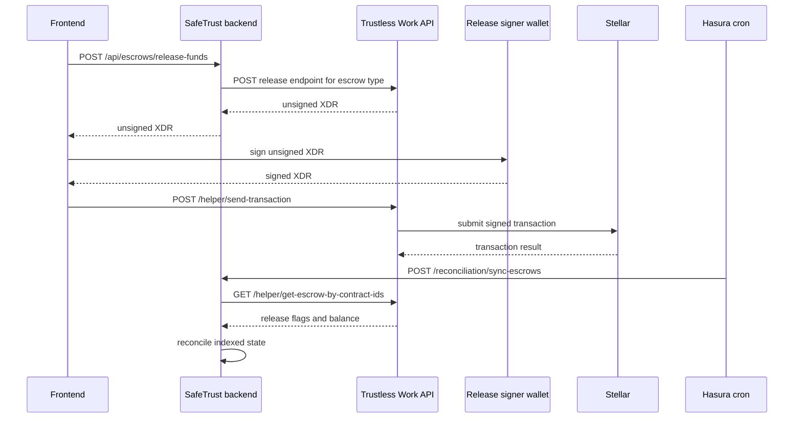

# Release Funds

> **Status:** the TrustlessWork `release-funds` callback was removed.
> Reconciliation polling at `POST /reconciliation/sync-escrows` now applies the
> `completed` transition. The client-facing XDR flow below is the intended
> post-Issue-03 integration; its SafeTrust routes are not present in this
> checkout.

The frontend requests an unsigned release transaction from SafeTrust. The
authorized wallet signs it, the frontend submits the signed XDR through
Trustless Work, and SafeTrust reconciles the result from indexer state.

## Sequence

## Routes and state

1. The frontend calls SafeTrust `POST /api/escrows/release-funds` with the
   contract and release details.
2. SafeTrust asks Trustless Work to build the unsigned XDR:
   - Single-release: `POST /escrow/single-release/release-funds`
   - Multi-release milestone: `POST /escrow/multi-release/release-milestone-funds`
3. The authorized release signer wallet signs the XDR. The frontend submits
   the signed XDR through `POST /helper/send-transaction`.
4. SafeTrust's reconciliation job polls
   `GET /helper/get-escrow-by-contract-ids` through
   `POST /reconciliation/sync-escrows`.

For single-release escrows, `flags.released` derives `completed`. For
multi-release escrows, all milestones must be released or resolved to derive
the terminal status. Reconciliation applies the `completed` transition through
the lifecycle service and checks the observed ledger sequence against the
stored one when available. The V1 snapshot does not contain a ledger sequence,
so an escrow already beyond `created` or `pending_funding` needs a versioned
snapshot or transaction confirmation before the later transition is safe. See
[Trustless Work Indexer](./trustless-work-indexer.md).
