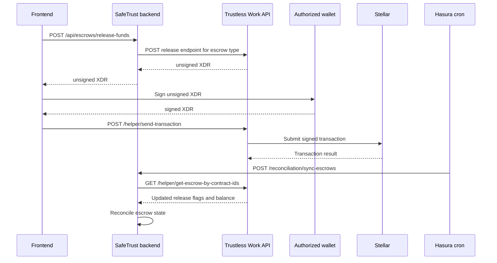

# Release Funds

> **Status: Planned — post-Issue-03 behavior.** This is the intended
> polling-based flow; the route implementation in this checkout has not yet
> been migrated to it.

For a single-release escrow, SafeTrust requests the release transaction from
Trustless Work. The authorized wallet signs it, Trustless Work submits it, and
SafeTrust learns the result through reconciliation polling. Multi-release
escrows release a specific milestone using the corresponding milestone
operation.

## Sequence

## Routes and state updates

1. The frontend calls SafeTrust `POST /api/escrows/release-funds` with the
   contract and release details.
2. SafeTrust asks Trustless Work to build an unsigned XDR:
   - Single-release: `POST /escrow/single-release/release-funds`
   - Multi-release milestone: `POST /escrow/multi-release/release-milestone-funds`
3. The authorized wallet signs the XDR. The frontend submits the signed XDR
   through `POST /helper/send-transaction`.
4. The Hasura cron trigger invokes `POST /reconciliation/sync-escrows`.
   SafeTrust polls `GET /helper/get-escrow-by-contract-ids` and updates its
   local state from the release flags and balance.

SafeTrust must not mark an escrow complete merely because it returned an XDR or
because the wallet signed one. The state transition follows the indexed
transaction result. See [Trustless Work Indexer](./trustless-work-indexer.md).
