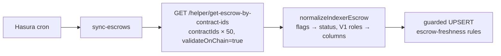

# Trustless Work Indexer Sync

Trustless Work sends no webhooks. SafeTrust learns about escrow changes by
reading the Trustless Work V1 indexer: the reconciliation job
(`POST /reconciliation/sync-escrows`, run by a Hasura cron trigger every 15
minutes) fetches every escrow it tracks and writes the result to
`safetrust.trustless_work_escrows`.



| File | Responsibility |
|---|---|
| `webhook/src/lib/source-adapters/tw.adapter.ts` | Configuration, request URL, sequential fetch |
| `crates/chunk-processor` | Parallel fetch of the same URL (`RUST_CHUNKS_ENABLED=true`) |
| `webhook/src/lib/source-adapters/tw-indexer.types.ts` | V1 response type |
| `webhook/src/lib/source-adapters/tw-indexer.normalize.ts` | Mapping onto table columns (both paths) |
| `webhook/src/repositories/reconciliation.repository.ts` | Guarded UPSERT |

## Configuration

| Variable | Default | Purpose |
|---|---|---|
| `TRUSTLESSWORK_API_URL` | `https://dev.api.trustlesswork.com` | V1 API base URL; mainnet is `https://api.trustlesswork.com` |
| `TRUSTLESSWORK_API_KEY` | empty | Sent as `x-api-key` |

These are the names `docker-compose.yml` passes to the container. The older
`TRUSTLESS_WORK_API_URL` / `TRUSTLESS_WORK_API_KEY` spelling is still read, and
logs `trustlesswork.legacy_env_name` once per name; rename it in your `.env`.
The current name wins when both are set.

## Request

```
GET {TRUSTLESSWORK_API_URL}/helper/get-escrow-by-contract-ids
    ?contractIds=<id>&contractIds=<id>…&validateOnChain=true
x-api-key: {TRUSTLESSWORK_API_KEY}
```

- **The path was checked against the testnet API on 2026-11-18.**
  `/helper/get-escrow-by-contract-ids` answers `401 Unauthorized` without a
  key, so the route exists. The plural `/helper/get-escrows-by-contract-ids`
  that earlier code called answers `404 Resource not found`.
- **Up to 50 contract ids per request**, one `contractIds` pair per id. The
  documented examples show a single id; repeated keys are the standard
  encoding of the `string[]` parameter. Confirm the multi-id form with an API
  key (Swagger: https://dev.api.trustlesswork.com/docs).
- **`validateOnChain=true`** makes the indexer check its copy against the
  contract before answering, so the result is not a stale indexer row. It is
  slower; Trustless Work allows 50 requests per 60 seconds, and one sync makes
  one request per 50 escrows.

## Status derivation

The V1 response has no `status` field. Lifecycle state is in `flags`, on the
escrow (single-release) or on each milestone (multi-release). First match wins:

| Single-release | Status |
|---|---|
| `flags.resolved` | `resolved` |
| `flags.released` | `completed` |
| `flags.disputed` | `disputed` |
| any milestone `approved` | `milestone_approved` |
| `balance > 0` or `fundedBy` set | `funded` |
| otherwise | `created` |

| Multi-release | Status |
|---|---|
| every milestone released or resolved | `resolved` if any was resolved, else `completed` |
| any milestone disputed and not resolved | `disputed` |
| any milestone approved or released | `milestone_approved` |
| `balance > 0` or `fundedBy` set | `funded` |
| otherwise | `created` |

Not derivable from the indexer:

- `active` and `pending_funding` are SafeTrust steps with no V1 flag.
- `cancelled`: V1 has no cancel operation.
- A single-release `withdraw-remaining-funds`: V1 emits no event for it.

## Field mapping

| V1 indexer | Column | Note |
|---|---|---|
| `contractId` | `contract_id` | |
| derived (above) | `status` | |
| `amount`, or the sum of milestone `amount` (multi-release) | `amount` | |
| `balance` | `balance` | 0 when not reported; never overwrites a stored nonzero balance |
| `type` (`single-release` / `multi-release`) | `escrow_type` (`single_release` / `multi_release`) | |
| `roles.serviceProvider` | `marker` | pre-V1 column name |
| `roles.approver` | `approver` | |
| `roles.releaseSigner` | `releaser` | pre-V1 column name |
| `roles.platformAddress`, `roles.disputeResolver`, `roles.receiver` | — | no column yet |

The role columns keep their pre-V1 names until the escrow schema migration.

## Limitation: unversioned snapshots

The V1 indexer response carries no ledger sequence. Under the unversioned
snapshot policy in `webhook/src/lib/escrow-freshness.ts` (#661), a snapshot
without a ledger sequence may only update escrows that are still `created` or
`pending_funding`. A sync therefore records funding, but it does not move an
escrow from `funded` to `milestone_approved`, `completed`, `disputed` or
`resolved`. Those transitions need a version token for the snapshot (for
example a ledger sequence) before polling can drive them.

The unversioned UPSERT matches the Rust bulk path (`pg-bulk-upsert`): a
snapshot with a confirmed status may not create a row, but for an existing row
the stored status decides. `reconciliation.repository.integration.test.ts`
checks this against a real database (opt-in with `RECONCILIATION_DB_TEST=true`):
a stored `created` escrow accepts a `funded` snapshot, while confirmed rows,
invalid transitions, other networks and nonzero balances stay protected.

## Soroban drift reader

The optional drift check (`SOROBAN_VALIDATION_ENABLED`, `crates/soroban-reconciler`)
reads the same endpoint. `normalize_tw_v1_response` applies the status table
above before the crate's existing identity, status and exact-balance checks.
It requires the V1 `balance` and never substitutes the configured `amount`.
