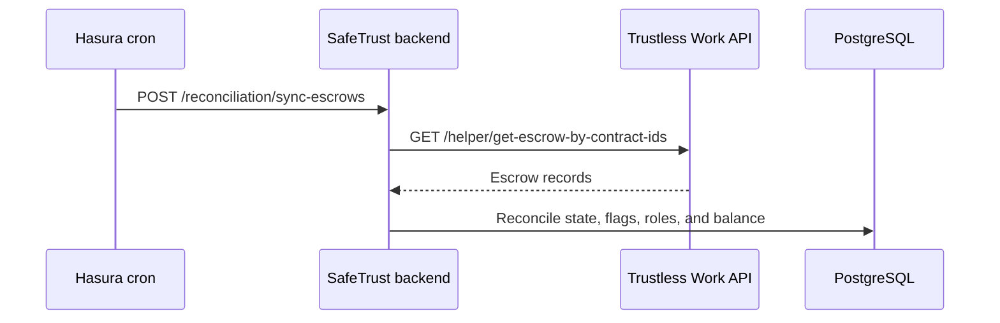

# Trustless Work Indexer

> **Status: Planned — post-Issue-03 behavior.** This page documents the
> intended polling endpoint; the local reconciliation adapter in this
> checkout has not yet been migrated to it.

SafeTrust reads escrow state from the Trustless Work V1 indexer through the
scheduled reconciliation endpoint. Trustless Work has no webhooks.

## Polling flow



The cron trigger calls SafeTrust `POST /reconciliation/sync-escrows`. The
backend queries the V1 indexer using:

```http
GET {TRUSTLESSWORK_API_URL}/helper/get-escrow-by-contract-ids
    ?contractIds=<contract-id>
x-api-key: <TRUSTLESSWORK_API_KEY>
```

For a batch, SafeTrust repeats the `contractIds` query parameter for each ID.
The endpoint is singular: `/helper/get-escrow-by-contract-ids`.

## Reconciliation behavior

The indexer response is used as the source for observed on-chain flags, roles,
and balance. SafeTrust maps those values to its escrow record and derives
lifecycle state from the flags and balance. A request to build an unsigned XDR
or a wallet signature alone does not change the stored escrow state.

Reconciliation is scheduled by the Hasura cron trigger and can also be
invoked directly by an authorized server-side caller. It is not a frontend
transaction endpoint.
