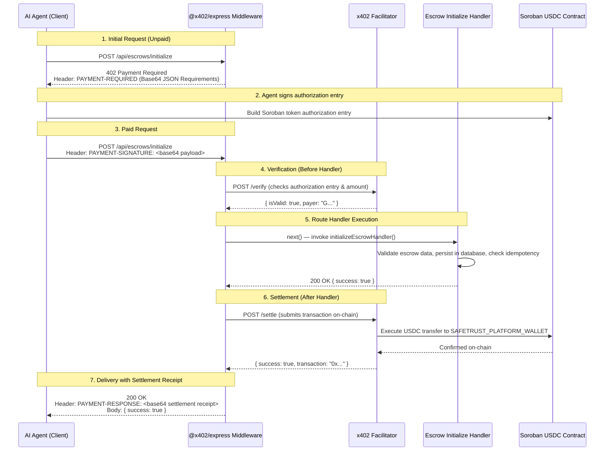

# x402 Protocol — Agentic Payments on Stellar

x402 is an open, internet-native payment protocol that enables per-request micropayments using the HTTP `402 Payment Required` status code. It is designed specifically for autonomous AI agents and automated services that transact machine-to-machine and cannot interact with browser-based wallet popups (such as Freighter).

SafeTrust implements the official `@x402` Stellar standard (`@x402/express`, `@x402/core`, and `@x402/stellar`) for agentic payments on the escrow initialization endpoint (`POST /api/escrows/initialize`).

---

## 1. Why x402 Rather than MPP

When evaluating micropayment architectures on Stellar, SafeTrust chose the **x402 protocol** over alternatives such as MPP (Micropayment Protocol):

| Consideration | x402 (Chosen) | MPP (Micropayment Protocol) |
|---|---|---|
| **Settlement Delegation** | Delegates transaction submission, gas sponsoring, and sequencer interaction to an external **Facilitator**. | In pull/sponsorship mode, requires a server-held fee-payer private key and on-chain submission infrastructure on the API server; in push mode, client broadcasts and server verifies a `signedHash` credential. |
| **Secret Management** | Client signs authorization directly; server verifies proof via facilitator without server-held secrets or shared pre-shared keys (PSKs). | Pull/sponsorship mode requires a server-held fee-payer secret key and shared secrets between client and merchant. |
| **Discovery & Standards** | Conforms to official `@x402` v2 specifications and Bazaar agent registry discovery mechanisms. | Bespoke protocol implementation with non-standard client libraries. |
| **Client-Side Friction** | Autonomous agents use `@x402/fetch` or standard HTTP headers (`PAYMENT-SIGNATURE`) in a single round-trip challenge-response. | Custom integration flow required by each client agent. |

---

## 2. End-to-End Payment Flow & Order of Operations

In the official `@x402/express` architecture, the payment middleware intercepts requests, manages the 402 challenge, verifies payment authorization entries with the facilitator before invoking the handler, and triggers settlement **after** the handler succeeds (default `authorization` flow).



### Order of Operations & Failure Handling:
1. **Verification**: When an agent sends a payment header, the middleware verifies the authorization with the facilitator. If verification fails, the request is rejected immediately with HTTP 402 and the failure reason; the route handler is never called.
2. **Handler Execution**: Once verified, `next()` invokes `initializeEscrowHandler`. The handler persists the escrow in Hasura / PostgreSQL and prepares the HTTP 200 response. If the handler returns an error (`status >= 400`), settlement is skipped.
3. **Settlement**: After the handler returns a success response, the middleware executes settlement with the facilitator and attaches `PAYMENT-RESPONSE` to the HTTP 200 response.
4. **If settlement fails**: The middleware detects settlement failure before dispatching the buffered success response and returns an error response to the client. Note that because `initializeEscrowHandler` already persisted the escrow before settlement ran, a settlement failure can leave the escrow persisted without a settled payment.

---

## 3. Verified Facilitator Endpoints

Facilitator endpoints were verified directly against their `/supported` introspection endpoints:

### Testnet
- **Facilitator Endpoint**: `https://x402.org/facilitator`
  - **Status**: Live, publicly reachable without an API key (HTTP 200).
  - **Supported Scheme**: `exact`
  - **Supported Network**: `stellar:testnet`
  - **Fee Sponsorship**: `extra.areFeesSponsored: true` (gas fees for transaction submission are sponsored by the facilitator).
  - **API Key**: Not required.
- **Alternative (OpenZeppelin Testnet)**: `https://channels.openzeppelin.com/x402/testnet`
  - Returns HTTP 401 Unauthorized without an API key; requires an OpenZeppelin Channels account and key.

### Mainnet (Pubnet)
- **Facilitator Endpoint**: `https://channels.openzeppelin.com/x402`
  - **Status**: Checked via live probe (`/supported`); returns HTTP 401 Unauthorized without authentication credentials.
  - **API Key**: Required. Operators must configure an API key via `X402_FACILITATOR_API_KEY`.
  - **Endpoint Configuration**: Because public mainnet facilitators require authentication, `X402_FACILITATOR_URL` is a documented configuration input rather than an invented public URL.

---

## 4. USDC SEP-41 Contract Identifiers

To prevent transaction failure, payment requirements specify the exact SEP-41 Stellar Asset Contract (SAC) ID for USDC. The addresses below are written in full and verified against official documentation:

| Network | Full USDC Contract Address | Classic Issuer Account | Source Citation |
|---|---|---|---|
| **Testnet** | `CBIELTK6YBZJU5UP2WWQEUCYKLPU6AUNZ2BQ4WWFEIE3USCIHMXQDAMA` | `GBBD47IF6LWK7P7MDEVSCWR7DPUWV3NY3DTQEVFL4NAT4AQH3ZLLFLA5` | [Stellar Developer Docs: Agentic Payments with x402](https://developers.stellar.org/docs/build/agentic-payments/x402)<br/>Derived via `@stellar/stellar-sdk` `new Asset('USDC', issuer).contractId(Networks.TESTNET)` |
| **Mainnet** | `CCW67TSZV3SSS2HXMBQ5JFGCKJNXKZM7UQUWUZPUTHXSTZLEO7SJMI75` | `GA5ZSEJYB37JRC5AVCIA5MOP4RHTM335X2KGX3IHOJAPP5RE34K4KZVN` | [Circle: USDC on Stellar](https://www.circle.com/multi-chain-usdc/stellar)<br/>[Stellar Developer Docs: Agentic Payments with x402](https://developers.stellar.org/docs/build/agentic-payments/x402)<br/>Derived via `@stellar/stellar-sdk` `new Asset('USDC', issuer).contractId(Networks.PUBLIC)` |

> [!IMPORTANT]
> **USDC Trustline Requirement on `SAFETRUST_PLATFORM_WALLET`**:
> The recipient platform wallet configured in `SAFETRUST_PLATFORM_WALLET` must establish an explicit trustline for the native USDC asset before accepting payments. If the recipient account lacks a USDC trustline, on-chain Soroban token transfer invocations fail with:
> ```text
> Error(Contract, #13)
> ```
> Error code `#13` indicates an absent trustline / balance record for the recipient.

---

## 5. Escrow Initialization Idempotency & Retried Payments

With `X402_ENABLED=false`, the x402 middleware fails closed with `503 Feature Unavailable` on the escrow initialization route. When `X402_ENABLED=true`, every request must present a valid `PAYMENT-SIGNATURE` header; without one the route returns `402 Payment Required`. The Trustless Work HMAC bypass that used to short-circuit this check has been removed — callbacks from Trustless Work are no longer accepted and the backend learns escrow state by polling instead. Firebase authentication does not create an exemption on this route either.

SafeTrust enforces strict idempotency at the database boundary via the `safetrust.trustless_work_webhook_events` table:

1. When a client agent retries an initialization request with a fresh payment and the same `contract_id` and payload:
   - The x402 payment middleware verifies the new payment, runs `initializeEscrowHandler(payload, tenantId)`, and settles the payment.
   - The repository checks `logAndCheckWebhookEvent`. If the `contract_id` was already processed, `isDuplicate: true` is returned and no duplicate escrow record is created.
   - **Important**: The event table prevents a duplicate escrow, **not** a duplicate charge. Retrying with a fresh signed payment will settle and charge again.
2. **Recovery procedure when a response is lost in transit**:
   - Before signing or submitting another payment, inspect the original settlement transaction status on Stellar/facilitator and query the escrow status (e.g. via reconciliation or escrow read endpoints) to confirm whether initialization already completed.
   - Only initiate a new payment if the original settlement did not execute and the escrow does not exist.

---

## 6. Environment Variables Reference

| Variable | Status | Default | Description |
|---|---|---|---|
| `X402_ENABLED` | **Kept** | `false` | Master safety switch. When `false`, x402-gated routes fail closed with HTTP 503 (`Feature Unavailable`). Operators set to `true` once configuration is complete. |
| `STELLAR_NETWORK` | **Kept** | `testnet` | Target Stellar network: `testnet` (resolves to `stellar:testnet`) or `mainnet` / `pubnet` (resolves to `stellar:pubnet`). |
| `SAFETRUST_PLATFORM_WALLET` | **Kept** | `G_YOUR_PLATFORM_WALLET_PUBLIC_KEY` | Recipient wallet for $0.10 booking fees. Must be a valid Stellar public key (`G...`). Startup validation rejects unedited placeholders when `X402_ENABLED=true`. |
| `X402_FACILITATOR_URL` | **Kept** | `https://x402.org/facilitator` | URL of the x402 facilitator. Testnet defaults to open endpoint; mainnet must be supplied by operator. |
| `X402_FACILITATOR_API_KEY` | **Added** | `(empty)` | Optional API key sent as bearer token via `createAuthHeaders` for authenticated facilitators (e.g. OpenZeppelin Channels). |

---

## 7. Operator Setup & Activation Guide

1. Ensure the platform wallet has been created and funded on the desired Stellar network.
2. Establish a USDC trustline on the platform wallet:
   - Testnet: Trust `USDC:GBBD47IF6LWK7P7MDEVSCWR7DPUWV3NY3DTQEVFL4NAT4AQH3ZLLFLA5`
   - Mainnet: Trust `USDC:GA5ZSEJYB37JRC5AVCIA5MOP4RHTM335X2KGX3IHOJAPP5RE34K4KZVN`
3. In your environment (`.env`), configure the target network explicitly:
   - **Testnet**:
     ```bash
     STELLAR_NETWORK=testnet
     SAFETRUST_PLATFORM_WALLET=G<YOUR_REAL_STELLAR_WALLET_PUBLIC_KEY>
     X402_FACILITATOR_URL=https://x402.org/facilitator
     X402_ENABLED=true
     ```
   - **Mainnet (`pubnet`)**:
     ```bash
     STELLAR_NETWORK=mainnet
     SAFETRUST_PLATFORM_WALLET=G<YOUR_REAL_STELLAR_WALLET_PUBLIC_KEY>
     X402_FACILITATOR_URL=https://channels.openzeppelin.com/x402
     X402_FACILITATOR_API_KEY=<OPTIONAL_API_KEY>
     X402_ENABLED=true
     ```
4. Start the service. If `SAFETRUST_PLATFORM_WALLET` is invalid or missing when `X402_ENABLED=true` (or if `X402_FACILITATOR_URL` is missing on mainnet), the service refuses to start.
